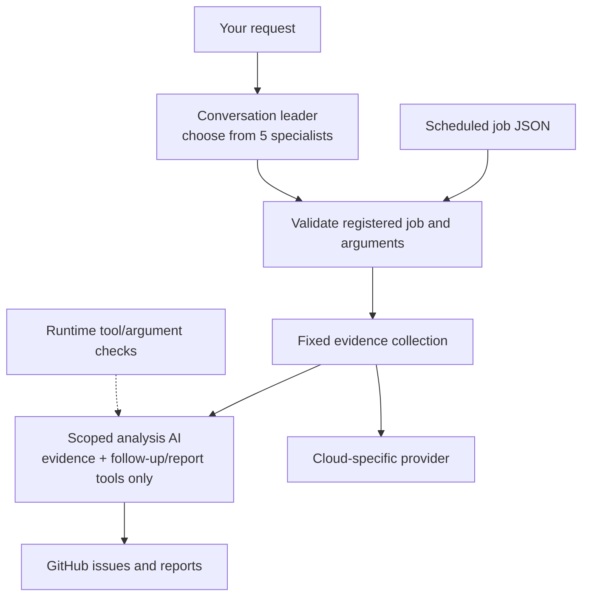

# cloud-ops-team

[](https://github.com/atsuki-sakai/cloud-ops-team/actions/workflows/ci.yml)
[](LICENSE)


**An AI operations team for your cloud.** Five specialist agents watch production errors and suspicious access daily,
review infrastructure weekly, audit security monthly and verify merged fixes weekly. They report through GitHub issues.
Programs validate registered jobs and gather evidence through fixed procedures before a scoped AI analysis stage runs.

[日本語 README（メイン）](README.md) · [Architecture](docs/en/architecture.md) · [Customization](docs/en/customization.md) ·
[Providers (GCP / AWS / Azure)](docs/en/providers.md) · [Configuration](docs/en/configuration.md) · [Deploy on Google Cloud](docs/en/deployment-gcp.md) ·
[Known limitations and improvement plan](docs/en/known-limitations.md) · [Changelog](CHANGELOG.en.md)

The current version provides evidence for human review. PR identity, audit coverage and issue writes across separate runs
have unresolved defects. Read the [known limitations](docs/en/known-limitations.md) before enabling writes, and start with
`OPS_DRY_RUN=true` and `OPS_AUTO_CLOSE_ISSUES=false`. Disabling automatic closure still allows verification labels and
comments when writes are enabled; inspect their evidence before accepting a fix as complete.

| Job | Default schedule | Agent | What it does |
|---|---|---|---|
| `error_watch` | daily 08:00 | SRE | Groups error logs by fingerprint, correlates them with 5xx rates, failing scheduled jobs and recent deployments, and files an `[ops/error]` issue with a root-cause hypothesis, evidence and a verification recipe. Recurring errors get a comment instead of a duplicate |
| `access_watch` | daily 08:30 | Access investigator | Reviews the last 24 hours of audit logs, HTTP 401/403 and probe paths, and Cloud Armor denials. Separates suspicious signals from confirmed compromise and reports evidence, confidence and coverage gaps |
| `infrastructure_review` | Mondays 10:00 | Infrastructure reviewer | Combines GCP Recommender cost/IAM recommendations with IAM, credential, Cloud Run, Cloud SQL and network audits; proposes changes with impact, risk, validation and rollback steps |
| `monthly_security_audit` | 1st of the month | Cloud security | Reviews IAM, long-lived credentials, compute, databases, network rules, security services, posture findings, container CVEs, end-of-life runtimes, CISA KEV and current threat intel; files critical and high findings plus a monthly report |
| `weekly_pr_review` | Mondays 09:00 | Release manager | For each open team issue: are linked PRs merged, is CI green, and did the error stop occurring? Marks `ops:verified` or `ops:stale` and publishes a weekly report |

Schedules default to `Asia/Tokyo`. You can also ask: *"investigate suspicious access"*, *"review infrastructure waste and permissions"*, *"what is the PR status?"*.

Access investigation is a scheduled log review, with no real-time protection or blocking. Missing, inaccessible or truncated
logs and zero detections do not establish that no unauthorized access occurred. Savings are quoted only when the API returns
an estimate. Optimization covers Cloud Run and Cloud SQL in the target region and project IAM, not every cloud resource.

## How it works



- **Read-only by design.** No tool can change your cloud. GitHub writes are limited to issues, comments and labels, and are
  off (`OPS_DRY_RUN=true`) until you enable them.
- **Deterministic scheduled work.** Code selects the registered job and performs its fixed collection steps. Unknown jobs and invalid arguments are rejected before collection or a model call. Natural-language requests select a specialist adapter and enter the same validated workflow.
- **Scoped model context.** Analysis agents receive evidence plus only the follow-up and reporting tools for their stage: currently 5–10 tools per specialist. Tool descriptions and cloud glossary entries use the same scope. Runtime checks also reject unauthorized calls and excessive query arguments.
- **Cloud-neutral collection, pluggable clouds.** Twenty capability functions (`list_services`, `audit_network`, ...) are available to workflows;
  a provider maps them to a cloud. Google Cloud implements these capabilities for the services listed below; AWS and Azure ship as skeletons that the agents already
  understand — capabilities can be added one at a time.
- **Issues are the ledger.** A stored fingerprint helps find existing issues and count recurrences after a merge.
  Normal issue creation is serialized within one invocation, but there is no shared lock across separate runs or instances.
- **Issue budgets have a defined scope.** `OPS_MAX_ISSUES_PER_RUN` limits normal issue creation across one invocation,
  including `full`, and resets on the next request through the standard router. `publish_report` is outside that shared
  budget and has no enforced call-count cap. Recurrence cooldown uses the issue's update time; overlapping runs can still
  create duplicates. See [known limitations](docs/en/known-limitations.md).
- **Built on [Google ADK](https://adk.dev/)** with [agents-cli](https://github.com/google/agents-cli). A programmatic root serves HTTP/SSE and A2A; scheduled calls bypass LLM routing, and specialist adapters preserve streamed tool events for conversations.

Routing/tool changes have a [baseline/candidate comparison gate](tests/eval/routing/README.md) for route, tools, arguments, preconditions and task completion. Unauthorized tool presentation, attempt or execution must remain zero; missing or incomparable evidence fails closed. Stubbed-model tests validate contracts and cannot establish live-model accuracy or release eligibility. This architecture change still needs target-environment validation and deployment.

Browser coordinate recording/replay, backup creation/restore and the other operations extensions remain planned in [Issue #7](https://github.com/atsuki-sakai/cloud-ops-team/issues/7); they are not implemented by this architecture change.

## Supported clouds

| Cloud | Status | Logs · services · jobs · DBs · metrics | Security checks |
|---|---|---|---|
| Google Cloud | ✅ 20 capabilities implemented; known coverage and classification gaps | Cloud Logging, Cloud Run, Cloud Scheduler, Cloud SQL, Cloud Monitoring, Recommender | Audit/access logs, Cloud Armor denials, IAM, SA keys, Cloud Run, Cloud SQL, VPC firewall, SCC, Artifact Analysis |
| AWS | 🚧 Skeleton — contributions welcome | CloudWatch Logs, ECS / Lambda, EventBridge, RDS (planned) | IAM, Security Hub, Inspector, security groups (planned) |
| Azure | 🚧 Skeleton — contributions welcome | Log Analytics, App Service / Container Apps, Azure DBs (planned) | RBAC, Defender for Cloud, NSGs (planned) |

On every cloud, repository posture, CISA KEV, end-of-life checks, web threat research and PR progress review are available.
Without a log capability, the weekly review cannot verify recurrence; confirm that evidence separately.
See [docs/providers.md](docs/en/providers.md) to add or complete a provider.

## Use it for your own project

This repository is meant to be **cloned and adapted**: click **Use this template** on GitHub (or clone it), then everything
runs through `make` (`make` alone lists the tasks).

Requirements: Python 3.11–3.13, [uv](https://docs.astral.sh/uv/), [agents-cli](https://github.com/google/agents-cli)
(`uv tool install google-agents-cli`), `make`, `gcloud` (logged in, plus `gcloud auth application-default login`), Gemini access
(Vertex AI or `GEMINI_API_KEY`) and a GitHub token or `gh auth login`.

```bash
git clone https://github.com/<you>/cloud-ops-team && cd cloud-ops-team
make setup                       # install, then answer a few questions to create .env
make doctor                      # check configuration, Gemini, GitHub and cloud access — prints a fix for every gap
make run JOB=error_watch         # run one job locally and watch every tool call (dry-run: nothing is written)
make run JOB=access_watch ARGS="--hours 24"   # investigate suspicious access
make run JOB=infrastructure_review          # review cost, permissions and configuration
cp config/ops-context.example.md config/ops-context.md   # optional: describe your services, severity policy, known noise
```

Deploy to Google Cloud (Cloud Run + Cloud Scheduler):

```bash
make gcp-bootstrap               # once: APIs, runtime service account, read-only roles, GitHub token secret (prompts)
make gcp-deploy                  # dry-run first; OPS_DRY_RUN=false make gcp-deploy to start filing issues
make gcp-schedule                # create the jobs (finds the service URL itself)
make gcp-logs                    # recent runs
```

Change schedules with variables, e.g. `ERROR_WATCH_CRON="0 * * * *" ERROR_WATCH_HOURS=1 make gcp-schedule` for an hourly
error watch (`make jobs` shows the current ones). Full guide and runbook: [docs/deployment-gcp.md](docs/en/deployment-gcp.md).

## Customize

| You want to | Do this |
|---|---|
| Tell the team what your services do and which errors are noise | `config/ops-context.md` (no code) |
| Use your repository's labels, another language, other schedules | `.env` (no code) |
| Change a specialist's procedure or issue format | edit `INSTRUCTION` in `app/specialists/<name>.py` |
| Add a tool | add a function in `app/tools/`, choose its collection/analysis stage, scope and tests |
| Add a job or a whole specialist | add the definition, request schema, fixed collection plan, analysis scope and comparison cases |
| Support another cloud capability | implement it in `app/providers/<cloud>/` |

Recipes with code: [Customization](docs/en/customization.md) (日本語: [カスタマイズ](docs/customization.md)).

## Configuration

| Variable | Default | |
|---|---|---|
| `OPS_CLOUD_PROVIDER` | `gcp` | `gcp`, `aws`, `azure` |
| `OPS_TARGET` / `OPS_TARGET_REGION` | — | Project / account / subscription to monitor, and its region |
| `GITHUB_REPO` | — | `owner/repo` |
| `OPS_DRY_RUN` | `true` | Preview instead of writing to GitHub |
| `OPS_AUTO_CLOSE_ISSUES` | `false` | Let the weekly review close verified issues |
| `OPS_MAX_ISSUES_PER_RUN` | `10` | Normal issue cap shared within one invocation; resets on the next request and excludes reports |
| `OPS_REPORT_LANGUAGE` | `ja` | `ja` or `en` |
| `OPS_MODEL` | `gemini-3.8-flash` | Model for all agents |
| `OPS_ERROR_LABELS` / `OPS_SECURITY_LABELS` / `OPS_SEVERITY_LABELS` | `bug` / `security` / `severity: …` | Labels to match your repository |
| `OPS_CONTEXT_FILE` | `config/ops-context.md` | Project knowledge; the standard deployment does not forward custom paths |

All variables: [docs/configuration.md](docs/en/configuration.md).

## Folder structure

```
cloud-ops-team/
├── app/
│   ├── specialists/        ★ team members: instruction, tools and jobs (copy _template.py to add one)
│   ├── tools/              ★ tools the model calls (cloud-neutral)
│   ├── providers/          ★ one adapter per cloud: gcp (implemented), aws and azure (skeletons)
│   ├── agent.py            builds the router, conversation leader and analysis agents
│   ├── routing.py          validates registered jobs and routes them directly
│   ├── workflows.py        fixed collection, evidence and analysis tool selection
│   ├── tool_scope.py       per-stage tool and argument execution boundary
│   ├── prompts.py          renders instructions (cloud, language, project context)
│   ├── config.py           settings from .env
│   └── core/ integrations/ fingerprints and redaction; GitHub client
├── config/ops-context.example.md   ★ template for your project knowledge
├── scripts/                setup, doctor, run_job, jobs; gcp/ (bootstrap, deploy, schedules, roles)
├── tests/                  unit (offline), integration, eval (LLM-judged)
├── docs/                   architecture, customization, providers, configuration, deployment (Japanese; en/: English)
└── Makefile                entry point for every task
```

★ marks what you typically change. File-by-file description: [docs/architecture.md#folder-structure](docs/en/architecture.md#folder-structure).

## Contributing

Issues and pull requests are welcome — especially AWS and Azure capabilities. Use `make test`, `make lint`, `make run` and
`make eval` while developing, and start with [CONTRIBUTING.en.md](CONTRIBUTING.en.md);
security reports go through [SECURITY.md](SECURITY.md).
Live-model checks (`uv run pytest tests/integration -q`) require cloud credentials. Adjust the HTTP/SSE and A2A model read wait with `OPS_E2E_MODEL_TIMEOUT_SECONDS` (default 180 seconds, range 1–900). This bounds idle read time; it is not a performance guarantee.

## License

[Apache License 2.0](LICENSE). Some files originate from the agents-cli scaffold (Copyright Google LLC, Apache-2.0).
