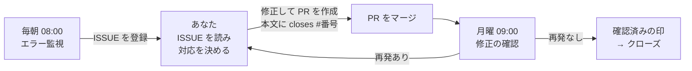

# cloud-ops-team

**クラウドの運用保守を、AI のチームが毎日代わりに見張ってくれる仕組みです。**

本番環境のエラーを毎日チェックし、原因を調べて GitHub に ISSUE（やることリスト）として登録します。
月に一度はセキュリティの健康診断をし、毎週「直したはずの問題が本当に直ったか」を確かめます。
AI はクラウドの設定を一切変更しません。調べて、報告して、確認するだけです。修正するのはあなた（と、あなたが使う AI コーディングツール）です。

[English README](README.md) ・ [仕組みの詳細（日本語）](docs/ja/architecture.md) ・ [設定一覧](docs/configuration.md) ・ [Google Cloud へのデプロイ手順](docs/deployment-gcp.md)

---

## こんな人のためのツールです

- 本番のエラーログを毎日見る余裕がない
- セキュリティ診断や「使っているソフトのサポート期限」の確認を後回しにしてしまう
- ISSUE を直したつもりでも、本当に直ったかまでは追えていない
- 小さなチームで、専任の SRE（運用担当）やセキュリティ担当がいない

## 導入すると、こう変わります

| | 導入前 | 導入後 |
|---|---|---|
| エラー | 気づくのはユーザーからの問い合わせ | 毎朝、原因の見立てと対応案つきの ISSUE が届く |
| セキュリティ | 気が向いたときに確認 | 毎月、危険度の高い問題が ISSUE になり、月次レポートが届く |
| 修正の確認 | PR をマージしたら終わり | 毎週、マージ後にエラーが再発していないかを自動で確認 |

## 3 人の AI 担当者

| 担当 | いつ（変更可） | やること |
|---|---|---|
| 🔍 **エラー監視**（SRE） | 毎日 08:00 | 直近 24 時間のエラーログを集めて同じ種類ごとにまとめ、サーバーエラーの割合・失敗している定期ジョブ・直前のデプロイと照らし合わせて原因を推測します。対応が必要なものだけ ISSUE にします。同じエラーが続いている場合は新しい ISSUE を作らず、既存の ISSUE にコメントします |
| 🛡️ **セキュリティ診断** | 毎月 1 日 09:00 | 権限の付けすぎ、インターネットに開いたままのポート、古い鍵、データベースの設定、使っているソフトの脆弱性やサポート期限切れ、最近実際に悪用されている攻撃などを調べます。危険度の高いものは ISSUE にし、全体を月次レポートにまとめます |
| ✅ **修正の確認**（リリース管理） | 毎週月曜 09:00 | AI が作った ISSUE ごとに、対応する PR がマージされたか、テストが通っているか、マージ後に同じエラーが出ていないかを確認します。直っていれば「確認済み」、2 週間動きがなければ「停滞」の印を付け、週次レポートを書きます |

定期実行のほかに、話しかけて使うこともできます（例:「直近 3 日のエラーを見て」「脆弱性診断して」「PR の進捗はどう？」）。

## 1 週間の流れ（例）



たとえば、ある朝こんな ISSUE が届きます（実際の出力を簡略化した例）。

```text
[ops/error] worker: /api/v1/jobs/expire-reservations で HTTP 500 が継続（DB の接続数不足）
ラベル: ops-agent, ops:error, bug, major

## 概要
worker サービスで 12:30〜12:40 に 5 分おきに 3 回、HTTP 500 が発生。

## 影響範囲
期限切れ予約の自動解放が約 10 分遅延。

## 証跡
"pool timed out while waiting for an open connection"（12:30:05, 12:35:04, 12:40:04）

## 原因分析（確度: 高）
12:30 に 10 件以上の定期ジョブが同時に起動し、データベースの接続が足りなくなった。

## 推奨対応
1. 定期ジョブの実行時刻を数分ずつずらす
2. 接続プールの上限とデータベースの最大接続数を見直す

## 確認方法
修正後、"/api/v1/jobs/expire-reservations" のエラーが 0 件であることを確認（週次の確認で自動チェック）。
```

あなたはこれを読んで修正し、PR の本文に `closes #番号` と書いてマージするだけです。翌週の月曜に、AI が直ったかどうかを確かめます。

## 安全に使えるように作っています

| AI がやること | AI がやらないこと |
|---|---|
| ログ・設定・メトリクスを**読む** | クラウドの設定変更、再起動、削除、デプロイ |
| GitHub に ISSUE・コメント・ラベルを**書く** | PR のマージ、コードの変更 |
| 確認済みの ISSUE に印を付ける | ISSUE のクローズ（設定で許可した場合のみ） |

- **最初は「お試しモード」**（`OPS_DRY_RUN=true`）で動きます。GitHub には何も書き込まず、「こういう ISSUE を作る予定です」という下書きだけを表示します。内容に納得してから本番モードに切り替えてください。
- **ISSUE が大量に届くことはありません。** 1 回の実行で作る ISSUE は最大 10 件です。同じエラーは同じ ISSUE にまとめられ、再発のコメントも 1 日 1 回までです。
- **秘密情報は書き込みません。** ログに含まれるトークン・パスワード・メールアドレス・IP アドレスなどは、ISSUE に書く前に自動で伏せ字にします。
- クラウドには**閲覧用の権限だけ**を与えます。仮に AI が指示を誤解しても、クラウドを壊すことはできません。

## 始め方

### 1. 用意するもの

- 監視したい **Google Cloud プロジェクト**と、それを閲覧できるアカウント（`gcloud` コマンドでログイン済み）
- **Gemini** を使える環境（Google Cloud の Vertex AI、または Gemini API キー）
- ISSUE を登録する **GitHub リポジトリ**と、そのアクセス権（`gh auth login` 済み、またはトークン）
- **Python 3.11〜3.13**、[uv](https://docs.astral.sh/uv/)、agents-cli（`uv tool install google-agents-cli` で入ります）

### 2. 手元で動かしてみる（お試しモード）

```bash
git clone https://github.com/atsuki-sakai/cloud-ops-team
cd cloud-ops-team
agents-cli install            # 必要なライブラリをインストール
cp .env.example .env          # 設定ファイルを作成
```

`.env` を開き、最低限この 3 つを書き換えます。

```bash
GOOGLE_CLOUD_PROJECT=my-project     # Gemini を動かす Google Cloud プロジェクト
OPS_TARGET=my-project               # 監視したいプロジェクト（上と同じでよい）
GITHUB_REPO=my-org/my-app           # ISSUE を登録するリポジトリ
```

エラー監視を 1 回だけ実行してみます。AI が何を調べているかが 1 行ずつ表示され、最後にレポートが出ます。
お試しモードなので、GitHub には何も書き込まれません。

```bash
uv run python scripts/run_job.py error_watch --hours 24
```

ほかの担当も同じように試せます。

```bash
uv run python scripts/run_job.py monthly_security_audit --kev-days 30   # セキュリティ診断（数分かかります）
uv run python scripts/run_job.py weekly_pr_review --days 7             # 修正の確認
agents-cli playground                                                  # ブラウザで話しかけて試す
```

### 3. 本番で毎日動かす（Google Cloud）

コマンド 3 つで、Cloud Run（AI チームの実行場所）と Cloud Scheduler（毎日・毎週・毎月の目覚まし）を準備します。

```bash
# ① 初期設定: 必要な API の有効化、AI 用のアカウント作成、閲覧権限の付与、GitHub トークンの保存
PROJECT_ID=my-project GITHUB_TOKEN=github_pat_xxx ./scripts/gcp/bootstrap.sh

# ② デプロイ: まずはお試しモードで本番に置く
PROJECT_ID=my-project GITHUB_REPO=my-org/my-app ./scripts/gcp/deploy_cloud_run.sh

# ③ 定期実行の登録: ② の最後に表示された URL を AGENT_URL に入れる
PROJECT_ID=my-project AGENT_URL=https://cloud-ops-team-xxxx.a.run.app CLOUD_RUN_SERVICE=cloud-ops-team \
  ./scripts/gcp/setup_schedules.sh
```

数日分の下書きを見て問題がなければ、② を `OPS_DRY_RUN=false` 付きで再実行すると、実際に ISSUE が登録されるようになります。
GitHub トークンの作り方、動作確認、止め方などは [デプロイ手順書](docs/deployment-gcp.md) にまとめています。

### 4. 実行する時間や頻度を変える

③ のコマンドに設定を付けて再実行するだけです。既存の予定が上書きされます。

| やりたいこと | ③ に付ける設定 |
|---|---|
| エラー監視を毎時にする | `ERROR_WATCH_CRON="0 * * * *" ERROR_WATCH_HOURS=1` |
| エラー監視を 6 時間ごとにする | `ERROR_WATCH_CRON="0 */6 * * *" ERROR_WATCH_HOURS=6` |
| 平日の朝 9:30 だけにする（月曜は週末分も見る） | `ERROR_WATCH_CRON="30 9 * * 1-5" ERROR_WATCH_HOURS=72` |
| 月次診断を 15 日に変える | `MONTHLY_CRON="0 9 15 * *"` |
| 1 つの予定だけを変える | 上に加えて `ONLY_JOBS=error-watch` |

`ERROR_WATCH_HOURS`（何時間前までさかのぼるか）は、実行間隔と同じにしておくと見落としがありません。
一時的に止めたいときは `gcloud scheduler jobs pause cloud-ops-error-watch --location asia-northeast1` を実行します（`resume` で再開）。

## 主な設定

| 設定 | 初期値 | 意味 |
|---|---|---|
| `OPS_TARGET` | — | 監視するプロジェクト |
| `GITHUB_REPO` | — | ISSUE を登録するリポジトリ（`組織名/リポジトリ名`） |
| `OPS_DRY_RUN` | `true` | `true` はお試しモード（書き込まない）、`false` で本番モード |
| `OPS_REPORT_LANGUAGE` | `ja` | レポートと ISSUE の言語。`en` で英語 |
| `OPS_AUTO_CLOSE_ISSUES` | `false` | `true` にすると、直ったことを確認した ISSUE を AI がクローズする |
| `OPS_MAX_ISSUES_PER_RUN` | `10` | 1 回の実行で作る ISSUE の上限 |
| `OPS_CLOUD_PROVIDER` | `gcp` | 対象のクラウド（`gcp` / `aws` / `azure`） |

すべての設定は [設定一覧](docs/configuration.md) にあります。

## 対応しているクラウド

| クラウド | 状態 |
|---|---|
| Google Cloud | ✅ すべての機能に対応 |
| AWS | 🚧 準備中（土台はできており、機能ごとに追加できます） |
| Azure | 🚧 準備中（同上） |

AWS・Azure でも、GitHub リポジトリの診断、脆弱性情報（CISA KEV）の確認、サポート期限の確認、最新の攻撃動向の調査、修正の確認は今すぐ使えます。
ログやクラウド設定の診断は、対応が済むまで「未対応のため確認できなかった項目」としてレポートに記載されます。
追加の方法は [プロバイダー追加ガイド](docs/providers.md)（英語）を参照してください。

## よくある質問

**お金はかかりますか？**
主な費用は Gemini の利用料です。Cloud Run は実行中しか課金されず、待機中は 0 台まで縮小します。
既定の頻度（毎日・毎週・毎月）なら、1 か月の実行は数十回程度です。

**AI が勝手にコードやクラウドを直してしまいませんか？**
直しません。クラウドには閲覧権限しかなく、GitHub でもできるのは ISSUE・コメント・ラベルの作成だけです。

**もう自分で登録した ISSUE と重複しませんか？**
登録の前に、リポジトリ内の似た ISSUE を検索します。同じものがあれば新しく作らず、その番号をレポートに書きます。

**同じエラーが毎日出ていたら、毎日 ISSUE が増えますか？**
増えません。エラーごとに「指紋（フィンガープリント）」を付けて ISSUE に記録しているので、2 回目以降は既存の ISSUE へのコメントになります（1 日 1 回まで）。

**英語で出力できますか？**
`OPS_REPORT_LANGUAGE=en` にすると、レポート・ISSUE・コメントが英語になります。

**すぐに止めたいときは？**
GitHub への書き込みだけを止めるなら、本番の設定を `OPS_DRY_RUN=true` に戻します。
定期実行そのものを止めるなら、上の `pause` コマンドを使います。手順は [デプロイ手順書](docs/deployment-gcp.md#runbook) にあります。

## 用語集

| 用語 | 意味 |
|---|---|
| ISSUE | GitHub 上の「やることリスト」の 1 項目 |
| PR（プルリクエスト） | コードの変更をまとめて、レビュー・マージするための単位 |
| お試しモード（dry-run） | 実際には書き込まず、「何をする予定か」だけを表示する動き方 |
| フィンガープリント | エラーメッセージから日時や ID を取り除いて作る、エラーの種類ごとの識別子 |
| SRE | サービスを安定して動かし続けることを担当するエンジニアの役割 |
| CVE / 脆弱性 | ソフトウェアのセキュリティ上の欠陥と、その識別番号 |
| CISA KEV | 米国 CISA が公開している「実際に悪用が確認された脆弱性」の一覧 |
| EOL（サポート期限） | ソフトウェアのセキュリティ更新が終わる日 |
| プロバイダー | 各クラウド（GCP・AWS・Azure）とのやり取りを担当する部品 |

## 開発に参加する

不具合の報告や改善の提案、特に AWS・Azure 対応のコードを歓迎します。[CONTRIBUTING.md](CONTRIBUTING.md) を参照してください。
セキュリティ上の問題は公開の ISSUE ではなく、[SECURITY.md](SECURITY.md) の手順で非公開に報告してください。

## ライセンス

[Apache License 2.0](LICENSE)。Google の agents-cli が生成したファイル（Google LLC、Apache-2.0）を含みます。
