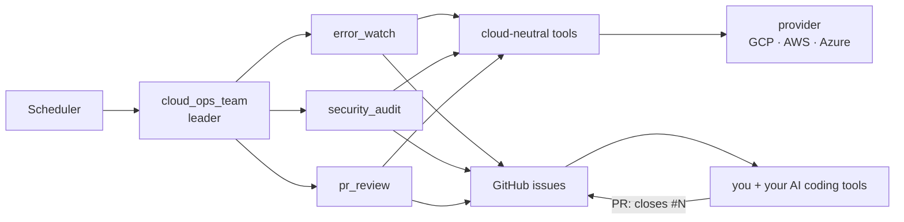

# cloud-ops-team

[](https://github.com/atsuki-sakai/cloud-ops-team/actions/workflows/ci.yml)
[](LICENSE)


**An AI operations team for your cloud.** Three specialist agents watch production errors, audit security every month and
verify every week that merged pull requests really fixed what they found — and they talk to you through GitHub issues.

[日本語 README](README.ja.md) · [Architecture](docs/architecture.md) · [Customization](docs/customization.md) ·
[Providers (GCP / AWS / Azure)](docs/providers.md) · [Configuration](docs/configuration.md) · [Deploy on Google Cloud](docs/deployment-gcp.md)

| Job | Default schedule | Agent | What it does |
|---|---|---|---|
| `error_watch` | daily 08:00 | SRE | Groups error logs by fingerprint, correlates them with 5xx rates, failing scheduled jobs and recent deployments, and files an `[ops/error]` issue with a root-cause hypothesis, evidence and a verification recipe. Recurring errors get a comment instead of a duplicate |
| `monthly_security_audit` | 1st of the month | Cloud security | Reviews IAM, long-lived credentials, compute, databases, network rules, security services, posture findings, container CVEs, end-of-life runtimes, CISA KEV and current threat intel; files critical and high findings plus a monthly report |
| `weekly_pr_review` | Mondays 09:00 | Release manager | For each open team issue: are linked PRs merged, is CI green, and did the error stop occurring? Marks `ops:verified` or `ops:stale` and publishes a weekly report |

You can also just talk to it: *"check the errors of the last 24 hours"*, *"run a security audit"*, *"what is the PR status?"*.

## How it works



- **Read-only by design.** No tool can change your cloud. GitHub writes are limited to issues, comments and labels, and are
  off (`OPS_DRY_RUN=true`) until you enable them.
- **Cloud-neutral agents, pluggable clouds.** The agents use 18 capability tools (`list_services`, `audit_network`, ...);
  a provider maps them to a cloud. Google Cloud is fully implemented; AWS and Azure ship as skeletons that the agents already
  understand — capabilities can be added one at a time.
- **No database.** Issues are the ledger: a log fingerprint stored in each issue de-duplicates findings and lets the weekly
  review count recurrences after a fix is merged.
- **Built on [Google ADK](https://adk.dev/)** with [agents-cli](https://github.com/google/agents-cli); specialists run as
  `single_turn` sub-agents so every tool call is streamed and traced.

## Supported clouds

| Cloud | Status | Logs · services · jobs · DBs · metrics | Security checks |
|---|---|---|---|
| Google Cloud | ✅ Implemented | Cloud Logging, Cloud Run, Cloud Scheduler, Cloud SQL, Cloud Monitoring | IAM, SA keys, Cloud Run, Cloud SQL, VPC firewall, SCC, Artifact Analysis |
| AWS | 🚧 Skeleton — contributions welcome | CloudWatch Logs, ECS / Lambda, EventBridge, RDS (planned) | IAM, Security Hub, Inspector, security groups (planned) |
| Azure | 🚧 Skeleton — contributions welcome | Log Analytics, App Service / Container Apps, Azure DBs (planned) | RBAC, Defender for Cloud, NSGs (planned) |

On every cloud, repository posture, CISA KEV, end-of-life checks, web threat research and the weekly PR review work today.
See [docs/providers.md](docs/providers.md) to add or complete a provider.

## Use it for your own project

This repository is meant to be **cloned and adapted**: click **Use this template** on GitHub (or clone it), then everything
runs through `make` (`make` alone lists the tasks).

Requirements: Python 3.11–3.13, [uv](https://docs.astral.sh/uv/), [agents-cli](https://github.com/google/agents-cli)
(`uv tool install google-agents-cli`), `make`, `gcloud` (logged in, plus `gcloud auth application-default login`), Gemini access
(Vertex AI or `GEMINI_API_KEY`) and a GitHub token or `gh auth login`.

```bash
git clone https://github.com/<you>/cloud-ops-team && cd cloud-ops-team
make setup                       # install, then answer a few questions to create .env
make doctor                      # check configuration, Gemini, GitHub and cloud access — prints a fix for every gap
make run JOB=error_watch         # run one job locally and watch every tool call (dry-run: nothing is written)
cp config/ops-context.example.md config/ops-context.md   # optional: describe your services, severity policy, known noise
```

Deploy to Google Cloud (Cloud Run + Cloud Scheduler):

```bash
make gcp-bootstrap               # once: APIs, runtime service account, read-only roles, GitHub token secret (prompts)
make gcp-deploy                  # dry-run first; OPS_DRY_RUN=false make gcp-deploy to start filing issues
make gcp-schedule                # create the jobs (finds the service URL itself)
make gcp-logs                    # recent runs
```

Change schedules with variables, e.g. `ERROR_WATCH_CRON="0 * * * *" ERROR_WATCH_HOURS=1 make gcp-schedule` for an hourly
error watch (`make jobs` shows the current ones). Full guide and runbook: [docs/deployment-gcp.md](docs/deployment-gcp.md).

## Customize

| You want to | Do this |
|---|---|
| Tell the team what your services do and which errors are noise | `config/ops-context.md` (no code) |
| Use your repository's labels, another language, other schedules | `.env` (no code) |
| Change a specialist's procedure or issue format | edit `INSTRUCTION` in `app/specialists/<name>.py` |
| Add a tool | a function in `app/tools/`, added to a specialist's `tools` |
| Add a job or a whole specialist | add a `Job`, or copy `app/specialists/_template.py` and register it — routing and schedules follow |
| Support another cloud capability | implement it in `app/providers/<cloud>/` |

Recipes with code: [docs/customization.md](docs/customization.md) (日本語: [docs/ja/customization.md](docs/ja/customization.md)).

## Configuration

| Variable | Default | |
|---|---|---|
| `OPS_CLOUD_PROVIDER` | `gcp` | `gcp`, `aws`, `azure` |
| `OPS_TARGET` / `OPS_TARGET_REGION` | — | Project / account / subscription to monitor, and its region |
| `GITHUB_REPO` | — | `owner/repo` |
| `OPS_DRY_RUN` | `true` | Preview instead of writing to GitHub |
| `OPS_AUTO_CLOSE_ISSUES` | `false` | Let the weekly review close verified issues |
| `OPS_REPORT_LANGUAGE` | `ja` | `ja` or `en` |
| `OPS_MODEL` | `gemini-3.8-flash` | Model for all agents |
| `OPS_ERROR_LABELS` / `OPS_SECURITY_LABELS` / `OPS_SEVERITY_LABELS` | `bug` / `security` / `severity: …` | Labels to match your repository |
| `OPS_CONTEXT_FILE` | `config/ops-context.md` | Project knowledge for the agents |

All variables: [docs/configuration.md](docs/configuration.md).

## Folder structure

```
cloud-ops-team/
├── app/
│   ├── specialists/        ★ team members: instruction, tools and jobs (copy _template.py to add one)
│   ├── tools/              ★ tools the model calls (cloud-neutral)
│   ├── providers/          ★ one adapter per cloud: gcp (implemented), aws and azure (skeletons)
│   ├── agent.py            builds the leader; specialists are loaded from the registry
│   ├── prompts.py          renders instructions (cloud, language, project context)
│   ├── config.py           settings from .env
│   └── core/ integrations/ fingerprints and redaction; GitHub client
├── config/ops-context.example.md   ★ template for your project knowledge
├── scripts/                setup, doctor, run_job, jobs; gcp/ (bootstrap, deploy, schedules, roles)
├── tests/                  unit (offline), integration, eval (LLM-judged)
├── docs/                   architecture, customization, providers, configuration, deployment (ja/: Japanese)
└── Makefile                entry point for every task
```

★ marks what you typically change. File-by-file description: [docs/architecture.md#folder-structure](docs/architecture.md#folder-structure).

## Contributing

Issues and pull requests are welcome — especially AWS and Azure capabilities. Use `make test`, `make lint`, `make run` and
`make eval` while developing, and start with [CONTRIBUTING.md](CONTRIBUTING.md);
security reports go through [SECURITY.md](SECURITY.md).

## License

[Apache License 2.0](LICENSE). Some files originate from the agents-cli scaffold (Copyright Google LLC, Apache-2.0).
