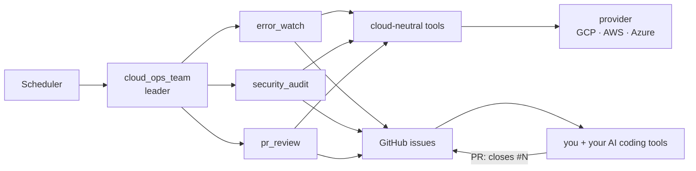

# cloud-ops-team

[](https://github.com/atsuki-sakai/cloud-ops-team/actions/workflows/ci.yml)
[](LICENSE)


**An AI operations team for your cloud.** Three specialist agents watch production errors, audit security every month and
verify every week that merged pull requests really fixed what they found — and they talk to you through GitHub issues.

[日本語 README](README.ja.md) · [Architecture](docs/architecture.md) · [Providers (GCP / AWS / Azure)](docs/providers.md) ·
[Configuration](docs/configuration.md) · [Deploy on Google Cloud](docs/deployment-gcp.md)

| Job | Default schedule | Agent | What it does |
|---|---|---|---|
| `error_watch` | daily 08:00 | SRE | Groups error logs by fingerprint, correlates them with 5xx rates, failing scheduled jobs and recent deployments, and files an `[ops/error]` issue with a root-cause hypothesis, evidence and a verification recipe. Recurring errors get a comment instead of a duplicate |
| `monthly_security_audit` | 1st of the month | Cloud security | Reviews IAM, long-lived credentials, compute, databases, network rules, security services, posture findings, container CVEs, end-of-life runtimes, CISA KEV and current threat intel; files critical and high findings plus a monthly report |
| `weekly_pr_review` | Mondays 09:00 | Release manager | For each open team issue: are linked PRs merged, is CI green, and did the error stop occurring? Marks `ops:verified` or `ops:stale` and publishes a weekly report |

You can also just talk to it: *"check the errors of the last 24 hours"*, *"run a security audit"*, *"what is the PR status?"*.

## How it works



- **Read-only by design.** No tool can change your cloud. GitHub writes are limited to issues, comments and labels, and are
  off (`OPS_DRY_RUN=true`) until you enable them.
- **Cloud-neutral agents, pluggable clouds.** The agents use 18 capability tools (`list_services`, `audit_network`, ...);
  a provider maps them to a cloud. Google Cloud is fully implemented; AWS and Azure ship as skeletons that the agents already
  understand — capabilities can be added one at a time.
- **No database.** Issues are the ledger: a log fingerprint stored in each issue de-duplicates findings and lets the weekly
  review count recurrences after a fix is merged.
- **Built on [Google ADK](https://adk.dev/)** with [agents-cli](https://github.com/google/agents-cli); specialists run as
  `single_turn` sub-agents so every tool call is streamed and traced.

## Supported clouds

| Cloud | Status | Logs · services · jobs · DBs · metrics | Security checks |
|---|---|---|---|
| Google Cloud | ✅ Implemented | Cloud Logging, Cloud Run, Cloud Scheduler, Cloud SQL, Cloud Monitoring | IAM, SA keys, Cloud Run, Cloud SQL, VPC firewall, SCC, Artifact Analysis |
| AWS | 🚧 Skeleton — contributions welcome | CloudWatch Logs, ECS / Lambda, EventBridge, RDS (planned) | IAM, Security Hub, Inspector, security groups (planned) |
| Azure | 🚧 Skeleton — contributions welcome | Log Analytics, App Service / Container Apps, Azure DBs (planned) | RBAC, Defender for Cloud, NSGs (planned) |

On every cloud, repository posture, CISA KEV, end-of-life checks, web threat research and the weekly PR review work today.
See [docs/providers.md](docs/providers.md) to add or complete a provider.

## Quick start (local)

Requirements: Python 3.11–3.13, [uv](https://docs.astral.sh/uv/), [agents-cli](https://github.com/google/agents-cli)
(`uv tool install google-agents-cli`), Gemini access (Vertex AI or `GEMINI_API_KEY`), read access to the cloud you monitor and
a GitHub token (or `gh auth login`).

```bash
git clone https://github.com/atsuki-sakai/cloud-ops-team && cd cloud-ops-team
agents-cli install                 # uv sync
cp .env.example .env               # set OPS_TARGET, GITHUB_REPO, ... (OPS_DRY_RUN=true by default)

# Run a job once and watch every tool call (nothing is written to GitHub in dry-run mode)
uv run python scripts/run_job.py error_watch --hours 24
uv run python scripts/run_job.py weekly_pr_review --days 7
uv run python scripts/run_job.py monthly_security_audit --kev-days 30

# Or chat with it
agents-cli playground
```

## Deploy

Google Cloud (Cloud Run + Cloud Scheduler), about ten minutes:

```bash
PROJECT_ID=my-project GITHUB_TOKEN=github_pat_xxx ./scripts/gcp/bootstrap.sh
PROJECT_ID=my-project GITHUB_REPO=owner/repo ./scripts/gcp/deploy_cloud_run.sh
PROJECT_ID=my-project AGENT_URL=https://... CLOUD_RUN_SERVICE=cloud-ops-team ./scripts/gcp/setup_schedules.sh
```

Every schedule is configurable (`ERROR_WATCH_CRON="0 * * * *" ERROR_WATCH_HOURS=1` for hourly, for example).
Full guide and runbook: [docs/deployment-gcp.md](docs/deployment-gcp.md).

## Configuration

| Variable | Default | |
|---|---|---|
| `OPS_CLOUD_PROVIDER` | `gcp` | `gcp`, `aws`, `azure` |
| `OPS_TARGET` / `OPS_TARGET_REGION` | — | Project / account / subscription to monitor, and its region |
| `GITHUB_REPO` | — | `owner/repo` |
| `OPS_DRY_RUN` | `true` | Preview instead of writing to GitHub |
| `OPS_AUTO_CLOSE_ISSUES` | `false` | Let the weekly review close verified issues |
| `OPS_REPORT_LANGUAGE` | `ja` | `ja` or `en` |
| `OPS_MODEL` | `gemini-3.8-flash` | Model for all agents |

All variables: [docs/configuration.md](docs/configuration.md).

## Project layout

```
app/
  agent.py, prompts.py     leader + specialists, cloud-neutral instructions
  config.py                environment-driven settings
  tools/                   tools the model calls: cloud.py (capabilities), threat_intel.py, repo.py, issues.py, context.py
  providers/               base.py (contract), gcp/ (implemented), aws/ and azure/ (skeletons)
  core/                    fingerprint, redaction, findings, time helpers
  integrations/github.py   GitHub REST + GraphQL client
scripts/                   run_job.py, trigger_local.sh, gcp/{bootstrap,deploy_cloud_run,setup_schedules,grant_target_roles}.sh
tests/                     unit (no network), integration, eval (LLM-as-judge)
docs/                      architecture, providers, configuration, deployment
```

## Contributing

Issues and pull requests are welcome — especially AWS and Azure capabilities. Start with [CONTRIBUTING.md](CONTRIBUTING.md);
security reports go through [SECURITY.md](SECURITY.md).

## License

[Apache License 2.0](LICENSE). Some files originate from the agents-cli scaffold (Copyright Google LLC, Apache-2.0).
