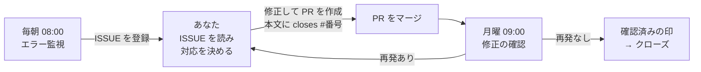
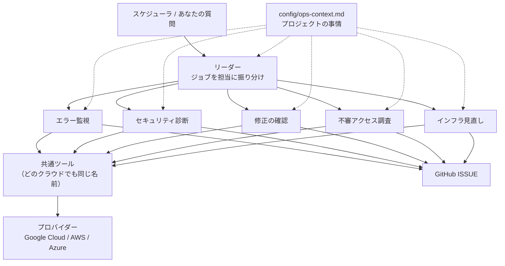

# cloud-ops-team

[](https://github.com/atsuki-sakai/cloud-ops-team/actions/workflows/ci.yml)
[](LICENSE)


**クラウドの運用保守を、AI のチームが毎日代わりに見張ってくれる仕組みです。**

本番環境のエラーを毎日チェックし、原因を調べて GitHub に ISSUE（やることリスト）として登録します。
不審なアクセスの兆候も毎日調査し、毎週インフラの無駄・権限・構成を見直して修正案をまとめます。
月に一度はセキュリティの健康診断をし、毎週「直したはずの問題が本当に直ったか」を確かめます。
AI はクラウドの設定を一切変更しません。調べて、報告して、確認するだけです。修正するのはあなた（と、あなたが使う AI コーディングツール）です。

[English README](README.en.md) ・ [仕組みの詳細](docs/architecture.md) ・ [カスタマイズガイド](docs/customization.md) ・ [設定一覧](docs/configuration.md) ・ [Google Cloud へのデプロイ手順](docs/deployment-gcp.md) ・
[プロバイダー（GCP / AWS / Azure）](docs/providers.md) ・ [変更履歴](CHANGELOG.md)

---

## こんな人のためのツールです

- 本番のエラーログを毎日見る余裕がない
- セキュリティ診断や「使っているソフトのサポート期限」の確認を後回しにしてしまう
- ISSUE を直したつもりでも、本当に直ったかまでは追えていない
- 小さなチームで、専任の SRE（運用担当）やセキュリティ担当がいない

## 導入すると、こう変わります

| | 導入前 | 導入後 |
|---|---|---|
| エラー | 気づくのはユーザーからの問い合わせ | 毎朝、原因の見立てと対応案つきの ISSUE が届く |
| 不審なアクセス | ログを個別に調べるまで気づかない | 毎日、攻撃の兆候と確認できた証拠・調査の限界を報告 |
| インフラ・権限 | 無駄な費用や過剰な権限を見直せない | 毎週、根拠・リスク・確認方法付きの改善案を報告 |
| セキュリティ | 気が向いたときに確認 | 毎月、危険度の高い問題が ISSUE になり、月次レポートが届く |
| 修正の確認 | PR をマージしたら終わり | 毎週、マージ後にエラーが再発していないかを自動で確認 |

## 5 人の AI 担当者

| 担当 | いつ（変更可） | やること |
|---|---|---|
| 🔍 **エラー監視**（SRE） | 毎日 08:00 | 直近 24 時間のエラーログを集めて同じ種類ごとにまとめ、サーバーエラーの割合・失敗している定期ジョブ・直前のデプロイと照らし合わせて原因を推測します。対応が必要なものだけ ISSUE にします。同じエラーが続いている場合は新しい ISSUE を作らず、既存の ISSUE にコメントします |
| 🔎 **不審アクセス調査** | 毎日 08:30 | 直近 24 時間の監査ログ、HTTP 401/403・探索パス、Cloud Armor の拒否を調べます。不審な兆候と侵入の確証を区別し、証拠・確度・確認できなかった範囲を報告します |
| 🧰 **インフラ見直し** | 毎週月曜 10:00 | GCP Recommender の費用・権限の推奨事項と、IAM・認証情報・Cloud Run・Cloud SQL・ネットワークの監査をまとめます。期待効果、変更リスク、実施・確認・ロールバックの案を示します |
| 🛡️ **セキュリティ診断** | 毎月 1 日 09:00 | 権限の付けすぎ、インターネットに開いたままのポート、古い鍵、データベースの設定、使っているソフトの脆弱性やサポート期限切れ、最近実際に悪用されている攻撃などを調べます。危険度の高いものは ISSUE にし、全体を月次レポートにまとめます |
| ✅ **修正の確認**（リリース管理） | 毎週月曜 09:00 | AI が作った ISSUE ごとに、対応する PR がマージされたか、テストが通っているか、マージ後に同じエラーが出ていないかを確認します。直っていれば「確認済み」、2 週間動きがなければ「停滞」の印を付け、週次レポートを書きます |

時刻の既定は `Asia/Tokyo` で、変更できます。定期実行のほかに、話しかけて使うこともできます（例:「不審なアクセスがないか調べて」「インフラの無駄と権限を見直して」「PR の進捗はどう？」）。

不審アクセス調査は定期的なログレビューです。リアルタイムの侵入防御や遮断は行いません。
ログが未収集・取得不可・途中までの場合や、検出が 0 件の場合に「不正アクセスがない」とは断定しません。
費用削減額は API に見積もりがある場合だけ示します。対象リージョンの Cloud Run・Cloud SQL とプロジェクトの IAM を扱い、全インフラの費用を網羅するものではありません。

## 1 週間の流れ（例）



たとえば、ある朝こんな ISSUE が届きます（実際の出力を簡略化した例）。

```text
[ops/error] worker: /api/v1/jobs/expire-reservations で HTTP 500 が継続（DB の接続数不足）
ラベル: ops-agent, ops:error, bug, major

## 概要
worker サービスで 12:30〜12:40 に 5 分おきに 3 回、HTTP 500 が発生。

## 影響範囲
期限切れ予約の自動解放が約 10 分遅延。

## 証跡
"pool timed out while waiting for an open connection"（12:30:05, 12:35:04, 12:40:04）

## 原因分析（確度: 高）
12:30 に 10 件以上の定期ジョブが同時に起動し、データベースの接続が足りなくなった。

## 推奨対応
1. 定期ジョブの実行時刻を数分ずつずらす
2. 接続プールの上限とデータベースの最大接続数を見直す

## 確認方法
修正後、"/api/v1/jobs/expire-reservations" のエラーが 0 件であることを確認（週次の確認で自動チェック）。
```

あなたはこれを読んで修正し、PR の本文に `closes #番号` と書いてマージするだけです。翌週の月曜に、AI が直ったかどうかを確かめます。

## 安全に使えるように作っています

| AI がやること | AI がやらないこと |
|---|---|
| ログ・設定・メトリクスを**読む** | クラウドの設定変更、再起動、削除、デプロイ |
| GitHub に ISSUE・コメント・ラベルを**書く** | PR のマージ、コードの変更 |
| 確認済みの ISSUE に印を付ける | ISSUE のクローズ（設定で許可した場合のみ） |

- **最初は「お試しモード」**（`OPS_DRY_RUN=true`）で動きます。GitHub には何も書き込まず、「こういう ISSUE を作る予定です」という下書きだけを表示します。内容に納得してから本番モードに切り替えてください。
- **ISSUE が大量に届くことはありません。** 1 回の実行で作る ISSUE は最大 10 件です。同じエラーは同じ ISSUE にまとめられ、再発のコメントも 1 日 1 回までです。
- **秘密情報は書き込みません。** ログに含まれるトークン・パスワード・メールアドレス・IP アドレスなどは、ISSUE に書く前に自動で伏せ字にします。
- クラウドには**閲覧用の権限だけ**を与えます。仮に AI が指示を誤解しても、クラウドを壊すことはできません。

## 自分のプロジェクトで使う

このリポジトリは **クローンして自分用に使う** ためのものです。GitHub の「Use this template」から自分のリポジトリを作るか、そのままクローンしてください。
すべての操作は `make` コマンドにまとめてあります（`make` だけで一覧が出ます）。

### 1. 用意するもの

- 監視したい **Google Cloud プロジェクト**と、それを閲覧できるアカウント（`gcloud auth login` と `gcloud auth application-default login` 済み）
- **Gemini** を使える環境（Google Cloud の Vertex AI、または Gemini API キー）
- ISSUE を登録する **GitHub リポジトリ**と、そのアクセス権（`gh auth login` 済み、またはトークン）
- **Python 3.11〜3.13**、[uv](https://docs.astral.sh/uv/)、agents-cli（`uv tool install google-agents-cli`）、`make`

### 2. 設定する（質問に答えるだけ）

```bash
git clone https://github.com/<あなた>/cloud-ops-team && cd cloud-ops-team
make setup        # 依存関係を入れ、質問に答えて .env を作る（監視するプロジェクト・ISSUE を出すリポジトリ・言語など）
make doctor       # 設定・Gemini・GitHub・クラウドの権限を点検し、足りないものと直し方を表示
```

`make doctor` の例（足りない API があると、有効化のコマンドまで教えてくれます）:

```text
Cloud access
  checking as: you@example.com (Application Default Credentials)
  ✓ summarize_error_groups
  ✓ list_services
  ! list_security_findings — API is not enabled
      → gcloud services enable securitycenter.googleapis.com --project my-project
Summary: 22 ok, 2 warnings, 0 failures
```

### 3. 手元で試す（お試しモード）

```bash
make run JOB=error_watch                              # エラー監視を 1 回。AI が何を調べたかが 1 行ずつ出る
make run JOB=access_watch ARGS="--hours 24"             # 不審アクセス調査
make run JOB=infrastructure_review                     # インフラ・権限・費用の見直し
make run JOB=monthly_security_audit ARGS="--kev-days 30"   # セキュリティ診断（数分）
make run JOB=weekly_pr_review                         # 修正の確認
make chat                                             # ブラウザで話しかけて試す
```

お試しモード（`OPS_DRY_RUN=true`）なので、GitHub には何も書き込まれず「作る予定の ISSUE」だけが表示されます。

### 4. 自分のプロジェクトの事情を教える（おすすめ）

```bash
cp config/ops-context.example.md config/ops-context.md
```

サービスの役割、重要度の考え方、無視してよいエラーなどを書いておくと、AI がそれを前提に判断します。
ラベルや手順の変え方、担当やツールの追加方法は [カスタマイズガイド](docs/customization.md) にまとめています。

### 5. 本番で毎日動かす（Google Cloud）

```bash
make gcp-bootstrap    # 初回だけ: API の有効化、AI 用アカウントと閲覧権限、GitHub トークンの保存（入力を求められます）
make gcp-deploy       # Cloud Run にデプロイ（まずはお試しモードのまま）
make gcp-schedule     # 毎日・毎週・毎月の定期実行を登録（デプロイ先の URL は自動で見つけます）
make gcp-logs         # 実行履歴を確認
```

数日分の下書きを見て問題がなければ、`OPS_DRY_RUN=false make gcp-deploy` で実際に ISSUE を登録するようにします。
詳しい手順と運用（止め方・トークンの更新・ロールバック）は [デプロイ手順書](docs/deployment-gcp.md) にあります。

### 6. 実行する時間や頻度を変える

`make jobs` で現在の予定を確認し、変えたい値を付けて `make gcp-schedule` を再実行します。既存の予定が上書きされます。

| やりたいこと | コマンド |
|---|---|
| エラー監視を毎時にする | `ERROR_WATCH_CRON="0 * * * *" ERROR_WATCH_HOURS=1 make gcp-schedule` |
| エラー監視を 6 時間ごとにする | `ERROR_WATCH_CRON="0 */6 * * *" ERROR_WATCH_HOURS=6 make gcp-schedule` |
| 平日の朝 9:30 だけにする（月曜は週末分も見る） | `ERROR_WATCH_CRON="30 9 * * 1-5" ERROR_WATCH_HOURS=72 make gcp-schedule` |
| 月次診断を 15 日に変える | `MONTHLY_CRON="0 9 15 * *" make gcp-schedule` |
| 不審アクセス調査を毎朝 9:00 にする | `ACCESS_WATCH_CRON="0 9 * * *" ACCESS_WATCH_HOURS=24 ONLY_JOBS=access-watch make gcp-schedule` |
| インフラ見直しを金曜 10:00 にする | `INFRASTRUCTURE_REVIEW_CRON="0 10 * * 5" ONLY_JOBS=infrastructure-review make gcp-schedule` |
| 1 つの予定だけを変える | 上に加えて `ONLY_JOBS=error-watch` |

いつも同じ設定にしたい場合は、`.env` に書いておけば毎回付ける必要はありません。
`ERROR_WATCH_HOURS`（何時間前までさかのぼるか）は実行間隔と同じにしておくと見落としがありません。
一時的に止めたいときは `gcloud scheduler jobs pause cloud-ops-error-watch --location asia-northeast1` を実行します（`resume` で再開）。

## 仕組み（全体像）



- **リーダー**が依頼（定期実行の JSON か、あなたの言葉）を読み、担当に振り分けて最後にレポートをまとめます。
- **担当（専門家）**は 1 ファイル 1 人で定義されています（`app/specialists/`）。担当を足すとリーダーの振り分け表と定期実行も自動で増えます。
- **共通ツール**はクラウドに依存しない名前（`list_services`、`audit_network` など）で、**プロバイダー**が各クラウドの API に置き換えます。
- **重複を防ぐ仕組み**: エラーごとの指紋（フィンガープリント）を ISSUE に埋め込み、同じエラーは同じ ISSUE にまとめます。データベースは使いません。

詳しくは [仕組みの詳細](docs/architecture.md) を参照してください。

## フォルダ構成

```
cloud-ops-team/
├── app/
│   ├── specialists/        ★ 担当の定義（指示文・ツール・ジョブ）。_template.py をコピーして追加
│   ├── tools/              ★ AI が使う調査ツール（クラウド非依存）
│   ├── providers/          ★ クラウドごとの実装（gcp は実装済み、aws / azure は雛形）
│   ├── agent.py            リーダーの組み立て（担当は自動で読み込み）
│   ├── prompts.py          指示文の組み立て（クラウド名・言語・プロジェクト情報の差し込み）
│   ├── config.py           .env の読み込み
│   └── core/ integrations/ 共通部品（フィンガープリント・伏せ字）、GitHub クライアント
├── config/ops-context.example.md   ★ プロジェクトの事情を書くひな形
├── scripts/                setup・doctor・run_job・jobs と、gcp/（初期設定・デプロイ・定期実行）
├── tests/                  unit（オフライン）・integration・eval（LLM 採点）
├── docs/                   設計・カスタマイズ・プロバイダー・設定・デプロイ（en/ に英語版）
└── Makefile                すべての操作の入口
```

★ が、自分のプロジェクト向けに調整するときに主に触る場所です。各ファイルの説明は [フォルダ構成の詳細](docs/architecture.md#フォルダ構成) にあります。

## 主な設定

| 設定 | 初期値 | 意味 |
|---|---|---|
| `OPS_TARGET` | — | 監視するプロジェクト |
| `GITHUB_REPO` | — | ISSUE を登録するリポジトリ（`組織名/リポジトリ名`） |
| `OPS_DRY_RUN` | `true` | `true` はお試しモード（書き込まない）、`false` で本番モード |
| `OPS_REPORT_LANGUAGE` | `ja` | レポートと ISSUE の言語。`en` で英語 |
| `OPS_AUTO_CLOSE_ISSUES` | `false` | `true` にすると、直ったことを確認した ISSUE を AI がクローズする |
| `OPS_MAX_ISSUES_PER_RUN` | `10` | 1 回の実行で作る ISSUE の上限 |
| `OPS_CLOUD_PROVIDER` | `gcp` | 対象のクラウド（`gcp` / `aws` / `azure`） |
| `OPS_ERROR_LABELS` / `OPS_SECURITY_LABELS` / `OPS_SEVERITY_LABELS` | `bug` / `security` / `severity: high` など | ISSUE に付けるラベル（自分のリポジトリに合わせて変更） |
| `OPS_CONTEXT_FILE` | `config/ops-context.md` | プロジェクトの事情を書いたファイル |

すべての設定は [設定一覧](docs/configuration.md) にあります。

## 対応しているクラウド

| クラウド | 状態 |
|---|---|
| Google Cloud | ✅ 本ツールの 20 機能を実装。各機能の対象サービス・取得条件は [プロバイダーガイド](docs/providers.md) を参照 |
| AWS | 🚧 準備中（土台はできており、機能ごとに追加できます） |
| Azure | 🚧 準備中（同上） |

AWS・Azure でも、GitHub リポジトリの診断、脆弱性情報（CISA KEV）の確認、サポート期限の確認、最新の攻撃動向の調査、修正の確認は今すぐ使えます。
ログやクラウド設定の診断は、対応が済むまで「未対応のため確認できなかった項目」としてレポートに記載されます。
追加の方法は [プロバイダー追加ガイド](docs/providers.md) を参照してください。

## よくある質問

**お金はかかりますか？**
主な費用は Gemini の利用料です。Cloud Run は実行中しか課金されず、待機中は 0 台まで縮小します。
既定の頻度（毎日・毎週・毎月）なら、1 か月の実行は数十回程度です。

**AI が勝手にコードやクラウドを直してしまいませんか？**
直しません。クラウドには閲覧権限しかなく、GitHub でもできるのは ISSUE・コメント・ラベルの作成だけです。

**もう自分で登録した ISSUE と重複しませんか？**
登録の前に、リポジトリ内の似た ISSUE を検索します。同じものがあれば新しく作らず、その番号をレポートに書きます。

**同じエラーが毎日出ていたら、毎日 ISSUE が増えますか？**
増えません。エラーごとに「指紋（フィンガープリント）」を付けて ISSUE に記録しているので、2 回目以降は既存の ISSUE へのコメントになります（1 日 1 回まで）。

**自分のプロジェクト向けに機能を足せますか？**
足せます。担当（専門家）は `app/specialists/_template.py` をコピーして登録するだけで増やせ、リーダーの振り分けと定期実行も自動で追加されます。
調査ツールの追加、手順やラベルの変更も含めて [カスタマイズガイド](docs/customization.md) に例付きでまとめています。

**英語で出力できますか？**
`OPS_REPORT_LANGUAGE=en` にすると、レポート・ISSUE・コメントが英語になります。

**すぐに止めたいときは？**
GitHub への書き込みだけを止めるなら、本番の設定を `OPS_DRY_RUN=true` に戻します。
定期実行そのものを止めるなら、上の `pause` コマンドを使います。手順は [デプロイ手順書](docs/deployment-gcp.md#運用手順) にあります。

## 用語集

| 用語 | 意味 |
|---|---|
| ISSUE | GitHub 上の「やることリスト」の 1 項目 |
| PR（プルリクエスト） | コードの変更をまとめて、レビュー・マージするための単位 |
| お試しモード（dry-run） | 実際には書き込まず、「何をする予定か」だけを表示する動き方 |
| フィンガープリント | エラーメッセージから日時や ID を取り除いて作る、エラーの種類ごとの識別子 |
| SRE | サービスを安定して動かし続けることを担当するエンジニアの役割 |
| CVE / 脆弱性 | ソフトウェアのセキュリティ上の欠陥と、その識別番号 |
| CISA KEV | 米国 CISA が公開している「実際に悪用が確認された脆弱性」の一覧 |
| EOL（サポート期限） | ソフトウェアのセキュリティ更新が終わる日 |
| プロバイダー | 各クラウド（GCP・AWS・Azure）とのやり取りを担当する部品 |

## 開発に参加する

不具合の報告や改善の提案、特に AWS・Azure 対応のコードを歓迎します。[CONTRIBUTING.md](CONTRIBUTING.md) を参照してください。
開発時は `make test`（オフラインのテスト）、`make lint`、`make run`、`make eval` を使います。
実モデルを呼ぶ `uv run pytest tests/integration -q` はクラウド認証が必要です。HTTP/SSE・A2Aのモデル応答待ち時間は `OPS_E2E_MODEL_TIMEOUT_SECONDS`（既定180秒、1〜900秒）で調整できます。これは無通信時間の制限で、性能保証ではありません。
セキュリティ上の問題は公開の ISSUE ではなく、[SECURITY.md](SECURITY.md) の手順で非公開に報告してください。

## ライセンス

[Apache License 2.0](LICENSE)。Google の agents-cli が生成したファイル（Google LLC、Apache-2.0）を含みます。
