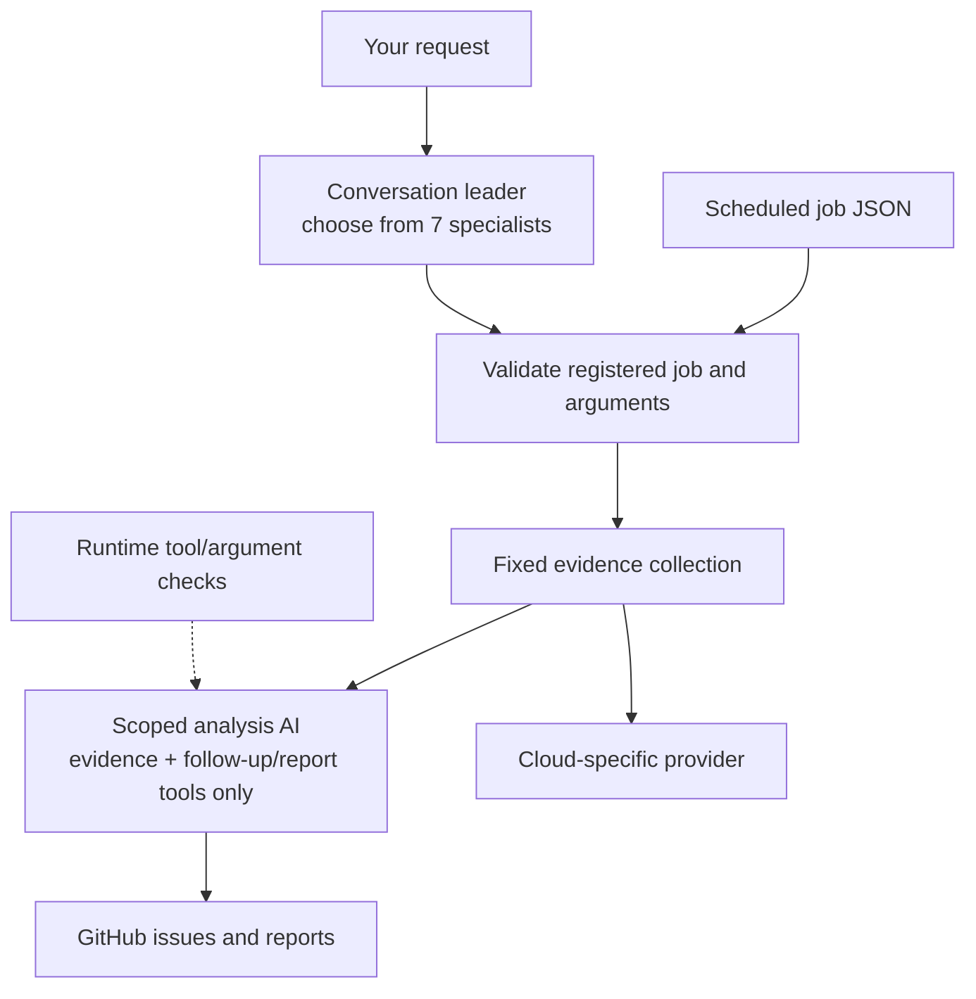

<div align="center">

# cloud-ops-team

**A scheduled AI operations team for your cloud.**<br/>
Five read-only specialist agents watch errors, suspicious access, infrastructure, security posture and merged fixes,
then report to you through GitHub issues.

[](https://github.com/atsuki-sakai/cloud-ops-team/actions/workflows/ci.yml)
[](LICENSE)


[Quick start](#quick-start) · [How it works](#how-it-works) · [Customize](#customize) · [Configuration](#configuration) · [FAQ](#faq) · [日本語](README.ja.md)

</div>

---

> [!WARNING]
> This release produces evidence for **human review**. PR identity, audit coverage and issue writes across separate runs
> have unresolved defects. Read the [known limitations](docs/en/known-limitations.md) first, and start with
> `OPS_DRY_RUN=true` and `OPS_AUTO_CLOSE_ISSUES=false`. Even with automatic closure off, enabling writes still adds
> verification labels and comments, so check their evidence before you accept a fix as complete.

## Why

Small teams rarely have time to read production logs every day, audit IAM and end-of-life runtimes, or confirm that a
merged fix actually stopped the error. cloud-ops-team does that legwork on a schedule. You read the issues and decide what to fix.

- **Read-only.** No tool can change your cloud. GitHub writes are limited to issues, comments and labels, and they stay off until you enable them.
- **Deterministic.** Code picks the registered job and runs its fixed evidence collection. The model only analyzes and reports.
- **Scoped.** Each analysis agent sees the collected evidence plus 5–10 follow-up and reporting tools. Runtime checks reject anything else.
- **Pluggable.** Twenty cloud-neutral capabilities with a full Google Cloud provider. AWS and Azure ship as skeletons.

## Meet the team

| Job | Default schedule | Specialist | What you get |
|---|---|---|---|
| `error_watch` | 1st & 15th 08:00 | 🔍 SRE | Groups 432 h of error logs by fingerprint and correlates them with 5xx rates, failing scheduled jobs and recent deploys. Only the problem rows reach the model, and a run with no errors or problems skips the model. Files an `[ops/error]` issue with a root-cause hypothesis, evidence and a verification recipe. Recurring errors get a comment instead of a duplicate. |
| `access_watch` | 1st & 15th 08:30 | 🔎 Access investigator | Reviews 432 h of audit logs, HTTP 401/403, probe paths and Cloud Armor denials. Keeps suspicious signals apart from confirmed compromise and reports evidence, confidence and coverage gaps. |
| `infrastructure_review` | 1st & 15th 10:00 | 🧰 Infrastructure reviewer | Combines GCP Recommender cost/IAM recommendations with IAM, credential, Cloud Run, Cloud SQL and network audits. Each proposal comes with impact, risk, validation and rollback steps. |
| `monthly_security_audit` | 1st of the month | 🛡️ Cloud security | Covers IAM, long-lived credentials, compute, databases, network rules, posture findings, container CVEs, end-of-life runtimes, CISA KEV and current threat intel. Critical and high findings become issues, and everything goes into a monthly report. |
| `weekly_pr_review` | 1st & 15th 09:00 | ✅ Release manager | Checks open issues, plus unverified issues closed within 30 days (including auto-closed via `closes #N`), against linked PRs, CI and recurrence. Labels verified fixes and stale issues and publishes a twice-monthly report. |
| `service_check` | Off (set `SERVICE_CHECK_CRON`) | 🩺 Service checker | Replays registered HTTP and browser scenarios against your public URLs and judges them in code by expected results, with confirming retries. Files, updates and records recovery of `[ops/error]` issues; healthy runs need no model call. [Details](docs/en/service-checks.md) |
| `deploy_verification` | After each deploy | 🚦 Deploy verifier | Verifies the revision actually serving traffic: readiness, traffic split, production scenarios and the new revision's own error rate and p95 latency against the previous revisions. |

Schedules default to `Asia/Tokyo`. You can also just ask, for example *"investigate suspicious access"*,
*"review infrastructure waste and permissions"* or *"what is the PR status?"*.

<details>
<summary><b>Example issue</b> (simplified from real output)</summary>

```text
[ops/error] worker: HTTP 500 persists on /api/v1/jobs/expire-reservations (DB connection pool exhausted)
Labels: ops-agent, ops:error, bug, major

## Summary
The worker service returned HTTP 500 three times, every 5 minutes, between 12:30 and 12:40.

## Impact
Automatic release of expired reservations was delayed by about 10 minutes.

## Evidence
"pool timed out while waiting for an open connection" (12:30:05, 12:35:04, 12:40:04)

## Root cause (confidence: high)
More than 10 scheduled jobs started at 12:30 and exhausted the database connections.

## Recommended actions
1. Stagger the scheduled jobs by a few minutes
2. Review the connection pool limit and the database max_connections

## Verification
After the fix, confirm zero errors on "/api/v1/jobs/expire-reservations" (checked automatically by the twice-monthly review).
```

You fix it, merge a PR containing `closes #N`, and at the next review (1st or 15th) the release manager reports what it found.
Review its PR, CI, deploy and recurrence evidence yourself; "verified" is not a guarantee that the fix is complete.

</details>

> [!NOTE]
> Access investigation is a scheduled log review. It does not block anything in real time. Missing, inaccessible or
> truncated logs, or zero detections, never prove that no unauthorized access happened. Savings are quoted only when the API
> returns an estimate, and optimization covers Cloud Run and Cloud SQL in the target region plus project IAM, not every resource.

## Quick start

**Prerequisites:** Python 3.11–3.13, [uv](https://docs.astral.sh/uv/), [agents-cli](https://github.com/google/agents-cli)
(`uv tool install google-agents-cli`), `make`, `gcloud` (logged in, plus `gcloud auth application-default login`),
Gemini access (Vertex AI or `GEMINI_API_KEY`) and a GitHub token or `gh auth login`.

The repository is meant to be **cloned and adapted**: click **Use this template** on GitHub, or clone it directly.
Every task runs through `make`; run `make` on its own to list them.

### 1. Set up and check access

```bash
git clone https://github.com/<you>/cloud-ops-team && cd cloud-ops-team
make setup     # install dependencies, answer a few questions, write .env
make doctor    # check config, Gemini, GitHub and cloud access; prints a fix for every gap
```

```text
Cloud access
  checking as: you@example.com (Application Default Credentials)
  ✓ summarize_error_groups
  ✓ list_services
  ! list_security_findings — API is not enabled
      → gcloud services enable securitycenter.googleapis.com --project my-project
Summary: 22 ok, 2 warnings, 0 failures
```

### 2. Run jobs locally in dry-run mode

```bash
make run JOB=error_watch                                  # streams every tool call; nothing is written
make run JOB=access_watch ARGS="--hours 432"
make run JOB=infrastructure_review
make run JOB=monthly_security_audit ARGS="--kev-days 30"  # takes a few minutes
make run JOB=weekly_pr_review
make run JOB=service_check ARGS="--attempts 2"            # needs config/service-checks.json
make chat                                                 # talk to the team in the browser
```

Optionally, describe your services, severity policy and known noise so the team can take them into account:

```bash
cp config/ops-context.example.md config/ops-context.md
```

### 3. Deploy to Google Cloud (Cloud Run + Cloud Scheduler)

```bash
make gcp-bootstrap   # once: APIs, runtime service account, read-only roles, GitHub token secret
make gcp-deploy      # deploys in dry-run mode first
make gcp-schedule    # creates the scheduled jobs (finds the service URL itself)
make gcp-logs        # recent runs
```

When a few days of drafts look right, start filing issues with `OPS_DRY_RUN=false make gcp-deploy`.
The full guide and runbook (pausing, token rotation, rollback) is in [docs/en/deployment-gcp.md](docs/en/deployment-gcp.md).

<details>
<summary><b>Changing schedules</b></summary>

`make jobs` shows the current schedules. Re-run `make gcp-schedule` with new values to overwrite them, or put the values in `.env`.

| Goal | Command |
|---|---|
| Hourly error watch | `ERROR_WATCH_CRON="0 * * * *" ERROR_WATCH_HOURS=1 make gcp-schedule` |
| Error watch every 6 hours | `ERROR_WATCH_CRON="0 */6 * * *" ERROR_WATCH_HOURS=6 make gcp-schedule` |
| Weekdays at 09:30 (Monday covers the weekend) | `ERROR_WATCH_CRON="30 9 * * 1-5" ERROR_WATCH_HOURS=72 make gcp-schedule` |
| Monthly audit on the 15th | `MONTHLY_CRON="0 9 15 * *" make gcp-schedule` |
| Daily access watch at 09:00 | `ACCESS_WATCH_CRON="0 9 * * *" ACCESS_WATCH_HOURS=24 ONLY_JOBS=access-watch make gcp-schedule` |
| Infrastructure review on Fridays at 10:00 | `INFRASTRUCTURE_REVIEW_CRON="0 10 * * 5" ONLY_JOBS=infrastructure-review make gcp-schedule` |
| Change only one schedule | add `ONLY_JOBS=error-watch` |

With the default twice-monthly cadence (1st and 15th; cron cannot express "every two weeks"), the longest gap is the
408 hours from the 15th to the 1st. The default 432-hour lookback for `ERROR_WATCH_HOURS` and `ACCESS_WATCH_HOURS` adds a
24-hour overlap (maximum 720 hours); if you change the cadence, keep the lookback at least as long as the longest gap. To pause a job, run
`gcloud scheduler jobs pause cloud-ops-error-watch --location asia-northeast1` (`resume` restarts it).

</details>

## How it works



- **Scheduled work bypasses LLM routing.** Unknown jobs and invalid arguments are rejected before collection or any model call.
  Natural-language requests pick a specialist adapter and enter the same validated workflow.
- **Scoped model context.** Tool descriptions and cloud glossary entries follow the stage scope, and runtime checks
  reject unauthorized calls and excessive query arguments.
- **Cloud-neutral capabilities.** Workflows call functions such as `list_services` and `audit_network`; a provider maps them to a cloud.
- **Issues are the ledger.** A stored fingerprint finds existing issues and counts recurrences after a merge. Issue creation is
  serialized within one invocation, but there is no shared lock across runs, so overlapping runs can create duplicates.
- **Issue budgets.** `OPS_MAX_ISSUES_PER_RUN` caps normal issue creation across one invocation, including a `full` run of every job, and
  resets on the next request. `publish_report` is outside that budget and has no call-count cap. Publishing a new periodic report closes
  older open reports of the same series as not planned.
- **Built on [Google ADK](https://adk.dev/)** with [agents-cli](https://github.com/google/agents-cli). A programmatic root serves
  HTTP/SSE and A2A, and specialist adapters keep streamed tool events for conversations.

Routing and tool changes go through a [baseline/candidate comparison gate](tests/eval/routing/README.md) covering route, tools,
arguments, preconditions and task completion. Unauthorized tool presentation, attempts or executions must stay at zero, and
missing or incomparable evidence fails closed. Stubbed-model tests validate contracts only; they don't establish live-model accuracy
or release eligibility. This architecture still needs validation and deployment in your target environment.

Browser recording/replay, backup creation/restore and the other extensions are planned in
[Issue #7](https://github.com/atsuki-sakai/cloud-ops-team/issues/7) and are not implemented yet.

Deep dive: [docs/en/architecture.md](docs/en/architecture.md).

## Safety model

| The agents do | The agents never do |
|---|---|
| **Read** logs, configuration and metrics | Change, restart, delete or deploy cloud resources |
| **Write** GitHub issues, comments and labels | Merge PRs or change code |
| Label issues they verified as fixed | Close finding issues (unless `OPS_AUTO_CLOSE_ISSUES=true`) |

- **Dry-run by default.** With `OPS_DRY_RUN=true`, nothing reaches GitHub; you only see the issues that would be filed.
- **Secrets are redacted.** Tokens, passwords, email and IP addresses found in logs are masked before anything is written.
- **Least privilege.** The runtime identity has read-only cloud roles. Even if the model misreads an instruction, it has no permission to change your cloud.

## Supported clouds

| Cloud | Status | Logs · services · jobs · DBs · metrics | Security checks |
|---|---|---|---|
| Google Cloud | ✅ 20 capabilities; known coverage and classification gaps | Cloud Logging, Cloud Run, Cloud Scheduler, Cloud SQL, Cloud Monitoring, Recommender | Audit/access logs, Cloud Armor, IAM, SA keys, Cloud Run, Cloud SQL, VPC firewall, SCC, Artifact Analysis |
| AWS | 🚧 Skeleton, contributions welcome | CloudWatch Logs, ECS / Lambda, EventBridge, RDS (planned) | IAM, Security Hub, Inspector, security groups (planned) |
| Azure | 🚧 Skeleton, contributions welcome | Log Analytics, App Service / Container Apps, Azure DBs (planned) | RBAC, Defender for Cloud, NSGs (planned) |

Repository posture, CISA KEV, end-of-life checks, web threat research and PR progress review work on every cloud. Without a log
capability, the twice-monthly review can't verify recurrence, so confirm that separately. Unsupported checks are listed in reports as
not verified. To add or complete a provider, see [docs/en/providers.md](docs/en/providers.md).

## Customize

| You want to | Do this |
|---|---|
| Tell the team what your services do and which errors are noise | `config/ops-context.md` (no code) |
| Use your own labels, report language or schedules | `.env` (no code) |
| Change a specialist's procedure or issue format | Edit `INSTRUCTION` in `app/specialists/<name>.py` |
| Add a tool | Add a function in `app/tools/`, choose its collection/analysis stage, scope and tests |
| Add a job or a whole specialist | Add the definition, request schema, fixed collection plan, analysis scope and comparison cases |
| Support another cloud capability | Implement it in `app/providers/<cloud>/` |

Recipes with code: [docs/en/customization.md](docs/en/customization.md).

## Configuration

| Variable | Default | Description |
|---|---|---|
| `OPS_CLOUD_PROVIDER` | `gcp` | `gcp`, `aws` or `azure` |
| `OPS_TARGET` / `OPS_TARGET_REGION` | — | Project, account or subscription to monitor, and its region |
| `GITHUB_REPO` | — | `owner/repo` that receives issues |
| `OPS_DRY_RUN` | `true` | Preview instead of writing to GitHub |
| `OPS_AUTO_CLOSE_ISSUES` | `false` | Let the twice-monthly review close verified issues |
| `OPS_MAX_ISSUES_PER_RUN` | `10` | Normal issue cap shared within one invocation; resets on the next request and excludes reports |
| `OPS_REPORT_LANGUAGE` | `ja` | `ja` or `en` for reports, issues and comments |
| `OPS_MODEL` | `gemini-3.8-flash` | Model for all agents |
| `OPS_ERROR_LABELS` / `OPS_SECURITY_LABELS` / `OPS_SEVERITY_LABELS` | `bug` / `security` / `severity: …` | Labels matching your repository |
| `OPS_CONTEXT_FILE` | `config/ops-context.md` | Project knowledge; the standard deployment does not forward custom paths |

All variables: [docs/en/configuration.md](docs/en/configuration.md). Optional run and evidence ledger: [docs/en/execution-history.md](docs/en/execution-history.md).

<details>
<summary><b>Project layout</b></summary>

```
cloud-ops-team/
├── app/
│   ├── specialists/        ★ team members: instruction, tools and jobs (copy _template.py to add one)
│   ├── tools/              ★ tools the model calls (cloud-neutral)
│   ├── providers/          ★ one adapter per cloud: gcp (implemented), aws and azure (skeletons)
│   ├── agent.py            builds the router, conversation leader and analysis agents
│   ├── routing.py          validates registered jobs and routes them directly
│   ├── workflows.py        fixed collection, evidence and analysis tool selection
│   ├── tool_scope.py       per-stage tool and argument execution boundary
│   ├── prompts.py          renders instructions (cloud, language, project context)
│   ├── config.py           settings from .env
│   └── core/ integrations/ fingerprints and redaction; GitHub client
├── config/ops-context.example.md   ★ template for your project knowledge
├── scripts/                setup, doctor, run_job, jobs; gcp/ (bootstrap, deploy, schedules, roles)
├── tests/                  unit (offline), integration, eval (LLM-judged)
├── docs/                   architecture, customization, providers, configuration, deployment (Japanese; en/: English)
└── Makefile                entry point for every task
```

★ marks what you typically change. File-by-file notes: [docs/en/architecture.md](docs/en/architecture.md#folder-structure).

</details>

## FAQ

<details>
<summary><b>What does it cost?</b></summary>

Mostly Gemini usage. Cloud Run bills only while a request runs and scales to zero in between. The default schedules
add up to 9 runs a month: error, access, fix and infrastructure reviews on the 1st and 15th, and the monthly audit. An error
watch that finds no errors or problems does not call the model.

</details>

<details>
<summary><b>Can the agents change my code or cloud?</b></summary>

No. They have read-only cloud roles. On GitHub they create issues, comments and labels, and close only older periodic reports
of the same series. Verified findings are closed automatically only when `OPS_AUTO_CLOSE_ISSUES` is enabled.

</details>

<details>
<summary><b>Will a recurring error open a new issue every run?</b></summary>

Usually not. If an open issue with the same fingerprint exists, the run comments on it instead. The cooldown uses the issue's
update time, and overlapping runs can still create duplicates; see the [known limitations](docs/en/known-limitations.md).
Issues you filed by hand are searched too, but matching depends on AI similarity and search scope, so duplicates aren't ruled out.

</details>

<details>
<summary><b>Can I get output in English?</b></summary>

Yes. Set `OPS_REPORT_LANGUAGE=en` and reports, issues and comments are written in English.

</details>

<details>
<summary><b>How do I stop it quickly?</b></summary>

To stop GitHub writes, redeploy with `OPS_DRY_RUN=true`. To stop the runs themselves, pause the Cloud Scheduler job:
`gcloud scheduler jobs pause cloud-ops-error-watch --location asia-northeast1`. The [runbook](docs/en/deployment-gcp.md#runbook)
has the full procedure.

</details>

## Contributing

Issues and pull requests are welcome, especially AWS and Azure capabilities. Start with [CONTRIBUTING.en.md](CONTRIBUTING.en.md)
([日本語](CONTRIBUTING.md)), and report security issues privately as described in [SECURITY.md](SECURITY.md).

```bash
make test    # offline unit tests
make lint
make eval    # LLM-judged evaluation
uv run pytest tests/integration -q   # live model; requires cloud credentials
```

<details>
<summary><b>Model timeouts and retries</b></summary>

- `OPS_E2E_MODEL_TIMEOUT_SECONDS` (default 180 s, range 1–900) bounds the idle read wait for HTTP/SSE and A2A integration tests.
  It limits idle time and is not a performance guarantee.
- Model HTTP calls use HTTPX with a 60-second idle timeout per connect/read wait. The SDK retries timeouts, connection errors and
  retryable HTTP errors up to five attempts including the first, so a healthy request silent for 60 seconds may be resent.
- Reads after a stream starts and whole agent runs are not retried, so report tools are never replayed. This is not a 60-second
  job deadline: backoff and multiple model calls can make a job take longer.

</details>

## License

[Apache License 2.0](LICENSE). Some files originate from the agents-cli scaffold (Copyright Google LLC, Apache-2.0).
