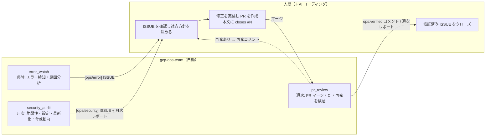
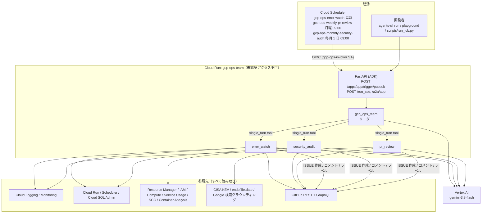
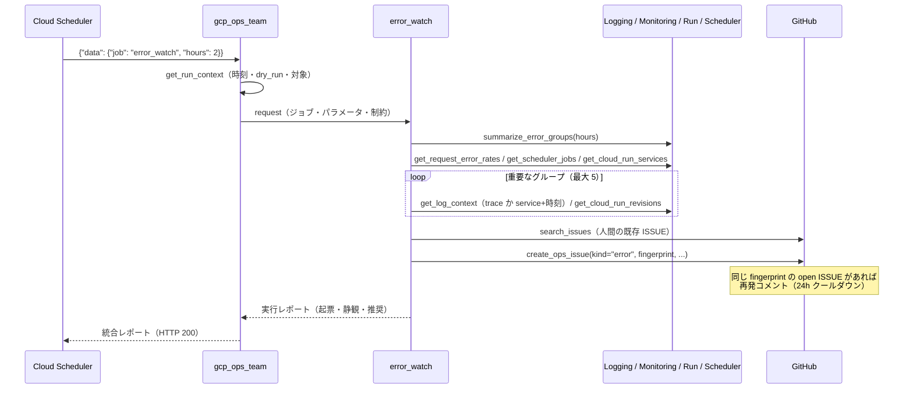
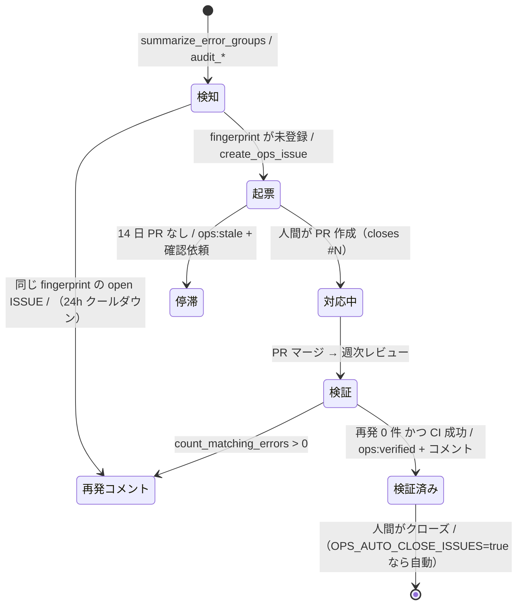

# アーキテクチャ

gcp-ops-team は、Google Cloud プロジェクトの運用保守（エラー監視・月次セキュリティ診断・週次の ISSUE/PR 進捗確認）を
3 人の専門家エージェントが分担し、結果を GitHub ISSUE として人間に引き渡すシステムです。
このドキュメントは実装（`app/`, `scripts/`, `tests/`）から読み取れる構造と仕組みをまとめたものです。

- フレームワーク: [ADK](https://adk.dev/) 2.11（Python）+ [agents-cli](https://github.com/google/agents-cli) 1.9
- モデル: `gemini-3.8-flash`（Vertex AI、`global` ロケーション）
- 実行基盤: Cloud Run（Cloud Scheduler から OIDC 認証付き HTTP で起動）

## 1. 人間とエージェントの役割分担



エージェントは **読み取り専用** です。GCP に対する変更操作のツールは存在せず、GitHub に対しても ISSUE の作成・コメント・ラベル付けだけを行います
（クローズは `OPS_AUTO_CLOSE_ISSUES=true` のときのみ）。

## 2. 全体構成



## 3. エージェント構成

| エージェント | 役割 | ツール数 | 出力 |
|---|---|---|---|
| `gcp_ops_team`（root） | 入力（JSON ジョブ or 自然言語）を解釈し、担当の専門家を呼び、統合レポートを日本語 Markdown で返す | 1 + 専門家 3 | 統合レポート |
| `error_watch` | ログをフィンガープリント単位にグループ化 → 5xx 率・Scheduler 失敗・直近デプロイと突合 → 原因仮説（確度付き）→ 起票 | 15 | `[ops/error]` ISSUE、実行レポート |
| `security_audit` | IAM / SA 鍵 / Cloud Run / Cloud SQL / FW / 有効 API / SCC / イメージ脆弱性 / EOL / CISA KEV / Web 脅威動向を診断 → critical・high を起票 | 19 | `[ops/security]` ISSUE、`[ops/report] 月次セキュリティ診断` |
| `pr_review` | チーム起票 ISSUE に紐づく PR のマージ・CI・ログ再発を検証 → `ops:verified` / `ops:stale` | 13 | `[ops/report] 週次運用レビュー` |

定義は `app/agent.py`、指示文は `app/prompts.py`、ツールの割り当ては `app/tools/__init__.py` にあります。

### 専門家は `mode="single_turn"` のサブエージェント

専門家は `AgentTool` ではなく、`sub_agents=[...]` に `mode="single_turn"` で登録しています。ADK はこれをリーダーのツールとして公開し、
**リーダーと同じセッション・同じ呼び出しの中でインライン実行** します。利点は次のとおりです。

- 専門家のツール呼び出しが 1 件ずつイベントとしてストリームされる（SSE クライアントや Cloud Run のリクエストが無音にならない。
  `AgentTool` では専門家の作業中にイベントが出ず、`agents-cli run` と `eval generate` の 120 秒読み取りタイムアウトに掛かった）
- Cloud Trace / セッション履歴に全ツール呼び出しが残る
- 専門家は `transfer_to_agent` の対象から外れるので、会話が専門家に乗っ取られない

指示文は **関数（InstructionProvider）** として渡しています。ADK は文字列の指示に含まれる `{...}` をセッション状態の変数として展開しようとするため、
JSON 例を含む指示文はそのままだと壊れます。

### プロンプトに埋め込んだ予算

各専門家の指示文には「ツール呼び出し合計 25〜30 回以内、`search_issues` 3 回まで、`web_threat_research` 1 回だけ、全体 5〜8 分以内」の予算を書いています。
実測では error_watch が 60〜150 秒、monthly_security_audit が約 200 秒・27 回で完走します。

## 4. ジョブとトリガー

Cloud Scheduler の HTTP ターゲットが、Pub/Sub push と同じエンベロープで ADK のトリガーエンドポイントを呼びます。

```text
POST /apps/app/trigger/pubsub   (Authorization: Bearer <OIDC token of gcp-ops-invoker>)
{"message": {"data": "<base64 of {"job":"error_watch","hours":2}>", "attributes": {...}},
 "subscription": "projects/<project>/subscriptions/gcp-ops-error-watch"}
```

ADK（`trigger_sources=["pubsub"]`）はこれをデコードし、ユーザーメッセージ `{"data": {"job": "error_watch", "hours": 2}, "attributes": {...}}` として
新しいセッションでエージェントを実行します。`subscription` はセッションの `user_id`（`/` は `--` に置換）になります。

| `job` | 既定パラメータ | 周期（Asia/Tokyo） | 担当 |
|---|---|---|---|
| `error_watch` | `hours`（Scheduler は 2、既定は `OPS_ERROR_LOOKBACK_HOURS`） | 毎時 0 分 | error_watch |
| `weekly_pr_review` / `pr_review` | `days`（7） | 月曜 09:00 | pr_review |
| `monthly_security_audit` / `security_audit` | `kev_days`（30） | 毎月 1 日 09:00 | security_audit |
| `full` | - | 手動 | 3 人を順に |

自然言語（「直近のエラーを見て」「脆弱性診断して」）でも同じ経路で動きます。JSON 入力のときは聞き返さず既定値で完走するよう指示しています。

### Pub/Sub push ではなく Scheduler HTTP を使う理由

Pub/Sub push の処理上限は 10 分で、未 ack のメッセージは再配送されます。月次診断は数分〜十数分かかり得るため、
`--attempt-deadline 1800s`・再試行 0 回にできる Scheduler の HTTP ターゲットを使い、Cloud Run のリクエストタイムアウトも 1800 秒に揃えています（`scripts/setup_schedules.sh`）。

## 5. 実行シーケンス（error_watch）



## 6. ツールカタログ

ツールは `app/tools/` の純粋な Python 関数です。規約: 型ヒント必須・既定値なし・docstring が LLM への説明・戻り値は `status` キーを持つ dict
（`ok` / `api_disabled` / `permission_denied` / `not_found` / `dry_run` / `error` など。例外を投げず、モデルが対処できる形で返す）。

### 共通

| ツール | 役割 |
|---|---|
| `get_run_context()` | 現在時刻（JST/UTC）、対象プロジェクト・リポジトリ、dry_run / auto_close / 起票上限などの運用パラメータ |

### 観測（`observability_tools.py`、Cloud Logging / Monitoring / Run / Scheduler）

| ツール | 役割 |
|---|---|
| `summarize_error_groups(hours)` | ERROR 以上のログをフィンガープリント単位に集約（件数、初回/最終、代表メッセージ、リビジョン、`search_text`） |
| `list_error_logs(hours, service_name, limit)` | 個別のエラーログ（マスク済み） |
| `get_log_context(service_name, around_time, window_minutes, trace)` | trace または時刻窓で前後のログを取得 |
| `count_matching_errors(service_name, search_text, since)` | 修正後の再発確認（`since` 以降の一致件数） |
| `get_cloud_run_services()` / `get_cloud_run_revisions(service_name, limit)` | Ready 状態、最終デプロイ、イメージ、SA、環境変数名（値は返さない） |
| `get_scheduler_jobs()` | 直近試行が失敗しているジョブの特定 |
| `get_request_error_rates(hours)` | Cloud Monitoring のリクエスト数と 5xx/4xx 比率 |
| `get_alerting_setup()` | アラートポリシーと Uptime Check の一覧 |

### 診断（`security_tools.py`）

| ツール | 役割 |
|---|---|
| `audit_iam_policy()` | 公開プリンシパル、基本ロール、強権限ロール、Data Access 監査ログ |
| `audit_service_account_keys()` | ユーザー管理 SA 鍵と経過日数 |
| `audit_cloud_run_security()` | 公開設定と ingress、ランタイム SA、平文の秘密っぽい環境変数、イメージのダイジェスト固定、デプロイ鮮度 |
| `get_cloud_sql_instances()` / `audit_cloud_sql()` | 公開 IP / 許可ネットワーク / SSL、バックアップ・PITR、削除保護、保留中メンテナンス |
| `audit_firewall_rules()` | 0.0.0.0/0 からの SSH/RDP/DB ポート開放（VM 台数で重要度を調整） |
| `audit_security_services()` | SCC・コンテナスキャン・Asset Inventory などの有効化状況 |
| `list_scc_findings(max_findings)` | Security Command Center の ACTIVE な検出結果 |
| `scan_deployed_images()` | 稼働中イメージの Artifact Analysis 脆弱性集計 |
| `fetch_cisa_kev(days)` | CISA KEV の新着と、スタックキーワードに一致する項目 |
| `check_eol_status(product, version)` | endoflife.date で EOL / 最新性を確認 |
| `get_repo_security_posture()` | GitHub のセキュリティ機能、ブランチ保護、セキュリティ系ワークフローの最新結果、Dockerfile の FROM 行 |
| `web_threat_research(focus, days)` | Google 検索グラウンディングで直近の悪用・攻撃動向を調査（90 秒上限、出典付き） |

### GitHub（`github_tools.py`）

| ツール | 役割 |
|---|---|
| `find_existing_ops_issue(fingerprint)` | 同じ fingerprint の open / 30 日以内にクローズされた ISSUE を探す |
| `create_ops_issue(kind, title, body, severity, fingerprint, service, search_text)` | 起票（重複なら再発コメント、dry_run・起票上限を尊重） |
| `publish_report(kind, title, body)` | 月次・週次レポートを `ops:report` ISSUE として発行 |
| `comment_on_issue` / `add_issue_labels` / `close_issue` | コメント、ラベル、検証済みマーク（自動クローズは設定時のみ） |
| `list_ops_issues(state, kind)` / `get_issue(issue_number)` / `search_issues(query)` | 参照 |
| `get_issue_linked_prs(issue_number)` | `closedByPullRequestsReferences` とクロスリファレンスから紐づく PR とマージ状態 |
| `list_recent_pull_requests(days)` / `get_pull_request(pr_number)` | PR、紐づく ISSUE、レビュー判定、CI ロールアップ、変更ファイル |
| `get_recent_workflow_runs(branch, limit)` | GitHub Actions の直近実行 |

## 7. ISSUE のライフサイクル



- **タイトル接頭辞**: `[ops/error]` `[ops/security]` `[ops/report]`
- **ラベル**: 全件 `ops-agent` ＋ 種別 `ops:error` / `ops:security` / `ops:report` ＋ 重要度（critical → `priority: critical`、high → `priority: high`、medium → `major`、low → `minor`）＋ 領域（error → `bug`、security → `security`, `infrastructure`）。無いラベルは作成します。
- **本文**: 概要 / 影響範囲 / 証跡 / 原因分析 / 推奨対応 / 確認方法 ＋ フッターの `<!-- ops-meta: {...} -->`

## 8. 重複排除の仕組み

状態を保存する DB はありません。**GitHub ISSUE 自体が台帳** です。

1. ログメッセージを正規化してテンプレート化（UUID → `<uuid>`、タイムスタンプ → `<ts>`、12 桁以上の 16 進 → `<hex>`、数値 → `<n>`、空白圧縮、240 文字で切り詰め）
2. `fingerprint = sha1(resource_type | service | template)[:16]`（`app/tools/_fingerprint.py`）
3. ISSUE 本文末尾の `<!-- ops-meta: {"fingerprint": ..., "service": ..., "search_text": ..., "kind": ..., "severity": ...} -->` に保存
4. 起票前に `ops-agent` ラベルの open ISSUE と 30 日以内にクローズされた ISSUE の本文を走査して突合
5. open があれば再発コメント（ただし `updated_at` が `OPS_RECURRENCE_COOLDOWN_HOURS` 以内なら何もしない）、閉じたものがあれば新規 ISSUE に関連として記載

`search_text` は後日の再発確認に使う文字列で、HTTP リクエストログでは ID セグメント手前までの URL パス（例 `/api/v1/worker/sns-plans`）、
それ以外は最長の英字連続部分を採ります。`count_matching_errors` はこれを Cloud Logging のグローバル検索と `httpRequest.requestUrl:` の OR で照合します。

セキュリティ検出の fingerprint は `"<check_id>:<resource>"`（例 `iam.primitive_sa:serviceAccount:...`）です。

## 9. 安全設計

| 層 | 仕組み |
|---|---|
| 権限 | GCP は viewer / reviewer 系ロールのみ（`scripts/grant_target_roles.sh`）。変更系 API を呼ぶツールは実装していない |
| 入口 | Cloud Run は未認証アクセス不可。Scheduler は専用 SA `gcp-ops-invoker` の OIDC トークンで呼び出す |
| 書き込みの既定 | `OPS_DRY_RUN=true` では GitHub に書かず「起票予定」を返す。`OPS_AUTO_CLOSE_ISSUES=false` では検証済みでもクローズしない |
| 暴走防止 | `OPS_MAX_ISSUES_PER_RUN`（既定 10）を超えると起票をスキップ。再発コメントは 24h に 1 回 |
| 秘匿情報 | `app/tools/_redact.py` がログ抜粋から Bearer/JWT/Stripe/Google/GitHub/Slack トークン、秘密鍵、`password=` 系、接続文字列の認証情報、メール（SA を除く）、カード番号、公開 IP の末尾オクテットをマスク。環境変数は名前だけ返し値は返さない |
| プロンプト | 変更操作の依頼は断って ISSUE 化を提案する、根拠のない断定をしない、個人情報を出力しない、JSON 入力は聞き返さない |
| 秘密の保管 | GitHub トークンは Secret Manager（`GITHUB_TOKEN` として注入）。イメージに `.env` は含めない |

## 10. 認証モデル

| 対象 | ローカル開発 | 本番（Cloud Run） |
|---|---|---|
| Vertex AI / GCP API | ADC（`gcloud auth application-default login`、または `.env` の `GOOGLE_APPLICATION_CREDENTIALS`）。`OPS_GCP_AUTH=gcloud` にすると `gcloud auth print-access-token` を使う | ランタイム SA `gcp-ops-team@<project>.iam.gserviceaccount.com` の ADC |
| GitHub | `GITHUB_TOKEN` 未設定なら `gh auth token` | Secret Manager の `gcp-ops-team-github-token` |

GCP の REST 呼び出し（`app/tools/_gcp.py`）は `x-goog-user-project: <対象プロジェクト>` を付けるため、呼び出し元に `roles/serviceusage.serviceUsageConsumer` が必要です。
対象プロジェクトと LLM を動かすプロジェクトは分けられます（`GCP_TARGET_PROJECT` と `GOOGLE_CLOUD_PROJECT`）。

## 11. 設定

| 変数 | 既定 | 意味 |
|---|---|---|
| `GCP_TARGET_PROJECT` / `GCP_TARGET_REGION` | `GOOGLE_CLOUD_PROJECT` / `asia-northeast1` | 監視・診断対象 |
| `GITHUB_REPO` | - | `owner/repo` |
| `GITHUB_TOKEN` | - | 未設定ならローカルで `gh auth token` |
| `OPS_GCP_AUTH` | `adc` | `adc` または `gcloud` |
| `OPS_DRY_RUN` | `true` | GitHub への書き込みを抑止 |
| `OPS_AUTO_CLOSE_ISSUES` | `false` | 検証済み ISSUE を実際にクローズ |
| `OPS_MAX_ISSUES_PER_RUN` | `10` | 1 実行あたりの起票上限 |
| `OPS_ERROR_LOOKBACK_HOURS` | `24` | エラー監視の既定の遡り時間 |
| `OPS_RECURRENCE_COOLDOWN_HOURS` | `24` | 再発コメントの最短間隔 |
| `OPS_TIMEZONE` | `Asia/Tokyo` | レポートの時刻表示 |
| `OPS_STACK_KEYWORDS` | Cloud Run, Cloud SQL, PostgreSQL, Node.js, ... | KEV / Web 調査の絞り込み |

## 12. デプロイ構成

| 項目 | 値 | 根拠 |
|---|---|---|
| Cloud Run | 1 vCPU / 2 GiB / 同時実行 4 / 最小 0・最大 2 インスタンス / タイムアウト 1800 秒 / 未認証不可 | 1 ジョブ = 1 リクエストで数分。待機時は 0 台でコストを抑える |
| ランタイム SA | `gcp-ops-team@<project>` | デフォルト Compute SA を使わない（自身の診断項目でもある） |
| Scheduler | HTTP ターゲット、OIDC、attempt deadline 1800 秒、再試行 0 | 長いジョブの二重起動を避ける |
| ビルド | `gcloud run deploy --source .`（Cloud Build、`Dockerfile` は python:3.12-slim + uv） | `scripts/deploy_cloud_run.sh` |
| セッション | インメモリ（インスタンス内） | 1 実行 = 1 セッションで履歴の持ち越しが不要。監査用途なら `DatabaseSessionService` へ切替可能 |

`agents-cli deploy` ではなく `scripts/deploy_cloud_run.sh` を使うのは、agents-cli がローカル `.env` を丸ごと環境変数に流し込み、
ローカル専用の `GOOGLE_APPLICATION_CREDENTIALS` やカンマを含む `OPS_STACK_KEYWORDS` が壊れるためです。

## 13. 観測性

- 実行履歴: Cloud Run のリクエストログ（`httpRequest.requestUrl:"trigger/pubsub"`、レイテンシが実行時間）
- 実行内容: ADK のセッション API `GET /apps/app/users/<subscription を -- 区切りにした id>/sessions/<id>`（同じインスタンスにいる間だけ）、
  または Cloud Trace（`otel_to_cloud=True`、`ADK_CAPTURE_MESSAGE_CONTENT_IN_SPANS=false` で本文は記録しない）
- 成果物: GitHub の `ops-agent` ラベル付き ISSUE（週次・月次レポートも ISSUE）
- ローカル: `scripts/run_job.py` が全ツール呼び出しを時刻付きで表示（`DevTracePlugin`）

## 14. 評価とテスト

| 種類 | 場所 | 内容 |
|---|---|---|
| ユニット | `tests/unit/test_ops_logic.py` | フィンガープリント正規化、マスク、メタ情報の往復、ラベル、設定の解釈、URL パス抽出、秘密っぽい環境変数の判定（ネットワーク不要） |
| 統合 | `tests/integration/` | ストリーミング応答と A2A サーバー（スキャフォールド付属） |
| 評価 | `tests/eval/datasets/basic-dataset.json`（5 ケース）、`tests/eval/holdout/`（重い 2 ケース） | `ops_report_rubric`（担当者の正しさ・根拠・日本語レポート構造・dry-run の明示・安全性）、`custom_response_quality`、`agent_turn_count` |

## 15. 拡張ポイント

- **ツールを足す**: `app/tools/*.py` に関数を追加（型ヒント、既定値なし、docstring、dict を返す、エラーは `status` で返す）→ `app/tools/__init__.py` の該当リストへ。
  GitHub への書き込み系は `CONFIG.dry_run` を必ず尊重する。
- **専門家を足す**: `app/agent.py` に `create_xxx_agent()`（`mode="single_turn"`、`description` は root がツール説明として使う）→ `root_agent.sub_agents` に追加 → `app/prompts.py` の root 指示にあるジョブ表へ行を追加 → `scripts/setup_schedules.sh` にジョブを追加。
- **対象を変える**: 環境変数だけで別プロジェクト・別リポジトリに向けられる。複数対象は Cloud Run サービスを対象ごとに分けるのが簡単。
- **モデルを変える**: `app/agent.py` の `MODEL`。

## 16. 既知の制約

- `agents-cli run` と `eval generate` は 120 秒の固定読み取りタイムアウトを持つ。イベントが 120 秒以上途切れる処理（長い単一ツール・長い生成）があると切れる。長いジョブは `scripts/run_job.py` を使う。
- セッションはインメモリ。複数インスタンスにスケールするとセッション API で履歴を引けないことがある。
- Security Command Center とコンテナスキャン API が対象プロジェクトで無効な場合、その項目は「未有効化」として報告される（有効化は人間の判断）。
- Terraform / CI/CD は未作成。必要になったら `agents-cli scaffold enhance . --deployment-target cloud_run --cicd-runner github_actions` で追加できる。
