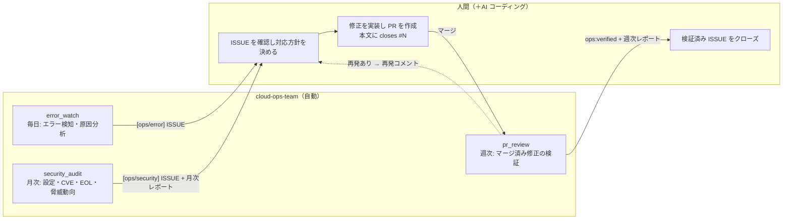
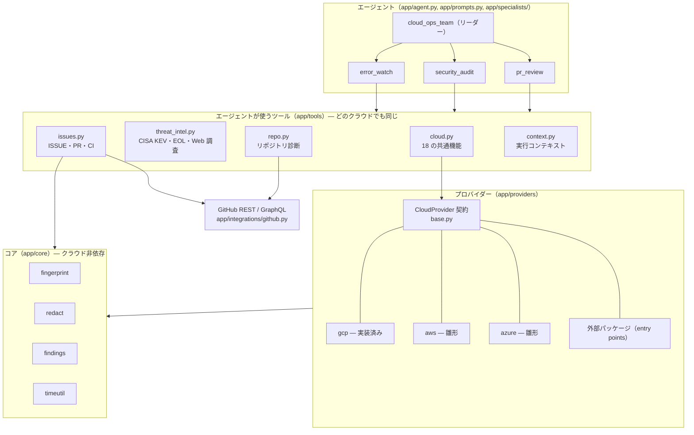
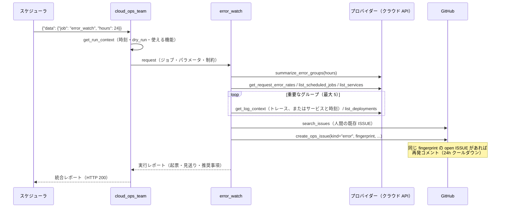
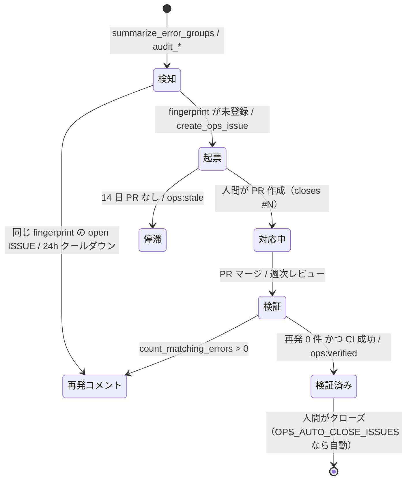

# アーキテクチャ

cloud-ops-team は、クラウド環境の定常的な運用保守を小さな AI エージェントチームで回します。
本番エラーを調査済みの GitHub ISSUE に変える **エラー監視**、**月次セキュリティ診断**、マージされた PR が本当に問題を直したかを確かめる
**週次レビュー** の 3 つです。修正は人間（＋AI コーディングツール）が行い、エージェントはクラウドを一切変更しません。

- フレームワーク: [ADK](https://adk.dev/) 2.x（Python）、[agents-cli](https://github.com/google/agents-cli) でスキャフォールド
- モデル: Gemini（既定 `gemini-3.8-flash`、`OPS_MODEL` で変更）
- クラウド: **Google Cloud**（実装済み）、**AWS** / **Azure**（雛形。[providers.md](providers.md)）
- ISSUE トラッカー: GitHub

English: [docs/en/architecture.md](en/architecture.md) ・ カスタマイズ: [customization.md](customization.md)

## 1. 人間とエージェントの役割分担



エージェントはクラウドに対して **読み取り専用** です。クラウドのリソースを変更できるツールは 1 つもありません。
GitHub に対しても、行うのは ISSUE の作成・コメント・ラベル付けだけです。ISSUE のクローズは `OPS_AUTO_CLOSE_ISSUES=true` のときに限られます。

## 2. レイヤー構成



| パッケージ | 責務 |
|---|---|
| `app/agent.py`, `app/prompts.py` | リーダーの組み立てと、全指示文の生成（クラウド名・言語・プロジェクト情報の差し込み） |
| `app/specialists/` | 担当ごとのモジュール（役割・指示文・ツール・ジョブ）。登録一覧から振り分けとスケジュールを自動生成 |
| `app/tools/` | モデルが呼ぶ関数。名前と docstring はクラウド非依存 |
| `app/providers/` | クラウドごとのアダプター（`CloudProvider` 契約の実装） |
| `app/core/` | フィンガープリント、マスキング、監査結果の共通形式、時刻ヘルパー |
| `app/integrations/github.py` | 最小限の GitHub クライアント（REST と GraphQL） |
| `app/config.py` | 環境変数から読み込む全設定 |
| `app/fast_api_app.py` | Pub/Sub 形式のトリガーを有効にした ADK サーバー |

## フォルダ構成

★ は、自分のプロジェクト向けに調整するときに主に触る場所です（[カスタマイズガイド](customization.md)）。

```
cloud-ops-team/
├── app/                          エージェント本体（Cloud Run にデプロイされる）
│   ├── agent.py                  リーダーを組み立てる（専門家は app/specialists から自動で読み込む）
│   ├── prompts.py                指示文の組み立て（クラウド名・言語・プロジェクト情報の差し込み）
│   ├── config.py                 .env / 環境変数から設定を読む
│   ├── fast_api_app.py           HTTP サーバー（スケジューラが呼ぶ /apps/app/trigger/pubsub）
│   ├── specialists/              ★ 担当（専門家）の定義。1 ファイル 1 担当
│   │   ├── base.py               Specialist / Job の型
│   │   ├── error_watch.py        エラー監視（指示文・ツール・ジョブ）
│   │   ├── security_audit.py     月次セキュリティ診断
│   │   ├── pr_review.py          週次の修正確認
│   │   ├── _template.py          新しい担当のひな形
│   │   └── __init__.py           登録一覧（SPECIALISTS）
│   ├── tools/                    ★ エージェントが呼ぶ関数（クラウド非依存）
│   │   ├── cloud.py              クラウド機能 18 種の窓口（プロバイダーに委譲）
│   │   ├── issues.py             GitHub の ISSUE / PR（お試しモード対応）
│   │   ├── threat_intel.py       CISA KEV・サポート期限・Web 脅威調査
│   │   ├── repo.py               リポジトリのセキュリティ設定
│   │   ├── context.py            実行コンテキスト（時刻・対象・使える機能）
│   │   └── __init__.py           担当ごとのツール一覧
│   ├── providers/                ★ クラウドごとの実装
│   │   ├── base.py               CloudProvider 契約（未実装は not_supported）
│   │   ├── gcp/                  Google Cloud（実装済み）
│   │   ├── aws/                  AWS（雛形）
│   │   └── azure/                Azure（雛形）
│   ├── core/                     共通部品（フィンガープリント・伏せ字・診断結果の形・時刻）
│   ├── integrations/github.py    GitHub API クライアント
│   └── app_utils/                agents-cli が生成したサーバー部品（A2A・セッション）
├── config/
│   └── ops-context.example.md    ★ プロジェクト固有情報のひな形（ops-context.md にコピー）
├── scripts/
│   ├── setup.py                  対話で .env を作る（make setup）
│   ├── doctor.py                 設定と権限を点検し、直し方を表示（make doctor）
│   ├── run_job.py                ジョブを 1 回実行し、ツール呼び出しを全部表示（make run）
│   ├── jobs.py                   ジョブと予定の一覧（make jobs）
│   ├── envrun.py                 .env を読み込んでコマンドを実行（Makefile が使用）
│   ├── trigger_local.sh          ローカルサーバーにスケジューラと同じ形式で送信
│   └── gcp/                      Google Cloud 用: 初期設定・デプロイ・スケジュール・権限付与
├── tests/
│   ├── unit/                     オフラインのテスト（契約・規約・設定）
│   ├── integration/              モデルを呼ぶテスト
│   └── eval/                     LLM 採点の評価データ
├── docs/                         設計・カスタマイズ・プロバイダー・設定・デプロイ（en/ に英語版）
├── Makefile                      よく使う操作の入口（make で一覧表示）
├── .env.example                  設定のひな形
└── Dockerfile                    Cloud Run 用イメージ（app/ と config/ を含む）
```

## 3. エージェント

| エージェント | 役割 | ツール | 出力 |
|---|---|---|---|
| `cloud_ops_team`（リーダー） | ジョブ（スケジューラの JSON か自然言語）を解釈して担当を呼び、統合レポートを書く | `get_run_context` ＋ 担当 3 人 | レポート |
| `error_watch` | エラーをフィンガープリント単位に集約し、5xx 率・失敗ジョブ・直近デプロイと突き合わせ、確度付きの原因仮説を立てて起票 | 15 個 | `[ops/error]` ISSUE |
| `security_audit` | IAM・認証情報・コンピュート・DB・ネットワーク・セキュリティサービス・検出結果・イメージ CVE・EOL・CISA KEV・Web 脅威調査を確認し、critical / high を起票 | 19 個 | `[ops/security]` ISSUE ＋ 月次レポート |
| `pr_review` | チームが起票した open ISSUE ごとに、紐づく PR・マージ状態・CI・マージ後の再発を検証 | 13 個 | `ops:verified` / `ops:stale` ＋ 週次レポート |

- **担当はコードではなく「定義」**です。各担当は `app/specialists/<名前>.py` の `Specialist`（役割・指示文・ツール・ジョブ）で、
  `app/specialists/__init__.py` に登録します。`app/agent.py` が登録された担当をサブエージェントに変換し、リーダーの担当一覧とジョブの振り分け表、
  Cloud Scheduler のジョブ（`scripts/jobs.py`）も同じ定義から作られます。担当やジョブの追加は 1 ファイルの変更で済みます。
- **プロジェクト固有の情報**: `config/ops-context.md`（任意、`OPS_CONTEXT_FILE`）の内容がすべての指示文に追加されます。
  サービス構成・重要度の考え方・既知のノイズを、プロンプトを編集せずに伝えられます。安全ルールより優先されることはありません。
- **担当は `mode="single_turn"` のサブエージェント**です。ADK がリーダーのツールとして公開し、リーダーと同じセッション内でインライン実行します。
  `AgentTool` で包む方式と比べて、担当のツール呼び出しが 1 件ずつイベントとしてストリームされます。そのため HTTP/SSE のクライアントや
  スケジューラの接続が無音にならず、`agents-cli run` / `eval generate` の 120 秒の読み取りタイムアウトにもかかりません。
  すべての呼び出しはトレースとセッション履歴に残ります。
- **指示文は文字列ではなく関数（InstructionProvider）**で渡します。文字列だと ADK が指示文中の JSON 例の `{...}` を変数展開しようとして壊れるためです。
  プロバイダーのプロファイル（表示名・対象の種別・CLI・用語集）、`CONFIG`、出力言語から組み立てます。
- **予算をプロンプトに明記**しています。1 回の実行でツール呼び出し 25〜30 回以内、ISSUE 検索 3 回、Web 調査 1 回、5〜8 分が目安です。
  Google Cloud での実測は、エラー監視が 60〜150 秒、月次診断が約 200 秒でツール呼び出し 27 回です。

## 4. プロバイダー抽象

担当が見るのは `app/tools/cloud.py` の 18 個の共通ツールだけです。各ツールは `OPS_CLOUD_PROVIDER` で選ばれたプロバイダーの同名メソッドを呼びます。

| 共通機能 | 正規化された意味 | Google Cloud | AWS（予定） | Azure（予定） |
|---|---|---|---|---|
| `summarize_error_groups`, `list_error_logs`, `get_log_context`, `count_matching_errors` | エラーログの集約と検索 | Cloud Logging | CloudWatch Logs Insights | Log Analytics（KQL） |
| `list_services` | コンピュートサービスと稼働状態 | Cloud Run サービス | ECS / Lambda / App Runner | App Service / Container Apps |
| `list_deployments` | サービスのリリース履歴 | Cloud Run リビジョン | ECS デプロイ / Lambda バージョン | Container Apps リビジョン |
| `list_scheduled_jobs` | 定期ジョブと失敗 | Cloud Scheduler | EventBridge Scheduler | Container Apps Jobs / Logic Apps |
| `list_databases` | マネージド DB（`engine` / `engine_version` 付き） | Cloud SQL | RDS / Aurora | PostgreSQL / MySQL / SQL |
| `get_request_error_rates` | サービスごとの 5xx / 4xx | Cloud Monitoring | CloudWatch メトリクス | Azure Monitor メトリクス |
| `get_alerting_setup` | アラートと死活監視 | アラートポリシー、稼働時間チェック | CloudWatch アラーム | アラートルール、可用性テスト |
| `audit_iam` | 公開アクセスや過剰な権限 | プロジェクトの IAM ポリシー | IAM、Access Analyzer | RBAC の割り当て |
| `audit_credentials` | 長期間有効な認証情報 | サービスアカウント鍵 | IAM アクセスキー | サービスプリンシパルのシークレット |
| `audit_compute` | 公開状態・実行 ID・平文の秘密情報・イメージの固定 | Cloud Run | ECS / Lambda | App Service / Container Apps |
| `audit_databases` | 公開状態・TLS・バックアップ・メンテナンス | Cloud SQL | RDS | Azure のデータベース |
| `audit_network` | インターネットに開いた重要ポート | VPC ファイアウォール | セキュリティグループ | NSG |
| `audit_security_services` | セキュリティ診断サービスの有効化状況 | SCC、コンテナスキャンなど | GuardDuty、Security Hub、Inspector | Defender for Cloud のプラン |
| `list_security_findings` | 有効な検出結果 | Security Command Center | Security Hub | Defender for Cloud |
| `scan_deployed_images` | 稼働中イメージの CVE | Artifact Analysis | Amazon Inspector | Defender for Containers |

設計ルール:

- **未実装は `not_supported` で、エラーではありません**。基底クラス `CloudProvider` が全機能を `{"status": "not_supported", ...}` で実装しているため、
  新しいプロバイダーは初日から使えます。PR レビュー・リポジトリ診断・CISA KEV・EOL・Web 調査はクラウドに依存せず動き、
  クラウドの機能は 1 つずつ実装できます。
- **エージェントは使える機能を知っています**。`get_run_context` が `capabilities` / `unsupported_capabilities` を返し、
  プロンプトの用語集にも未対応のツールが示されます。レポートには推測ではなく「確認できなかった項目」として書かれます。
- **結果の形を統一しています**。監査は `app.core.findings.result(...)` を返し、観測系は [providers.md](providers.md#共通形式の結果) に書かれたフィールドを使います。
- **プロバイダーは必要になってから読み込みます**。組み込みはキーで import し、外部パッケージは `cloud_ops_team.providers` の entry point で登録し、
  テストは `register_provider` を使います。
- **障害を隔離します**。プロバイダーの例外は `{"status": "error", ...}` に変換され、実行全体が止まることはありません。

## 5. ジョブとトリガー

スケジューラは Pub/Sub push と同じ形式のボディを ADK のトリガーエンドポイントに送ります。

```text
POST /apps/app/trigger/pubsub      Authorization: Bearer <呼び出し用 SA の OIDC トークン>
{"message": {"data": "<{"job":"error_watch","hours":24} の base64>", "attributes": {...}},
 "subscription": "projects/<project>/subscriptions/cloud-ops-error-watch"}
```

ADK（`trigger_sources=["pubsub"]`）がこれをデコードし、新しいセッションで
`{"data": {"job": "error_watch", "hours": 24}, "attributes": {...}}` をリーダーに渡して実行します。`subscription` はセッションの `user_id` になります。

| `job` | パラメータ | 既定の周期（変更可） | 担当 |
|---|---|---|---|
| `error_watch` | `hours`（`OPS_ERROR_LOOKBACK_HOURS`） | 毎日 08:00（`ERROR_WATCH_CRON`、`ERROR_WATCH_HOURS`） | error_watch |
| `weekly_pr_review` | `days`（7） | 月曜 09:00（`WEEKLY_CRON`） | pr_review |
| `monthly_security_audit` | `kev_days`（30） | 毎月 1 日 09:00（`MONTHLY_CRON`） | security_audit |
| `full` | — | 手動 | 3 人全員 |

Google Cloud では `scripts/gcp/setup_schedules.sh` が、Pub/Sub の push サブスクリプションではなく Cloud Scheduler の **HTTP** ジョブを作ります。
Pub/Sub push は配信の上限が 10 分で、応答がないと再配送されます。HTTP ジョブなら 30 分のデッドラインと再試行 0 回を設定できるので、
時間のかかる月次診断が二重に実行されることはありません。
周期・遡る時間・タイムゾーン・ジョブ名はすべて環境変数で変えられ、スクリプトを再実行すると既存のジョブがその場で更新されます
（[configuration.md](configuration.md#定期実行の設定make-gcp-schedule)）。
AWS では EventBridge Scheduler がサービスの URL を呼ぶ形、Azure では Container Apps のジョブか Logic App が同じ役割を担います。

自然言語の依頼も同じエンドポイントと `/run_sse` で受け付けます（例:「直近 24 時間のエラーを確認して」）。

## 6. エラー監視の流れ



## 7. ISSUE のライフサイクル



- タイトルの接頭辞: `[ops/error]` `[ops/security]` `[ops/report]`
- ラベル: すべての ISSUE に `ops-agent` と種別（`ops:error` / `ops:security` / `ops:report`）が付きます。
  さらに重要度ラベル（既定は `severity: critical` / `severity: high` / `severity: medium` / `severity: low`）と、
  領域ラベル（既定はエラーに `bug`、セキュリティに `security`）が付きます。重要度と領域のラベルは
  `OPS_SEVERITY_LABELS`・`OPS_ERROR_LABELS`・`OPS_SECURITY_LABELS` で自分のリポジトリに合わせられます。リポジトリにないラベルは自動で作成されます。
- 本文: 概要 / 影響範囲 / 証跡 / 原因分析 / 推奨対応 / 確認方法 の順に書き、末尾に非表示の `<!-- ops-meta: {...} -->` を付けます。
- 言語: `OPS_REPORT_LANGUAGE`（`ja` / `en`）で ISSUE・コメント・レポートの言語を切り替えます。

## 8. データベースなしの重複排除

GitHub の ISSUE そのものを台帳として使います。

1. ログメッセージをテンプレートに正規化します。UUID は `<uuid>`、時刻は `<ts>`、16 進 ID は `<hex>`、数値は `<n>` に置き換え、
   空白を詰めて 240 文字で切ります。
2. `fingerprint = sha1(resource_type | service | template)[:16]` で指紋を作ります（`app/core/fingerprint.py`）。
   式を変えると open な ISSUE がすべて再起票されてしまうため、基準値をユニットテストで固定しています。
3. fingerprint・service・`search_text`・provider・target を ISSUE の `ops-meta` ブロックに保存します。
4. 起票の前に、open の ISSUE と 30 日以内にクローズされた ISSUE を走査します。**fingerprint と target の両方**が一致したものだけを同一とみなすので、
   staging と本番で 1 つのリポジトリを共有できます。マルチクラウド対応より前に起票された ISSUE の `project` キーは target として扱います。
5. 一致した ISSUE が open なら再発コメントを付けます。ただし `OPS_RECURRENCE_COOLDOWN_HOURS` 以内に更新済みなら省略します。
   最近クローズされた ISSUE と一致した場合は、新しい ISSUE に関連として記載します。

`search_text` は、週次レビューがマージ後の再発件数を数えるときに使う文字列です。リクエストログでは URL パスの最初の ID らしき部分の手前まで
（例: `/api/v1/worker/sns-plans`）、それ以外ではメッセージ中で最も長い英字の並びを使います。
セキュリティの検出結果は `"<check_id>:<resource>"` を fingerprint にします。

## 9. 安全設計

| 層 | 仕組み |
|---|---|
| 権限 | 監視対象のクラウドには閲覧系・レビュー系のロールだけを付けます（`scripts/gcp/grant_target_roles.sh`）。変更系の API を呼ぶツールは存在しません |
| 入口 | サービスは未認証のリクエストを拒否します。スケジューラは専用サービスアカウントの OIDC トークンで呼び出します |
| 書き込み | `OPS_DRY_RUN=true`（既定、お試しモード）では GitHub に書き込まずプレビューだけを返します。クローズは `OPS_AUTO_CLOSE_ISSUES=true` のときだけ |
| 影響範囲 | 1 回の実行で新しく起票するのは `OPS_MAX_ISSUES_PER_RUN`（既定 10）件まで。再発コメントはクールダウン期間ごとに 1 ISSUE 1 回まで |
| データ | `app/core/redact.py` が、トークン（Bearer、JWT、Stripe、Google、GitHub、Slack）、秘密鍵、`password=` 形式の値、URL 内の認証情報、メールアドレス（サービスアカウントを除く）、カード番号、公開 IP の末尾をマスクします。環境変数は名前だけを返します |
| プロンプト | 変更の依頼は断って ISSUE 化を提案します。根拠を必ず添え、個人情報を出さず、`error` / `not_supported` は正直に報告します |
| 秘密情報 | GitHub トークンはシークレットマネージャーに保存し、`GITHUB_TOKEN` として注入します。`.env` はアップロードしません |

## 10. 認証

| 対象 | ローカル開発 | 本番（Google Cloud） |
|---|---|---|
| Gemini | ADC（Vertex AI）または `GEMINI_API_KEY` | ランタイム SA（`roles/aiplatform.user`） |
| Google Cloud API | ADC、または `OPS_GCP_AUTH=gcloud` で `gcloud auth print-access-token` のトークンを借用 | ランタイム SA（監視対象に閲覧系ロール） |
| GitHub | `GITHUB_TOKEN`、無ければ `gh auth token` | Secret Manager → `GITHUB_TOKEN` |

Google Cloud の REST 呼び出しには `x-goog-user-project: <監視対象>` を付けるため、呼び出す側には監視対象で
`roles/serviceusage.serviceUsageConsumer` が必要です。
モデルを動かすプロジェクト（`GOOGLE_CLOUD_PROJECT`）と監視対象（`OPS_TARGET`）は別のプロジェクトでもかまいません。
AWS / Azure のプロバイダーは、各 SDK の既定の認証チェーン（`boto3`、`DefaultAzureCredential`）を使う想定です。

## 11. 設定

すべての設定項目は [configuration.md](configuration.md) にあります。最低限必要なのは
`OPS_CLOUD_PROVIDER`、`OPS_TARGET`、`OPS_TARGET_REGION`、`GITHUB_REPO`、`OPS_DRY_RUN`、`OPS_REPORT_LANGUAGE` です。

## 12. Google Cloud へのデプロイ

| 項目 | 値 | 理由 |
|---|---|---|
| Cloud Run | 1 vCPU、2 GiB、同時実行 4、インスタンス 0〜2、タイムアウト 1800 秒、未認証アクセス不可 | 1 つのジョブは 1 つの長いリクエストです。ジョブがないときはインスタンス 0 まで縮小します |
| 実行 ID | 専用のサービスアカウント | 既定のコンピュート SA は使いません（診断自体がそれを指摘するため） |
| スケジューラ | HTTP ターゲット、OIDC、デッドライン 1800 秒、再試行 0 回 | 長いジョブが二重に実行されないようにするため |
| ビルド | `gcloud run deploy --source .`（Dockerfile: python:3.12-slim ＋ uv） | `scripts/gcp/deploy_cloud_run.sh` はサービスに必要な環境変数だけを渡します |
| セッション | メモリ内 | 1 回の実行が 1 つのセッションで完結し、引き継ぐものがないため |

手順は [deployment-gcp.md](deployment-gcp.md) にまとめています。

## 13. 動作の確認（可観測性）

- **実行されたか**: トリガーエンドポイントのリクエストログで確認します。レイテンシがそのまま実行時間です。
- **エージェントが何をしたか**: OpenTelemetry 経由の Cloud Trace（`otel_to_cloud=True`、メッセージ本文は記録しません）、
  インスタンスが生きている間は ADK のセッション API、ローカルでは `scripts/run_job.py`（すべてのツール呼び出しを時刻付きで表示）で確認します。
- **結果**: `ops-agent` ラベルの付いた GitHub ISSUE です。週次・月次のレポートもここに残ります。

## 14. テストと評価

| 種類 | 場所 | 内容 |
|---|---|---|
| ユニット | `tests/unit/` | フィンガープリントの基準値、マスキング、メタデータの往復、ラベル、設定、プロバイダーの登録と契約、雛形プロバイダー、ツールの規約（docstring・型ヒント・既定値なし）、プロバイダーごとのプロンプト生成、監視対象単位の重複排除、多言語対応 |
| 結合 | `tests/integration/` | ストリーミング応答と A2A サーバー（モデルを呼びます） |
| 評価 | `tests/eval/` | 基本の 5 ケースと、調整に使わない検証用（ホールドアウト）の 2 ケースを運用向けの LLM 採点基準（正しい担当を呼んだか、根拠、レポートの構成、お試しモードでの正直さ、安全性）で採点します |

CI（`.github/workflows/ci.yml`）は、プルリクエストごとに lint・型チェック・ユニットテストを実行します。

## 15. 拡張ポイント

コード付きの手順は [カスタマイズガイド](customization.md) にあります。要点は次のとおりです。

- **プロジェクトの事情を教える**: `config/ops-context.md`（コード変更なし）
- **担当を追加**: `app/specialists/_template.py` をコピーして役割・指示文・ツール・ジョブを書き、`SPECIALISTS` に登録。リーダーの振り分けとスケジュールは自動で追従
- **ジョブを追加**: 担当に `Job` を追加（`schedule`・`schedule_key`・`scheduled_params`）。時刻は `<キー>_CRON` で上書き可能
- **ツールを追加**: `app/tools/` に関数（型ヒント・既定値なし・モデルが判断に使える docstring・`status` 付き dict を返す・API エラーで例外を投げない）を作り、担当の `tools` に追加。GitHub への書き込みは `CONFIG.dry_run` を尊重
- **共通機能を追加**: `CloudProvider` にメソッド（`not_supported` を返す）、`app/tools/cloud.py` にラッパー、各プロファイルに用語を追加し、実装できるクラウドから実装。契約テストが 3 点がそろっているかを検査
- **クラウドを追加**: `CloudProvider` を継承して機能を 1 つずつ実装（[providers.md](providers.md)）
- **ISSUE トラッカーを変更**: GitHub に依存しているのは `app/tools/issues.py` と `app/tools/repo.py` だけ
- **モデルを変更**: `OPS_MODEL` で任意の Gemini モデルを選択。Gemini 以外は `app/agent.py` で ADK の `LiteLlm` を使う

## 16. 既知の制約

- `agents-cli run` と `agents-cli eval generate` には 120 秒の固定の読み取りタイムアウトがあります。1 つのツール呼び出しがそれより長く無音だと、
  クライアントの接続が切れます。時間のかかるジョブをローカルで動かすときは `scripts/run_job.py` を使います。
- セッションはメモリ内にあります。インスタンスが複数あると、セッション API で実行履歴を引けないことがあります。
- AWS / Azure のプロバイダーは雛形です。実装されるまで、クラウドの機能はすべて `not_supported` になります。
- プロンプトは日本語で書かれています。出力言語は `OPS_REPORT_LANGUAGE` で選べます。
