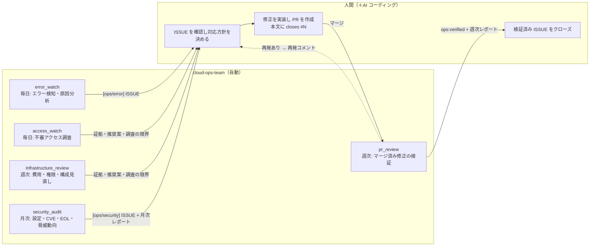
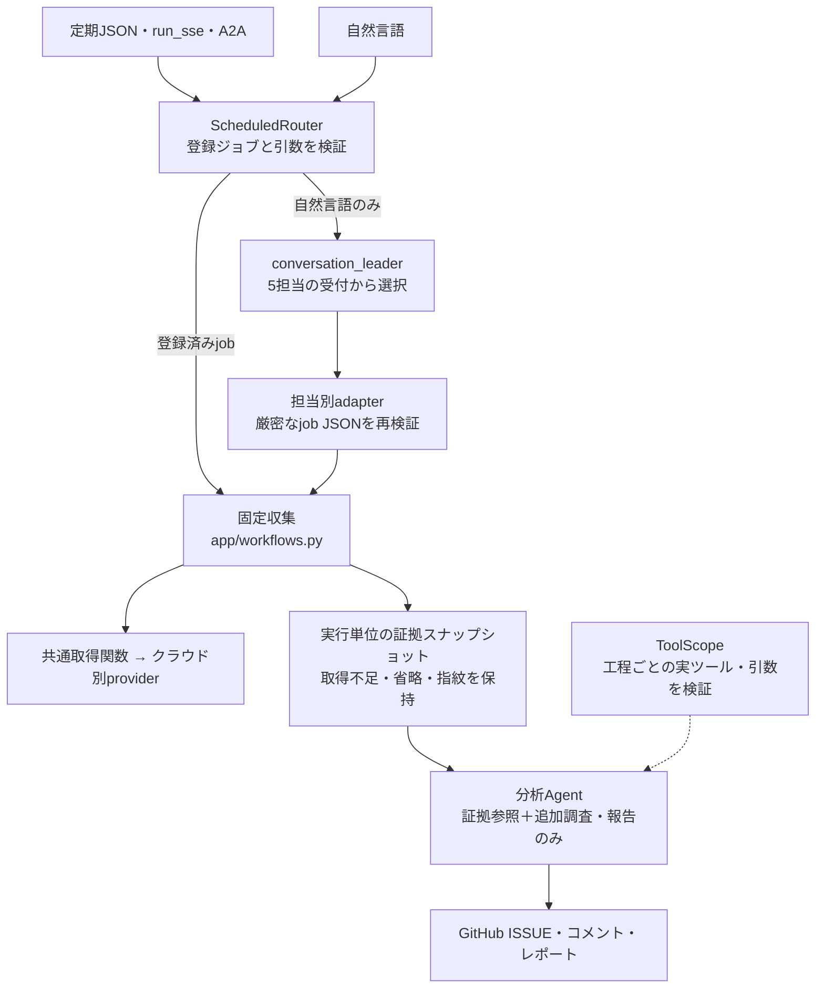
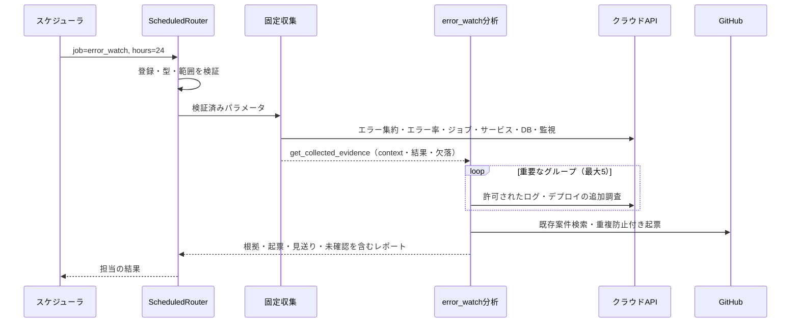
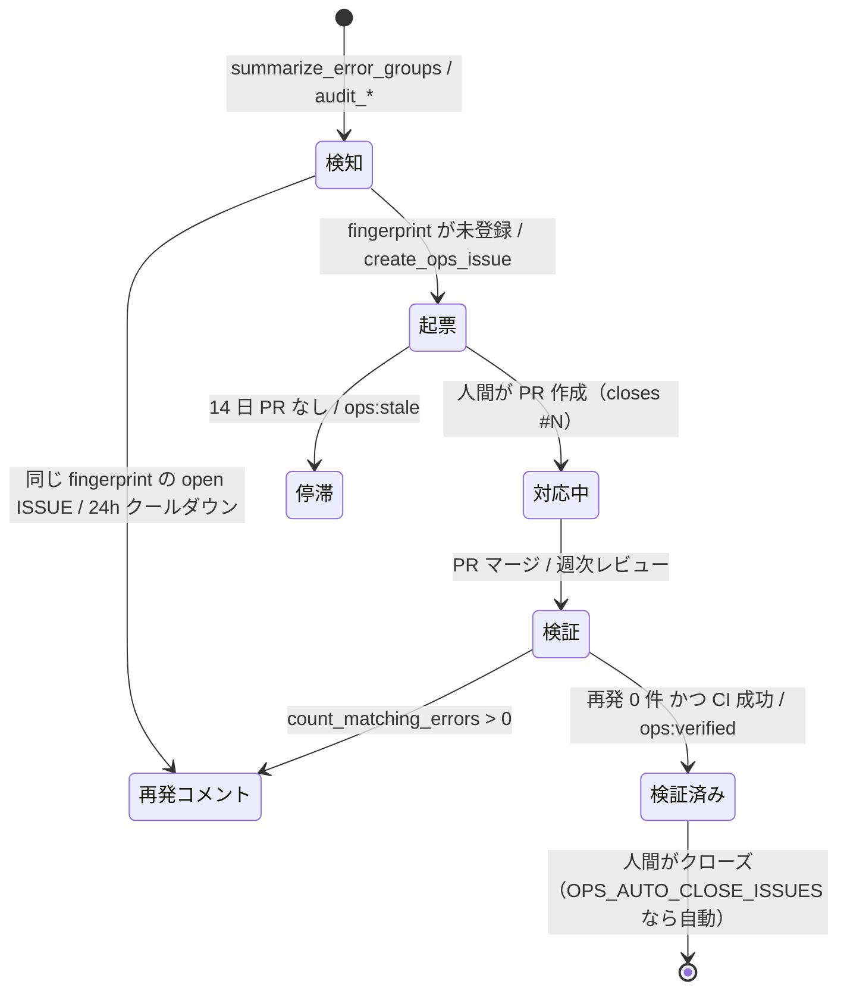

# アーキテクチャ

cloud-ops-team は、クラウド環境の定常的な運用保守を小さな AI エージェントチームで回します。
本番エラーを調査する **エラー監視**、毎日の **不審アクセス調査**、毎週の **インフラ見直し**、
**月次セキュリティ診断**、マージされた PR の修正を確かめる **週次レビュー** の 5 つです。修正は人間（＋AI コーディングツール）が行い、エージェントはクラウドを一切変更しません。

- フレームワーク: [ADK](https://adk.dev/) 2.x（Python）、[agents-cli](https://github.com/google/agents-cli) でスキャフォールド
- モデル: Gemini（既定 `gemini-3.8-flash`、`OPS_MODEL` で変更）
- クラウド: **Google Cloud**（実装済み）、**AWS** / **Azure**（雛形。[providers.md](providers.md)）
- ISSUE トラッカー: GitHub

English: [docs/en/architecture.md](en/architecture.md) ・ カスタマイズ: [customization.md](customization.md)

## 1. 人間とエージェントの役割分担



エージェントはクラウドに対して **読み取り専用** です。クラウドのリソースを変更できるツールは 1 つもありません。
GitHub に対しても、行うのは ISSUE の作成・コメント・ラベル付けだけです。ISSUE のクローズは `OPS_AUTO_CLOSE_ISSUES=true` のときに限られます。

## 2. レイヤー構成



| パッケージ | 責務 |
|---|---|
| `app/agent.py` | 全入口で共通のルーター、対話受付、ジョブごとの分析Agentを組み立てる |
| `app/routing.py` | 登録ジョブ・別名と引数の厳密な検証、直接振り分け、実行ごとの文脈分離 |
| `app/workflows.py` | 固定収集、伏せ字・サイズ制限付きの証拠、分析工程から収集用ツールを除外 |
| `app/tool_scope.py` | 工程別ツールの実体・引数の実行境界、限定したcontextとクラウド用語集の対象 |
| `app/prompts.py` | 収集指示を分析手順へ置換し、公開ツールだけの説明・用語集と報告要件を生成 |
| `app/specialists/` | 担当の役割・分析要件・ツールの母集団・ジョブ・定期実行の定義 |
| `app/tools/`, `app/providers/` | クラウド共通の取得関数とクラウド別アダプター。全関数をモデルへ公開するものではない |
| `app/core/`, `app/integrations/github.py` | 指紋・伏せ字・共通結果形式・時刻と、GitHub REST/GraphQL |
| `scripts/evaluate_routing.py`, `tests/eval/routing/` | 旧構成と候補の実行記録を同条件で比較し、欠落や権限違反を不合格にする |
| `app/fast_api_app.py`, `app/app_utils/a2a.py` | HTTP/SSE・Pub/Sub形式・A2Aのサーバー入口。いずれも同じrootを使用 |

## フォルダ構成

★ は、自分のプロジェクト向けに調整するときに主に触る場所です（[カスタマイズガイド](customization.md)）。

```
cloud-ops-team/
├── app/                          エージェント本体（Cloud Run にデプロイされる）
│   ├── agent.py                  ルーター・対話窓口・分析担当を組み立てる
│   ├── routing.py                登録ジョブ・引数の検証と直接振り分け
│   ├── workflows.py              固定収集、証拠、分析用ツールの切り分け
│   ├── tool_scope.py             工程別ツールと引数の実行境界
│   ├── prompts.py                指示文の組み立て（クラウド名・言語・プロジェクト情報の差し込み）
│   ├── config.py                 .env / 環境変数から設定を読む
│   ├── fast_api_app.py           HTTP サーバー（スケジューラが呼ぶ /apps/app/trigger/pubsub）
│   ├── specialists/              ★ 担当（専門家）の定義。1 ファイル 1 担当
│   │   ├── base.py               Specialist / Job の型
│   │   ├── error_watch.py        エラー監視（指示文・ツール・ジョブ）
│   │   ├── access_watch.py       毎日の不審アクセス調査
│   │   ├── infrastructure_review.py  週次の費用・権限・構成見直し
│   │   ├── security_audit.py     月次セキュリティ診断
│   │   ├── pr_review.py          週次の修正確認
│   │   ├── _template.py          新しい担当のひな形
│   │   └── __init__.py           登録一覧（SPECIALISTS）
│   ├── tools/                    ★ エージェントが呼ぶ関数（クラウド非依存）
│   │   ├── cloud.py              クラウド機能 20 種の窓口（プロバイダーに委譲）
│   │   ├── issues.py             GitHub の ISSUE / PR（お試しモード対応）
│   │   ├── threat_intel.py       CISA KEV・サポート期限・Web 脅威調査
│   │   ├── repo.py               リポジトリのセキュリティ設定
│   │   ├── context.py            実行コンテキスト（時刻・対象・使える機能）
│   │   └── __init__.py           担当ごとのツール一覧
│   ├── providers/                ★ クラウドごとの実装
│   │   ├── base.py               CloudProvider 契約（未実装は not_supported）
│   │   ├── gcp/                  Google Cloud（実装済み）
│   │   ├── aws/                  AWS（雛形）
│   │   └── azure/                Azure（雛形）
│   ├── core/                     共通部品（フィンガープリント・伏せ字・診断結果の形・時刻）
│   ├── integrations/github.py    GitHub API クライアント
│   └── app_utils/                agents-cli が生成したサーバー部品（A2A・セッション）
├── config/
│   └── ops-context.example.md    ★ プロジェクト固有情報のひな形（ops-context.md にコピー）
├── scripts/
│   ├── setup.py                  対話で .env を作る（make setup）
│   ├── doctor.py                 設定と権限を点検し、直し方を表示（make doctor）
│   ├── run_job.py                ジョブを 1 回実行し、ツール呼び出しを全部表示（make run）
│   ├── jobs.py                   ジョブと予定の一覧（make jobs）
│   ├── envrun.py                 .env を読み込んでコマンドを実行（Makefile が使用）
│   ├── trigger_local.sh          ローカルサーバーにスケジューラと同じ形式で送信
│   └── gcp/                      Google Cloud 用: 初期設定・デプロイ・スケジュール・権限付与
├── tests/
│   ├── unit/                     オフラインのテスト（契約・規約・設定）
│   ├── integration/              モデルを呼ぶテスト
│   └── eval/                     LLM 採点の評価データ
├── docs/                         設計・カスタマイズ・プロバイダー・設定・デプロイ（en/ に英語版）
├── Makefile                      よく使う操作の入口（make で一覧表示）
├── .env.example                  設定のひな形
└── Dockerfile                    Cloud Run 用イメージ（app/ と config/ を含む）
```

## 3. 受付・固定収集・分析の分担

`cloud_ops_team`はLLMではなく`ScheduledRouter`です。定期JSONから登録済みの担当へ直接進み、`full`は登録順に逐次実行します。
過去の対話やツール結果に含まれるジョブ指定は使いません。各ジョブの分析には、その実行の要求と証拠だけを渡します。
自然言語の場合だけ`conversation_leader`が5個の担当受付から選びます。受付は紐づいた担当の厳密なJSONだけを受け付け、同じ固定収集へ接続します。
`full`や自然言語で複数担当を実行する場合も、起票上限は1回の実行全体で共有します。起票カウンターだけを排他制御し、担当の履歴やその他の状態は共有しません。

| 担当 | プログラムが固定収集する情報 | 分析AIに残す主な仕事 | 従来→分析時のツール数 |
|---|---|---|---|
| `error_watch` | context、エラー集約、エラー率、定期ジョブ、サービス、DB、監視設定 | 最大5群の追加調査、原因候補、重複確認・起票 | 15 → 9 |
| `security_audit` | context、IAM・鍵・構成・DB・ネットワーク監査、CVE、検出、監視、リポジトリ、KEV | 最大6件のEOL確認、1回のWeb調査、根拠付きの起票・報告 | 19 → 8 |
| `pr_review` | context、open案件、期間内PR、mainのCI | 案件ごとの紐付きPR・再発の確認、コメント・ラベル・週次報告 | 13 → 10 |
| `access_watch` | context、不審アクセスの証拠と取得範囲 | 必要な追加確認、正当性未確認・調査不足を維持した起票・報告 | 8 → 7 |
| `infrastructure_review` | context、推薦、権限・鍵・構成・DB・ネットワーク監査、監視、サービス・DB一覧 | 証拠の照合、変更影響・確認・復旧案、重複確認・報告 | 14 → 5 |

数には`get_collected_evidence`を含みます。担当定義の`tools`は母集団であり、そのままモデルへ渡す一覧ではありません。
固定収集は各APIを所定の引数で一度ずつ呼び、例外や未対応を取得不足として保存します。収集結果は伏せ字・サイズ制限・SHA-256付きのスナップショットで、分析中に取得不足を正常へ書き換えません。
このスナップショットは実行内の証拠であり、永続的な実行履歴基盤の完成を意味しません。

分析Agentの実ツール・schema・docstring・用語集・contextのcapabilitiesを工程に限定します。
`ToolScope`のcallbackと公開関数wrapperが、未許可ツール、未知引数、不正な型、過大な取得量・期間、別対象のリソースや別リポジトリ検索を実行前に拒否します。
分析工程では`get_collected_evidence`の実際の読取が正常に返るまで、追加調査・起票・報告も実行側で拒否します。部分取得・失敗を含む証拠の読取後は、その不足を報告できます。
指示文は関数（InstructionProvider）として生成し、収集済み手順を分析用手順に置き換えたうえで、担当の根拠・安全・報告要件を維持します。

`config/ops-context.md`の前提知識は指示文に追加できますが、実行権限や対象・引数の検証を変更しません。
モデル・API待ち時間は残るため、ツール削減だけで完了時間を保証しません。定期実行の既定期限は30分です。

## 4. プロバイダー抽象

固定収集と必要な追加調査は `app/tools/cloud.py` の20個の共通機能から選びます。各担当のモデルには工程で必要なものだけを公開します。各関数は `OPS_CLOUD_PROVIDER` で選ばれたプロバイダーの同名メソッドを呼びます。

| 共通機能 | 正規化された意味 | Google Cloud | AWS（予定） | Azure（予定） |
|---|---|---|---|---|
| `summarize_error_groups`, `list_error_logs`, `get_log_context`, `count_matching_errors` | エラーログの集約と検索 | Cloud Logging | CloudWatch Logs Insights | Log Analytics（KQL） |
| `list_services` | コンピュートサービスと稼働状態 | Cloud Run サービス | ECS / Lambda / App Runner | App Service / Container Apps |
| `list_deployments` | サービスのリリース履歴 | Cloud Run リビジョン | ECS デプロイ / Lambda バージョン | Container Apps リビジョン |
| `list_scheduled_jobs` | 定期ジョブと失敗 | Cloud Scheduler | EventBridge Scheduler | Container Apps Jobs / Logic Apps |
| `list_databases` | マネージド DB（`engine` / `engine_version` 付き） | Cloud SQL | RDS / Aurora | PostgreSQL / MySQL / SQL |
| `get_request_error_rates` | サービスごとの 5xx / 4xx | Cloud Monitoring | CloudWatch メトリクス | Azure Monitor メトリクス |
| `get_alerting_setup` | アラートと死活監視 | アラートポリシー、稼働時間チェック | CloudWatch アラーム | アラートルール、可用性テスト |
| `audit_iam` | 公開アクセスや過剰な権限 | プロジェクトの IAM ポリシー | IAM、Access Analyzer | RBAC の割り当て |
| `audit_credentials` | 長期間有効な認証情報 | サービスアカウント鍵 | IAM アクセスキー | サービスプリンシパルのシークレット |
| `audit_compute` | 公開状態・実行 ID・平文の秘密情報・イメージの固定 | Cloud Run | ECS / Lambda | App Service / Container Apps |
| `audit_databases` | 公開状態・TLS・バックアップ・メンテナンス | Cloud SQL | RDS | Azure のデータベース |
| `audit_network` | インターネットに開いた重要ポート | VPC ファイアウォール | セキュリティグループ | NSG |
| `audit_security_services` | セキュリティ診断サービスの有効化状況 | SCC、コンテナスキャンなど | GuardDuty、Security Hub、Inspector | Defender for Cloud のプラン |
| `list_security_findings` | 有効な検出結果 | Security Command Center | Security Hub | Defender for Cloud |
| `scan_deployed_images` | 稼働中イメージの CVE | Artifact Analysis | Amazon Inspector | Defender for Containers |
| `investigate_access` | 不審なアクセスの兆候と取得範囲 | Cloud Audit Logs・HTTP アクセスログ・Cloud Armor ログ | 未実装 | 未実装 |
| `list_optimization_recommendations` | 費用・権限の改善提案 | Recommender（Cloud Run・Cloud SQL・IAM） | 未実装 | 未実装 |

設計ルール:

- **未実装は `not_supported` で、エラーではありません**。基底クラス `CloudProvider` が全機能を `{"status": "not_supported", ...}` で実装しているため、
  新しいプロバイダーは初日から使えます。PR レビュー・リポジトリ診断・CISA KEV・EOL・Web 調査はクラウドに依存せず動き、
  クラウドの機能は 1 つずつ実装できます。
- **エージェントは使える機能を知っています**。実行contextの `capabilities` / `unsupported_capabilities` は担当・工程に絞られ、
  プロンプトの用語集にも未対応のツールが示されます。レポートには推測ではなく「確認できなかった項目」として書かれます。
- **結果の形を統一しています**。監査は `app.core.findings.result(...)` を返し、観測系は [providers.md](providers.md#共通形式の結果) に書かれたフィールドを使います。
- **プロバイダーは必要になってから読み込みます**。組み込みはキーで import し、外部パッケージは `cloud_ops_team.providers` の entry point で登録し、
  テストは `register_provider` を使います。
- **障害を隔離します**。プロバイダーの例外は `{"status": "error", ...}` に変換され、実行全体が止まることはありません。

## 5. ジョブとトリガー

スケジューラは Pub/Sub push と同じ形式のボディを ADK のトリガーエンドポイントに送ります。

```text
POST /apps/app/trigger/pubsub      Authorization: Bearer <呼び出し用 SA の OIDC トークン>
{"message": {"data": "<{"job":"error_watch","hours":24} の base64>", "attributes": {...}},
 "subscription": "projects/<project>/subscriptions/cloud-ops-error-watch"}
```

ADK（`trigger_sources=["pubsub"]`）がこれをデコードし、新しいセッションで
`{"data": {"job": "error_watch", "hours": 24}, "attributes": {...}}` を`ScheduledRouter`に渡して実行します。`subscription` はセッションの `user_id` になります。

| `job` | パラメータ | 既定の周期（変更可） | 担当 |
|---|---|---|---|
| `error_watch` | `hours`（`OPS_ERROR_LOOKBACK_HOURS`） | 毎日 08:00（`ERROR_WATCH_CRON`、`ERROR_WATCH_HOURS`） | error_watch |
| `access_watch` | `hours`（24） | 毎日 08:30（`ACCESS_WATCH_CRON`、`ACCESS_WATCH_HOURS`） | access_watch |
| `infrastructure_review` | — | 月曜 10:00（`INFRASTRUCTURE_REVIEW_CRON`） | infrastructure_review |
| `weekly_pr_review` | `days`（7） | 月曜 09:00（`WEEKLY_CRON`） | pr_review |
| `monthly_security_audit` | `kev_days`（30） | 毎月 1 日 09:00（`MONTHLY_CRON`） | security_audit |
| `full` | — | 手動 | 5 人全員 |

Google Cloud では `scripts/gcp/setup_schedules.sh` が、Pub/Sub の push サブスクリプションではなく Cloud Scheduler の **HTTP** ジョブを作ります。
Pub/Sub push は配信の上限が 10 分で、応答がないと再配送されます。HTTP ジョブなら 30 分のデッドラインと再試行 0 回を設定できるので、
時間のかかる月次診断が二重に実行されることはありません。
周期・遡る時間・タイムゾーン・ジョブ名はすべて環境変数で変えられ、スクリプトを再実行すると既存のジョブがその場で更新されます
（[configuration.md](configuration.md#定期実行の設定make-gcp-schedule)）。
AWS では EventBridge Scheduler がサービスの URL を呼ぶ形、Azure では Container Apps のジョブか Logic App が同じ役割を担います。

直接JSON・Pub/Sub形式・`/run_sse`・A2Aは共通rootを通ります。未知job、重複JSONフィールド、未知パラメータ、数値文字列・bool、範囲外の値、別target/repoの指定を拒否します。
`hours`は1〜168、`days`は1〜90、`kev_days`は1〜365の整数です。自然言語では対話窓口が担当の受付へ厳密JSONを送り、その後は同じ検証・固定収集・分析を実行します。

### 不審アクセス調査とインフラ見直しの判断境界

アクセス調査は定期レビューです。権限拒否、探索リクエスト、IAM などの重要操作を、侵入成功とは区別します。
観測期間・対象・証拠・確度・追加確認を報告し、API エラー・未収集・取得上限・サンプリングなどの不確実性を残します。
「該当ログを検出しなかった」は「不正アクセスがない」の証明にはなりません。遮断や自動修復は行いません。
HTTP応答コードだけで遮断成功・安全性を判定せず、IAM変更の正当性は承認履歴と照合するまで未確認とします。

インフラ見直しは対象リージョンの Cloud Run・Cloud SQL と `global` の IAM Recommender、既存の IAM・認証情報・構成監査を使います。
推奨事項がない場合も、未生成・権限不足・対象範囲外を区別します。節約額は API の値がある場合だけ単位・期間とともに提示します。
可用性・ピーク時の性能・待機系の用途を考慮し、提案ごとに根拠・期待効果・変更リスク・実施手順・確認方法・ロールバック案を記載します。
手順は変更対象と設定値を文章で示し、未検証のコマンドやTerraformコードは生成しません。推薦0件を最適構成や削減額0円と解釈せず、変更影響は依存関係の確認まで未確認とします。
修正案の必須要件や付与範囲も検証対象です。上位フォルダ・組織への権限移動を縮小案にせず、接続方式などの未検証の詳細は公式仕様と現行構成を照合して選定する確認事項として記録します。
定期実行では担当のレポートを正本とし、ルーターがその結果を返します。別のLLMによる再評価・再要約を挟みません。

両担当は既存の dry-run・伏せ字・ISSUE 上限を使います。critical / high のセキュリティ検出には `kind="security"` と
`check_id:resource` を使い、月次診断と同じ問題を二重起票しません。費用改善はレポートにまとめます。
実クラウド上での取得権限・ログ収集・定期実行の確認は、オフラインテストとは別に導入先で行います。

## 6. エラー監視の流れ



担当を選ぶモデル呼び出しと、収集済みの一覧取得ツールは定期実行の分析工程にありません。

## 7. ISSUE のライフサイクル



- タイトルの接頭辞: `[ops/error]` `[ops/security]` `[ops/report]`
- ラベル: すべての ISSUE に `ops-agent` と種別（`ops:error` / `ops:security` / `ops:report`）が付きます。
  さらに重要度ラベル（既定は `severity: critical` / `severity: high` / `severity: medium` / `severity: low`）と、
  領域ラベル（既定はエラーに `bug`、セキュリティに `security`）が付きます。重要度と領域のラベルは
  `OPS_SEVERITY_LABELS`・`OPS_ERROR_LABELS`・`OPS_SECURITY_LABELS` で自分のリポジトリに合わせられます。リポジトリにないラベルは自動で作成されます。
- 本文: 概要 / 影響範囲 / 証跡 / 原因分析 / 推奨対応 / 確認方法 の順に書き、末尾に非表示の `<!-- ops-meta: {...} -->` を付けます。
- 言語: `OPS_REPORT_LANGUAGE`（`ja` / `en`）で ISSUE・コメント・レポートの言語を切り替えます。

## 8. データベースなしの重複排除

GitHub の ISSUE そのものを台帳として使います。

1. ログメッセージをテンプレートに正規化します。UUID は `<uuid>`、時刻は `<ts>`、16 進 ID は `<hex>`、数値は `<n>` に置き換え、
   空白を詰めて 240 文字で切ります。
2. `fingerprint = sha1(resource_type | service | template)[:16]` で指紋を作ります（`app/core/fingerprint.py`）。
   式を変えると open な ISSUE がすべて再起票されてしまうため、基準値をユニットテストで固定しています。
3. fingerprint・service・`search_text`・provider・target を ISSUE の `ops-meta` ブロックに保存します。
4. 起票の前に、open の ISSUE と 30 日以内にクローズされた ISSUE を走査します。**fingerprint と target の両方**が一致したものだけを同一とみなすので、
   staging と本番で 1 つのリポジトリを共有できます。マルチクラウド対応より前に起票された ISSUE の `project` キーは target として扱います。
5. 一致した ISSUE が open なら再発コメントを付けます。ただし `OPS_RECURRENCE_COOLDOWN_HOURS` 以内に更新済みなら省略します。
   最近クローズされた ISSUE と一致した場合は、新しい ISSUE に関連として記載します。

`search_text` は、週次レビューがマージ後の再発件数を数えるときに使う文字列です。リクエストログでは URL パスの最初の ID らしき部分の手前まで
（例: `/api/v1/worker/sns-plans`）、それ以外ではメッセージ中で最も長い英字の並びを使います。
セキュリティの検出結果は `"<check_id>:<resource>"` を fingerprint にします。

## 9. 安全設計

| 層 | 仕組み |
|---|---|
| 権限 | 監視対象のクラウドには閲覧系・レビュー系のロールだけを付けます（`scripts/gcp/grant_target_roles.sh`）。変更系の API を呼ぶツールは存在しません |
| ジョブ・ツール境界 | 全入口で登録ジョブと引数を検証し、工程外ツール・別対象・過大取得をcallbackと関数wrapperで拒否します |
| 入口 | サービスは未認証のリクエストを拒否します。スケジューラは専用サービスアカウントの OIDC トークンで呼び出します |
| 書き込み | `OPS_DRY_RUN=true`（既定、お試しモード）では GitHub に書き込まずプレビューだけを返します。クローズは `OPS_AUTO_CLOSE_ISSUES=true` のときだけ |
| 影響範囲 | 1 回の実行で新しく起票するのは `OPS_MAX_ISSUES_PER_RUN`（既定 10）件まで。再発コメントはクールダウン期間ごとに 1 ISSUE 1 回まで |
| データ | `app/core/redact.py` が、トークン（Bearer、JWT、Stripe、Google、GitHub、Slack）、秘密鍵、`password=` 形式の値、URL 内の認証情報、メールアドレス（サービスアカウントを除く）、カード番号、公開 IP の末尾をマスクします。環境変数は名前だけを返します |
| プロンプト | 変更の依頼は断って ISSUE 化を提案します。根拠を必ず添え、個人情報を出さず、`error` / `not_supported` は正直に報告します |
| 秘密情報 | GitHub トークンはシークレットマネージャーに保存し、`GITHUB_TOKEN` として注入します。`.env` はアップロードしません |

## 10. 認証

| 対象 | ローカル開発 | 本番（Google Cloud） |
|---|---|---|
| Gemini | ADC（Vertex AI）または `GEMINI_API_KEY` | ランタイム SA（`roles/aiplatform.user`） |
| Google Cloud API | ADC、または `OPS_GCP_AUTH=gcloud` で `gcloud auth print-access-token` のトークンを借用 | ランタイム SA（監視対象に閲覧系ロール） |
| GitHub | `GITHUB_TOKEN`、無ければ `gh auth token` | Secret Manager → `GITHUB_TOKEN` |

Google Cloud の REST 呼び出しには `x-goog-user-project: <監視対象>` を付けるため、呼び出す側には監視対象で
`roles/serviceusage.serviceUsageConsumer` が必要です。
モデルを動かすプロジェクト（`GOOGLE_CLOUD_PROJECT`）と監視対象（`OPS_TARGET`）は別のプロジェクトでもかまいません。
AWS / Azure のプロバイダーは、各 SDK の既定の認証チェーン（`boto3`、`DefaultAzureCredential`）を使う想定です。

## 11. 設定

すべての設定項目は [configuration.md](configuration.md) にあります。最低限必要なのは
`OPS_CLOUD_PROVIDER`、`OPS_TARGET`、`OPS_TARGET_REGION`、`GITHUB_REPO`、`OPS_DRY_RUN`、`OPS_REPORT_LANGUAGE` です。

## 12. Google Cloud へのデプロイ

| 項目 | 値 | 理由 |
|---|---|---|
| Cloud Run | 1 vCPU、2 GiB、同時実行 4、インスタンス 0〜2、タイムアウト 1800 秒、未認証アクセス不可 | 1 つのジョブは 1 つの長いリクエストです。ジョブがないときはインスタンス 0 まで縮小します |
| 実行 ID | 専用のサービスアカウント | 既定のコンピュート SA は使いません（診断自体がそれを指摘するため） |
| スケジューラ | HTTP ターゲット、OIDC、デッドライン 1800 秒、再試行 0 回 | 長いジョブが二重に実行されないようにするため |
| ビルド | `gcloud run deploy --source .`（Dockerfile: python:3.12-slim ＋ uv） | `scripts/gcp/deploy_cloud_run.sh` はサービスに必要な環境変数だけを渡します |
| セッション | メモリ内 | 1 回の実行が 1 つのセッションで完結し、引き継ぐものがないため |

手順は [deployment-gcp.md](deployment-gcp.md) にまとめています。

## 13. 動作の確認（可観測性）

- **実行されたか**: トリガーエンドポイントのリクエストログで確認します。レイテンシがそのまま実行時間です。
- **エージェントが何をしたか**: OpenTelemetry 経由の Cloud Trace（`otel_to_cloud=True`、メッセージ本文は記録しません）、
  インスタンスが生きている間は ADK のセッション API、ローカルでは `scripts/run_job.py`（すべてのツール呼び出しを時刻付きで表示）で確認します。
- **結果**: `ops-agent` ラベルの付いた GitHub ISSUE です。週次・月次のレポートもここに残ります。
- **モデルへの提示範囲**: 分析呼び出しごとの`model_tool_presentation`構造化ログに、実際のツール名・件数・schemaと説明の文字数を記録します。この記録にプロンプト・schema本文・引数・結果本文は含めません。

## 14. テストと評価

| 種類 | 場所 | 内容 |
|---|---|---|
| ユニット | `tests/unit/` | フィンガープリントの基準値、マスキング、メタデータの往復、ラベル、設定、プロバイダーの登録と契約、雛形プロバイダー、ツールの規約（docstring・型ヒント・既定値なし）、プロバイダーごとのプロンプト生成、監視対象単位の重複排除、多言語対応 |
| 結合 | `tests/integration/` | ストリーミング応答と A2A サーバー（モデルを呼びます） |
| 内容評価 | `tests/eval/datasets/`, `tests/eval/holdout/` | 既存の基本5件・holdout2件で根拠・報告内容・dry_run・安全性を評価 |
| 構成比較 | `tests/eval/routing/`, `scripts/evaluate_routing.py` | 15ケースの担当・必須ツール・引数・前提・業務完了、未許可提示/試行/実行を同条件の旧構成と比較 |

CI（`.github/workflows/ci.yml`）は、プルリクエストごとに lint・型チェック・ユニットテストを実行します。


[比較評価ガイド](../tests/eval/routing/README.md)の形式で、旧構成と候補を同じモデル・設定・データ・時刻・対象・権限で実行します。
各ケース最低3回が必要で、欠落・条件不一致・不完全なトレースは不合格です。未許可の提示・試行・実行は平均で相殺せず0件が条件です。
`runtime_stubbed`は実経路を代替モデルで試す契約試験で、合格しても`release_eligible=false`です。`live_model`の比較合格はこのゲートの公開条件であり、3回の反復だけで統計的精度や本番品質を保証しません。
比較CLIは記録を検証するもので、実行トレースや内容判定の証拠を自動生成しません。この変更の実機検証・デプロイは別途行います。

## 15. 拡張ポイント

コード付きの手順は [カスタマイズガイド](customization.md) にあります。要点は次のとおりです。

- **プロジェクトの事情を教える**: `config/ops-context.md`（コード変更なし）
- **担当を追加**: 定義を`SPECIALISTS`へ登録し、引数schema・固定収集・分析scopeと手順・比較ケースを追加。登録だけでは未定義workflowの実行を許可しない
- **ジョブを追加**: `Job`と`JOB_PARAMETER_BOUNDS`を一致させ、`collection_steps`と分析用subsetを定義し、正常/拒否/混同ケースを比較評価へ追加
- **ツールを追加**: `app/tools/` に関数（型ヒント・既定値なし・モデルが判断に使える docstring・`status` 付き dict を返す・API エラーで例外を投げない）を作り、担当の `tools` に追加。GitHub への書き込みは `CONFIG.dry_run` を尊重
- **共通機能を追加**: `CloudProvider` にメソッド（`not_supported` を返す）、`app/tools/cloud.py` にラッパー、各プロファイルに用語を追加し、実装できるクラウドから実装。契約テストが 3 点がそろっているかを検査
- **クラウドを追加**: `CloudProvider` を継承して機能を 1 つずつ実装（[providers.md](providers.md)）
- **ISSUE トラッカーを変更**: GitHub に依存しているのは `app/tools/issues.py` と `app/tools/repo.py` だけ
- **モデルを変更**: `OPS_MODEL` で任意の Gemini モデルを選択。Gemini 以外は `app/agent.py` で ADK の `LiteLlm` を使う

## 16. 既知の制約

- `agents-cli run` と `agents-cli eval generate` には 120 秒の固定の読み取りタイムアウトがあります。1 つのツール呼び出しがそれより長く無音だと、
  クライアントの接続が切れます。時間のかかるジョブをローカルで動かすときは `scripts/run_job.py` を使います。
- セッションはメモリ内にあります。インスタンスが複数あると、セッション API で実行履歴を引けないことがあります。
- AWS / Azure のプロバイダーは雛形です。実装されるまで、クラウドの機能はすべて `not_supported` になります。
- プロンプトは日本語で書かれています。出力言語は `OPS_REPORT_LANGUAGE` で選べます。

ブラウザ座標記録・再生、バックアップ作成・復元、DB性能・保守・費用急増・設定履歴等は[拡張計画 #7](https://github.com/atsuki-sakai/cloud-ops-team/issues/7)の予定です。本変更はそれらの完成や、本番デプロイ済みを示しません。
