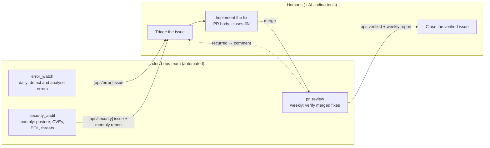
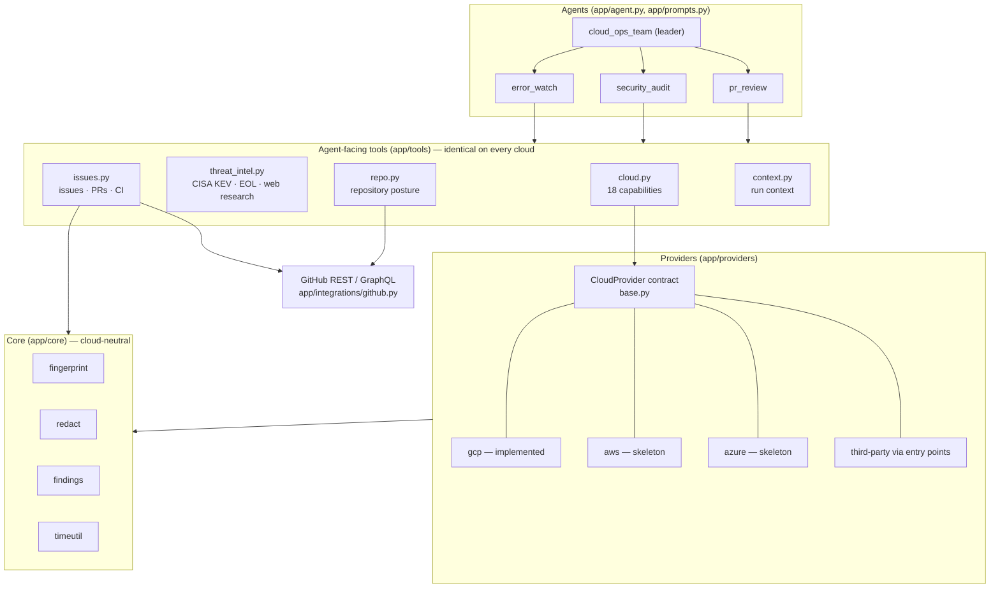
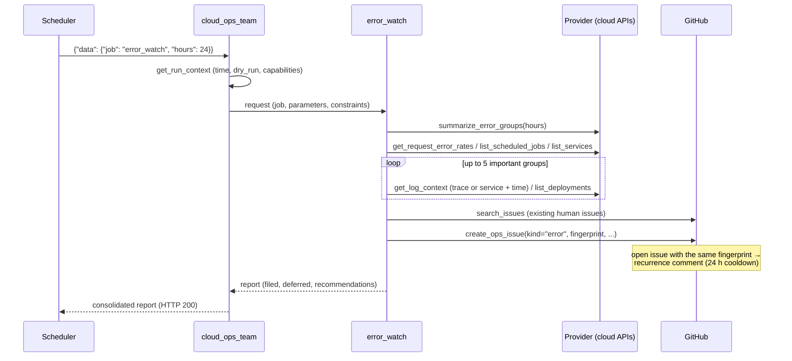
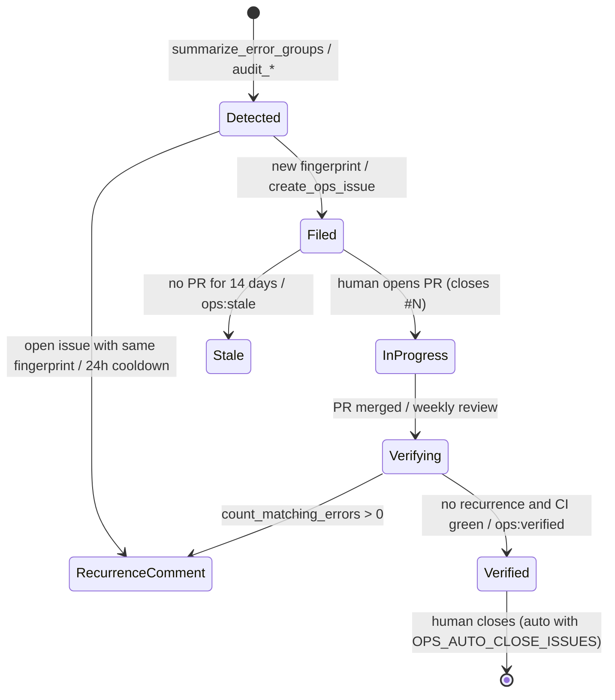

# Architecture

cloud-ops-team runs the routine operations work of a cloud environment with a small team of AI agents:
an **error watch** that turns production errors into well-researched GitHub issues, a **monthly security audit**,
and a **weekly review** that verifies whether merged pull requests actually fixed those issues.
Humans (often with AI coding tools) implement the fixes; the agents never change the cloud.

- Framework: [Agent Development Kit (ADK)](https://adk.dev/) 2.x for Python, scaffolded with [agents-cli](https://github.com/google/agents-cli)
- Model: Gemini (`gemini-3.8-flash` by default, `OPS_MODEL`)
- Clouds: **Google Cloud** (implemented), **AWS** and **Azure** (provider skeletons, see [providers.md](providers.md))
- Issue tracker: GitHub

日本語版: [docs/ja/architecture.md](ja/architecture.md)

## 1. The human–agent loop



The agents are **read-only** towards the cloud: no tool can change a cloud resource. Towards GitHub they only create issues,
comment and add labels; closing an issue requires `OPS_AUTO_CLOSE_ISSUES=true`.

## 2. Layers



| Package | Responsibility |
|---|---|
| `app/agent.py`, `app/prompts.py` | The leader and three specialists, their instructions and tool lists |
| `app/tools/` | Functions the model calls. Names and docstrings are cloud-neutral |
| `app/providers/` | One adapter per cloud implementing the `CloudProvider` contract |
| `app/core/` | Fingerprints, redaction, the shared audit result shape, time helpers |
| `app/integrations/github.py` | Minimal GitHub REST + GraphQL client |
| `app/config.py` | Everything configurable, from environment variables |
| `app/fast_api_app.py` | ADK server with the Pub/Sub-style trigger endpoint enabled |

## 3. Agents

| Agent | Role | Tools | Output |
|---|---|---|---|
| `cloud_ops_team` (root) | Reads the job (JSON from the scheduler or natural language), calls the right specialist, writes the consolidated report | `get_run_context` + 3 specialists | Report |
| `error_watch` | Groups error logs by fingerprint, correlates with 5xx rates, failing jobs and recent deployments, writes a root-cause hypothesis with confidence, files issues | 15 | `[ops/error]` issues |
| `security_audit` | IAM, credentials, compute, databases, network, security services, posture findings, image CVEs, EOL, CISA KEV, web threat research; files critical/high findings | 19 | `[ops/security]` issues + monthly report |
| `pr_review` | For every open team issue: linked PRs, merge state, CI, and whether the error recurred after the merge | 13 | `ops:verified` / `ops:stale` + weekly report |

**Specialists are `mode="single_turn"` sub-agents.** ADK exposes each as a tool of the leader and runs it inline in the leader's
session. Compared with wrapping them in `AgentTool`, every tool call streams as an event (HTTP/SSE clients and the scheduler
connection never go silent, and `agents-cli run` / `eval generate` stay under their 120-second read timeout) and every call is
recorded in traces and session history.

**Instructions are providers (callables)**, not strings: ADK would otherwise try to template the `{...}` JSON examples they contain.
They are rendered from the provider profile (display name, target type, CLI, glossary), `CONFIG` and the report language.

**Budgets are part of the prompts**: at most 25–30 tool calls, three issue searches, one web research call and a 5–8 minute
target per run. Measured on Google Cloud: error watch 60–150 s, monthly audit about 200 s with 27 tool calls.

## 4. Provider abstraction

The specialists only ever see the 18 capability tools in `app/tools/cloud.py`. Each tool calls the method of the same name on
the provider selected by `OPS_CLOUD_PROVIDER`:

| Capability | Normalized meaning | Google Cloud | AWS (planned) | Azure (planned) |
|---|---|---|---|---|
| `summarize_error_groups`, `list_error_logs`, `get_log_context`, `count_matching_errors` | Error logs, grouped and searchable | Cloud Logging | CloudWatch Logs Insights | Log Analytics (KQL) |
| `list_services` | Compute services and health | Cloud Run services | ECS / Lambda / App Runner | App Service / Container Apps |
| `list_deployments` | Releases of a service | Cloud Run revisions | ECS deployments / Lambda versions | Container Apps revisions |
| `list_scheduled_jobs` | Scheduled jobs and failures | Cloud Scheduler | EventBridge Scheduler | Container Apps Jobs / Logic Apps |
| `list_databases` | Managed DBs with `engine` / `engine_version` | Cloud SQL | RDS / Aurora | PostgreSQL / MySQL / SQL |
| `get_request_error_rates` | 5xx / 4xx per service | Cloud Monitoring | CloudWatch metrics | Azure Monitor metrics |
| `get_alerting_setup` | Alerts and uptime checks | Alert policies, uptime checks | CloudWatch alarms | Alert rules, availability tests |
| `audit_iam` | Public or over-privileged access | Project IAM policy | IAM, Access Analyzer | RBAC assignments |
| `audit_credentials` | Long-lived keys | Service-account keys | IAM access keys | Service-principal secrets |
| `audit_compute` | Exposure, identity, plain-text secrets, image pinning | Cloud Run | ECS / Lambda | App Service / Container Apps |
| `audit_databases` | Exposure, TLS, backups, maintenance | Cloud SQL | RDS | Azure databases |
| `audit_network` | Internet-open sensitive ports | VPC firewall | Security groups | NSGs |
| `audit_security_services` | Posture / scanning services enabled | SCC, container scanning, ... | GuardDuty, Security Hub, Inspector | Defender for Cloud plans |
| `list_security_findings` | Active posture findings | Security Command Center | Security Hub | Defender for Cloud |
| `scan_deployed_images` | CVEs in running images | Artifact Analysis | Amazon Inspector | Defender for Containers |

Design rules:

- **Unimplemented means `not_supported`, not an error.** `CloudProvider` implements every capability as
  `{"status": "not_supported", ...}`. A new provider is therefore usable from day one: the PR review, repository posture,
  CISA KEV, EOL checks and web research work on any cloud, and each capability can be implemented separately.
- **The agents know what is available.** `get_run_context` returns `capabilities` and `unsupported_capabilities`, and the
  prompt glossary marks unsupported tools so reports list them as "not checked" instead of guessing.
- **Results share one shape.** Audits return `app.core.findings.result(...)`; observability results use the fields documented
  in [providers.md](providers.md#normalized-results).
- **Providers are discovered lazily.** Built-ins are imported by key; third-party packages register through the
  `cloud_ops_team.providers` entry point; tests use `register_provider`.
- **Wrappers isolate failures.** A provider exception becomes `{"status": "error", ...}` and never crashes the run.

## 5. Jobs and triggers

The scheduler posts a Pub/Sub-push-shaped body to ADK's trigger endpoint:

```text
POST /apps/app/trigger/pubsub      Authorization: Bearer <OIDC token of the invoker service account>
{"message": {"data": "<base64 of {"job":"error_watch","hours":24}>", "attributes": {...}},
 "subscription": "projects/<project>/subscriptions/cloud-ops-error-watch"}
```

ADK (`trigger_sources=["pubsub"]`) decodes it and runs the leader with
`{"data": {"job": "error_watch", "hours": 24}, "attributes": {...}}` in a fresh session; `subscription` becomes the session's
`user_id`.

| `job` | Parameters | Default schedule (configurable) | Specialist |
|---|---|---|---|
| `error_watch` | `hours` (`OPS_ERROR_LOOKBACK_HOURS`) | daily 08:00 (`ERROR_WATCH_CRON`, `ERROR_WATCH_HOURS`) | error_watch |
| `weekly_pr_review` | `days` (7) | Monday 09:00 (`WEEKLY_CRON`) | pr_review |
| `monthly_security_audit` | `kev_days` (30) | 1st of the month 09:00 (`MONTHLY_CRON`) | security_audit |
| `full` | — | manual | all three |

On Google Cloud, `scripts/gcp/setup_schedules.sh` creates Cloud Scheduler **HTTP** jobs rather than Pub/Sub push subscriptions:
push deliveries are capped at 10 minutes and redelivered when not acknowledged, while HTTP jobs allow a 30-minute deadline and
zero retries, so a long audit never runs twice. Schedules, look-back windows, time zone and job names are all environment variables;
re-running the script updates jobs in place. On AWS the equivalent is EventBridge Scheduler calling the service URL; on Azure,
a Container Apps job or Logic App.

Natural language works through the same endpoint and through `/run_sse` ("check the errors of the last 24 hours").

## 6. Error watch, step by step



## 7. Issue lifecycle



- Title prefixes: `[ops/error]`, `[ops/security]`, `[ops/report]`
- Labels: `ops-agent` on every issue, `ops:error` / `ops:security` / `ops:report`, severity (`priority: critical`,
  `priority: high`, `major`, `minor`) and area (`bug`, `security`, `infrastructure`); missing labels are created.
- Body: Summary / Impact / Evidence / Root cause / Recommended fix / How to verify, followed by a hidden
  `<!-- ops-meta: {...} -->` block.
- Language: `OPS_REPORT_LANGUAGE` (`ja` or `en`) controls issue text, comments and reports.

## 8. De-duplication without a database

GitHub issues are the ledger.

1. A log message is normalized into a template: UUIDs → `<uuid>`, timestamps → `<ts>`, hex ids → `<hex>`, numbers → `<n>`,
   whitespace collapsed, cut at 240 characters.
2. `fingerprint = sha1(resource_type | service | template)[:16]` (`app/core/fingerprint.py`).
   Golden values are pinned by unit tests because changing the formula would re-file every open issue.
3. The fingerprint, service, `search_text`, provider and target are stored in the issue's `ops-meta` block.
4. Before filing, open issues and issues closed in the last 30 days are scanned. A match must have the same fingerprint **and**
   the same target, so staging and production can share one repository (issues filed before multi-cloud support use the
   legacy `project` key, which is treated as the target).
5. An open match gets a recurrence comment unless it was updated within `OPS_RECURRENCE_COOLDOWN_HOURS`; a recently closed
   match is referenced from the new issue.

`search_text` is what the weekly review later counts: for request logs the URL path up to the first id-like segment
(`/api/v1/worker/sns-plans`), otherwise the longest alphabetic run of the message. Security findings use
`"<check_id>:<resource>"` as their fingerprint.

## 9. Safety

| Layer | Mechanism |
|---|---|
| Permissions | Viewer / reviewer roles only on the monitored cloud (`scripts/gcp/grant_target_roles.sh`). No tool calls a mutating API |
| Entry point | The service rejects unauthenticated requests; the scheduler authenticates with an OIDC token of a dedicated service account |
| Writes | `OPS_DRY_RUN=true` (default) returns previews instead of writing to GitHub; closing needs `OPS_AUTO_CLOSE_ISSUES=true` |
| Blast radius | `OPS_MAX_ISSUES_PER_RUN` (10) caps new issues per run; one recurrence comment per issue per cooldown |
| Data | `app/core/redact.py` masks tokens (Bearer, JWT, Stripe, Google, GitHub, Slack), private keys, `password=`-style values, credentials in URLs, e-mail addresses (service accounts excepted), card numbers and the last octet of public IPs. Environment variables are returned by name only |
| Prompts | Refuse change requests and propose an issue instead; cite evidence; never output personal data; report `error` / `not_supported` honestly |
| Secrets | The GitHub token lives in a secret manager and is injected as `GITHUB_TOKEN`; `.env` is never uploaded |

## 10. Authentication

| Target | Local development | Deployed (Google Cloud) |
|---|---|---|
| Gemini | ADC with Vertex AI, or `GEMINI_API_KEY` | Runtime service account (`roles/aiplatform.user`) |
| Google Cloud APIs | ADC, or `OPS_GCP_AUTH=gcloud` to borrow `gcloud auth print-access-token` | Runtime service account (read-only roles on the target) |
| GitHub | `GITHUB_TOKEN`, else `gh auth token` | Secret Manager → `GITHUB_TOKEN` |

GCP REST calls send `x-goog-user-project: <target>`, so the caller needs `roles/serviceusage.serviceUsageConsumer` on the target.
The project that runs the model (`GOOGLE_CLOUD_PROJECT`) and the monitored target (`OPS_TARGET`) can differ.
AWS and Azure providers are expected to use their SDK default credential chains (`boto3`, `DefaultAzureCredential`).

## 11. Configuration

See [configuration.md](configuration.md) for every variable. The essentials: `OPS_CLOUD_PROVIDER`, `OPS_TARGET`,
`OPS_TARGET_REGION`, `GITHUB_REPO`, `OPS_DRY_RUN`, `OPS_REPORT_LANGUAGE`.

## 12. Deployment on Google Cloud

| Item | Value | Why |
|---|---|---|
| Cloud Run | 1 vCPU, 2 GiB, concurrency 4, 0–2 instances, 1800 s timeout, no unauthenticated access | One job is one long request; scale to zero between jobs |
| Runtime identity | Dedicated service account | Never the default compute account (which the audit itself flags) |
| Scheduler | HTTP target, OIDC, 1800 s deadline, 0 retries | No duplicate runs of long jobs |
| Build | `gcloud run deploy --source .` (Dockerfile: python:3.12-slim + uv) | `scripts/gcp/deploy_cloud_run.sh` passes only the variables the service needs |
| Sessions | In memory | One run is one session; nothing to carry over |

Step-by-step guide: [deployment-gcp.md](deployment-gcp.md).

## 13. Observability

- Runs: request logs of the trigger endpoint (latency = run time)
- What the agents did: Cloud Trace via OpenTelemetry (`otel_to_cloud=True`, message content not captured), ADK session API while
  the instance is alive, or `scripts/run_job.py` locally (prints every tool call with timestamps)
- Outcomes: GitHub issues labelled `ops-agent`, including the weekly and monthly reports

## 14. Tests and evaluation

| Kind | Location | What it covers |
|---|---|---|
| Unit | `tests/unit/` | Fingerprint golden values, redaction, metadata round trip, labels, configuration, provider registry and contract, skeleton providers, tool conventions (docstrings, type hints, no defaults), prompt rendering per provider, target-scoped de-duplication, i18n |
| Integration | `tests/integration/` | Streaming responses and the A2A server (calls the model) |
| Evaluation | `tests/eval/` | 5 core cases and 2 hold-out cases graded by an ops-specific LLM-as-judge rubric (right specialist, evidence, report structure, dry-run honesty, safety) |

CI (`.github/workflows/ci.yml`) runs lint, type checks and unit tests on every pull request.

## 15. Extending

- **A cloud**: implement a `CloudProvider` subclass — see [providers.md](providers.md).
- **A tool**: add a function to `app/tools/` (type hints, no defaults, a docstring the model can act on, return a dict with
  `status`, never raise for API errors) and add it to the specialist's list in `app/tools/__init__.py`. GitHub writes must honour
  `CONFIG.dry_run`.
- **A capability**: add the method to `CloudProvider` (returning `not_supported`), a wrapper to `app/tools/cloud.py`, a glossary entry
  to each profile, and implement it where possible. The contract tests enforce that all three exist.
- **A specialist**: add `create_xxx_agent()` with `mode="single_turn"` and a `description` (the leader reads it as the tool
  description), register it in `root_agent.sub_agents`, add a row to the job table in `app/prompts.py`, and a schedule.
- **An issue tracker**: `app/tools/issues.py` and `app/tools/repo.py` are the only GitHub-aware modules.
- **A model**: `OPS_MODEL` selects any Gemini model; other providers are possible through ADK's `LiteLlm` wrapper in `app/agent.py`.

## 16. Known limitations

- `agents-cli run` and `agents-cli eval generate` have a fixed 120-second read timeout; a single tool call that stays silent
  longer than that ends the client connection. Use `scripts/run_job.py` for long jobs locally.
- Sessions are in memory; with more than one instance the session API may not find a run's history.
- AWS and Azure providers are skeletons; every cloud capability reports `not_supported` there until implemented.
- Prompts are written in Japanese; output language is selectable with `OPS_REPORT_LANGUAGE`.
