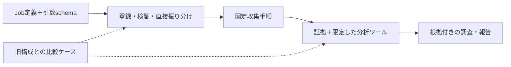

# カスタマイズガイド

cloud-ops-team は、クローンしたあとに **自分のプロジェクト向けに育てていく** ことを前提に作っています。
このページでは、よくある変更を「やりたいこと → どこを触るか → 具体例」の順にまとめます。

English: [docs/en/customization.md](en/customization.md) ・ 全体の仕組み: [architecture.md](architecture.md) ・ フォルダ構成: [architecture.md#フォルダ構成](architecture.md#フォルダ構成)

## まず全体像



| やりたいこと | 触る場所 | コード変更 |
|---|---|---|
| サービスの役割や既知のノイズを教える | `config/ops-context.md` | 不要 |
| 頻度・ラベル・言語を変える | `.env` | 不要 |
| 判断・報告要件を変える | `app/specialists/<担当>.py`と`app/prompts.py`の分析手順 | 主に文章 |
| 調査機能を追加する | `app/tools/`、必要なprovider、固定収集/分析scope、実行境界 | 必要 |
| ジョブや担当を追加する | 定義＋`routing.py`の引数schema＋`workflows.py`＋比較ケース | 必要 |
| AWS / Azureの機能を実装する | `app/providers/aws/`・`azure/` | 必要（[providers.md](providers.md)） |

定型的な取得は固定収集へ、対象に応じて必要になる深掘りだけを分析AIへ渡します。全担当のツール一覧へ追加しません。
変更後は`make test`・`make lint`と、旧構成/候補の同条件での比較を行います。実データ試験は`OPS_DRY_RUN=true`で行います。
オフライン契約試験と、実モデルの選択精度・本番確認は別の証拠です。[比較評価ガイド](../tests/eval/routing/README.md)を参照してください。

---

## 1. プロジェクトの事情を教える（コード変更なし）

いちばん効果が大きいカスタマイズです。サンプルをコピーして、自分のシステムについて書きます。

```bash
cp config/ops-context.example.md config/ops-context.md
```

書くと良いこと:

- **サービス構成**: どのサービスが何をしていて、どれが止まると困るか
- **重要度の考え方**: 「決済に関わるものは 1 回でも high」など
- **既知のノイズ**: ボットの 404、毎晩のバックアップ中に出る単発エラーなど、起票しなくてよいもの
- **修正の進め方**: 推奨対応に書いてほしいこと（ファイルパス、担当チームなど）
- **不審アクセス調査の前提**: 許可されたセキュリティ検査、正規の IAM 変更予定、ログの収集・除外・保持期間
- **インフラの制約**: ピーク時刻、可用性要件、待機系の用途、権限変更で維持すべき業務

このファイルの内容は、すべてのエージェントの指示文の末尾に「プロジェクト固有の情報」として追加されます。
最大 8,000 文字です。安全ルール（読み取り専用など）より優先されることはありません。
デプロイ時にイメージに含まれるので、**秘密情報は書かないでください**。別の場所に置く場合は `OPS_CONTEXT_FILE` でパスを指定します。

## 2. 実行時間・頻度を変える（コード変更なし）

スケジュールは各担当のジョブ定義から自動で作られ、環境変数で上書きできます。

```bash
make jobs                                                        # 現在のジョブと予定を確認
ERROR_WATCH_CRON="0 */6 * * *" ERROR_WATCH_HOURS=6 make gcp-schedule   # 6 時間ごとに変更
```

| 変数 | 意味 |
|---|---|
| `ERROR_WATCH_CRON` / `ERROR_WATCH_HOURS` | エラー監視の予定 / さかのぼる時間 |
| `ACCESS_WATCH_CRON` / `ACCESS_WATCH_HOURS` | 不審アクセス調査の予定 / さかのぼる時間（既定: 毎日 08:30 / 24 時間） |
| `INFRASTRUCTURE_REVIEW_CRON` | インフラ見直し（既定: 毎週月曜 10:00） |
| `WEEKLY_CRON` / `WEEKLY_DAYS` | 週次の修正確認 |
| `MONTHLY_CRON` / `MONTHLY_KEV_DAYS` | 月次のセキュリティ診断 |
| `<ジョブキー>_CRON` | 自分で追加したジョブ（例: `DEPLOY_WATCH_CRON`） |
| `ONLY_JOBS` | 更新するジョブを限定（例: `ONLY_JOBS=error-watch`） |

`.env` に書いておけば、毎回指定する必要はありません。

## 3. ラベルを自分のリポジトリに合わせる（コード変更なし）

エージェントが作る ISSUE には、必ず `ops-agent` と `ops:error` / `ops:security` / `ops:report` が付きます。
それ以外のラベルは `.env` で変えられます。値を空にすると付けません。

```bash
OPS_ERROR_LABELS=bug,backend
OPS_SECURITY_LABELS=security,infrastructure
OPS_SEVERITY_LABELS=critical=priority: critical,high=priority: high,medium=priority: medium,low=priority: low
```

`OPS_SEVERITY_LABELS` は `重要度=ラベル` をカンマで区切ります。1 つの重要度に複数付けるときは `high=priority: high|urgent` のように `|` で区切ります。
存在しないラベルは初回に自動で作られます。

## 4. 担当者の手順・判断基準・ISSUE の書式を変える

各担当の根拠・安全・報告要件は`app/specialists/<担当>.py`の`INSTRUCTION`にあります。
分析時には元の収集手順を除き、`app/prompts.py`の`_ANALYSIS_STEPS`へ置き換えます。判定手順を変える場合は両方の整合も確認してください。
固定収集の順序・引数・対象はプロンプトではなく`app/workflows.py`で変更します。

- `app/specialists/error_watch.py`: エラー監視（起票する / 静観する基準、ISSUE の見出し）
- `app/specialists/access_watch.py`: 不審アクセス調査（証拠・確度・取得範囲の扱い、調査の優先度）
- `app/specialists/infrastructure_review.py`: インフラ見直し（費用・権限・構成の優先度、変更リスク・確認・ロールバック案）
- `app/specialists/security_audit.py`: 月次診断（チェックリスト、起票する重要度）
- `app/specialists/pr_review.py`: 修正の確認（「確認済み」「停滞」の判定）

例: 「medium 以上も起票する」に変えたい場合は `security_audit.py` の起票ルールを書き換えます。

不審アクセス調査では、HTTP 拒否や重要操作を単独で侵入成功と扱わず、証拠と推測を分けるルールを維持してください。
インフラ見直しでは、API にない節約額を推測しないこと、クラウドを自動変更しないこと、既存の月次診断と同じ
`check_id:resource`・`kind="security"` で重複を防ぐことを維持します。

```text
## 起票ルール
- critical / high / medium の finding ごとに create_ops_issue(...)   ← medium を追加
```

指示文の中では次の差し込み文字が使えます。

| 差し込み | 内容 |
|---|---|
| `__PROVIDER__` / `__TARGET__` / `__TARGET_LABEL__` / `__REGION__` | クラウド名 / 対象 / 「プロジェクト」などの呼び名 / リージョン |
| `__REPO__` | GitHub リポジトリ |
| `__LOOKBACK__` | エラー監視の既定のさかのぼり時間 |
| `__STACK__` | 脅威情報の絞り込みキーワード |
| `__CLI__` | クラウドの CLI（`gcloud` など） |
| `__LANG__` | 出力言語 |

その工程で公開するツールだけの用語集、出力言語、プロジェクト情報を自動で追加します。
手順を変えたら、収集済み処理をモデルが再実行できないこと、権限・部分取得・拒否が最終報告へ残ることも比較評価で確認してください。

## 5. 調査ツールを追加する

ツールは普通の Python 関数です。docstring がそのままモデルへの説明になります。
例として、TLS 証明書の期限を調べるツールを追加します。

```python
# app/tools/certificates.py
"""TLS certificate checks (read-only)."""

from __future__ import annotations

import datetime as dt
import socket
import ssl


def check_tls_certificate(hostname: str) -> dict:
    """Check the TLS certificate served by ``hostname`` and how many days remain.

    Args:
        hostname: Public host name, e.g. ``api.example.com``.
    """
    try:
        context = ssl.create_default_context()
        with socket.create_connection((hostname, 443), timeout=10) as sock:
            with context.wrap_socket(sock, server_hostname=hostname) as tls:
                cert = tls.getpeercert()
    except OSError as exc:
        return {"status": "error", "hostname": hostname, "message": str(exc)}
    expires = dt.datetime.strptime(cert["notAfter"], "%b %d %H:%M:%S %Y %Z").replace(
        tzinfo=dt.UTC
    )
    days_left = (expires - dt.datetime.now(dt.UTC)).days
    return {
        "status": "ok",
        "hostname": hostname,
        "expires": expires.isoformat(),
        "days_left": days_left,
    }
```

担当の`tools`は使用可能な関数の母集団です。証明書の定型確認なら固定収集へ登録し、分析AIにはその結果だけを渡します。
以下は追加方法の例で、証明書監視が既に実装されていることを示しません。hostnameは明示した許可リストで検証し、モデルや取得データから任意の接続先を選ばせないでください。

```python
# app/specialists/security_audit.py
from app.tools.certificates import check_tls_certificate

SPECIALIST = Specialist(
    ...,
    tools=[*SECURITY_AUDIT_TOOLS, check_tls_certificate],
)
```

`app/tools/__init__.py`にも関数をimportし、`app/workflows.py`の該当ジョブへ固定引数を追加します。

```python
# collection_steps のsecurity_audit用returnに追加する例
CollectionStep("check_tls_certificate", {"hostname": "api.example.com"}),
```

これにより収集後は`check_tls_certificate`が分析ツールから除外されます。分析要件には証拠中の有効期限・閾値・対象を使う判定だけを追加します。
引数・取得量・接続先の制約を`ToolScope`または関数内で強制し、拒否を直接呼び出しても迂回できないテストを追加してください。

ツールのルール（`make test` が自動で検査します）:

- すべての引数に型ヒントを付け、**既定値は付けない**（ADK の制約）
- docstring にモデル向けの説明と引数の説明を書く
- 戻り値は `status` を含む dict。API の失敗は例外にせず `{"status": "error", "message": ...}` で返す
- **読み取り専用**。クラウドや外部サービスを変更しない。GitHub に書く場合は `CONFIG.dry_run` を守る
- 秘密情報を返さない（ログの抜粋は `app.core.redact.redact` を通す）
- どのクラウドでも同じ意味になるツールは `app/tools/` に、クラウド固有の取得処理は `app/providers/<cloud>/` に置く

## 6. 既存の担当に新しいジョブを追加する

`Job`の登録だけでは実行を許可しません。例えば週次のエラー振り返りを追加する場合は、次を同時に定義します。

```python
# app/specialists/error_watch.py のjobsへ追加する例
Job(
    name="weekly_error_review",
    params={"hours": "data.hours があればそれ、無ければ168"},
    scheduled_params={"hours": 168},
    schedule="0 10 * * 1",
    schedule_key="weekly-error-review",
)
```

```python
# app/routing.py のJOB_PARAMETER_BOUNDSへ追加する例
"weekly_error_review": {"hours": (1, 168)},
```

```python
# app/workflows.py のcollection_stepsへ追加する例
if job_name == "weekly_error_review":
    return collection_steps("error_watch", params)
```

この例では同じ担当・分析要件を使い、固定収集も既存のエラー監視へ明示的に対応付けます。
新しい引数は`Job.params`・既定値・schemaを一致させます。未知引数や定義のないジョブを、既存のジョブへ黙って代替しません。

`tests/eval/routing/cases.json`へ正常入力、別名、類似業務、不正な型/範囲、未知引数のケースを追加し、同じ更新済みスイートで旧構成と候補を比較します。
`make jobs`とオフラインテストを確認し、同条件の実モデル比較・お試し実行を終えてからデプロイとスケジュール登録を行います。

## 7. 新しい担当（専門家）を追加する

`app/specialists/_template.py`をコピーし、`SPECIALISTS`へ登録したうえで、次を揃えます。

1. **受付契約**: canonicalなjob名・別名・整数パラメータ・既定値と、`JOB_PARAMETER_BOUNDS`の範囲。
2. **固定収集**: `collection_steps`で順序・関数・固定引数を定義。関数を`app/tools/__init__.py`と担当の母集団へ登録。
3. **分析範囲**: 固定収集を除外した`get_collected_evidence`＋追加調査・報告の最小subsetを確認。無関係な取得ツールを追加しない。
4. **判断・報告**: 担当の指示文と分析手順を、収集済み証拠を読む形で記述。未確認・重複防止・dry_runを維持。
5. **実行境界と評価**: 未許可ツール・対象の越境・取得量/期間の上限・部分取得をオフライン試験し、前後比較へ混同ケースも追加。

定義からスケジュールや対話受付の候補は生成されますが、受付契約や固定収集が未定義なら実行を拒否します。
単にツール一覧を増やす追加方法は使いません。ブラウザ記録・再生やデプロイ後検証等の新担当は[拡張計画 #7](https://github.com/atsuki-sakai/cloud-ops-team/issues/7)で管理しています。

## 8. AWS / Azure の機能を実装する

`app/providers/aws/__init__.py` と `azure/__init__.py` は雛形です。未実装の機能は「未対応」として扱われるので、
1 つずつ実装して増やしていけます。返すべきデータの形、各クラウドで使う API、テストの書き方は
[providers.md](providers.md) にまとめています。実装状況は `make doctor` で確認できます。

## 9. モデルを変える

`.env` の `OPS_MODEL` で全エージェントのモデルを変えられます（既定 `gemini-3.8-flash`）。
Web の脅威調査だけ別のモデルにする場合は `OPS_RESEARCH_MODEL` を使います（Google 検索グラウンディングに対応したモデルが必要です）。
Gemini 以外を使う場合は、`app/agent.py` の `_model()` で ADK の `LiteLlm` に置き換えます。

## 開発の流れとデバッグ

| やりたいこと | コマンド |
|---|---|
| 設定と権限の確認 | `make doctor`（`--quick` で診断系を省略） |
| ジョブを 1 回実行し、ツール呼び出しを全部見る | `make run JOB=<ジョブ名> ARGS="--hours 24"` |
| 話しかけて試す | `make chat` |
| ジョブと予定の一覧 | `make jobs` |
| オフラインのテスト / 静的チェック | `make test` / `make lint` |
| 報告内容の評価（LLM 採点） | `make eval`（`tests/eval/datasets/`） |
| 担当・ツール選択の前後比較 | `scripts/evaluate_routing.py`（[記録形式と実行例](../tests/eval/routing/README.md)） |

困ったとき:

- **ツールが `permission_denied` / `api_disabled` を返す** → `make doctor` が原因と直し方を表示します
- **エージェントが予想外の動きをする** → `make run` の出力で、どのツールを何の引数で呼んだかを確認し、指示文を直します
- **`agents-cli run` が 120 秒で切れる** → `make run`（`scripts/run_job.py`）を使います。こちらは時間制限がありません
- **Gemini が 429 を返す** → 自動で 5 回まで再試行します。並列で大量に実行しているときに起きやすくなります

変更を本番に反映するときは `make gcp-deploy` を実行します。安全のため、まずは `.env` の `OPS_DRY_RUN=true` のまま動かしてください。

比較評価は全ケースで最低3試行、条件一致、トレースの完全性、未許可の提示/試行/実行0件を要求します。`runtime_stubbed`の合格は公開条件を満たさず、`live_model`の結果と報告内容の検証が必要です。
