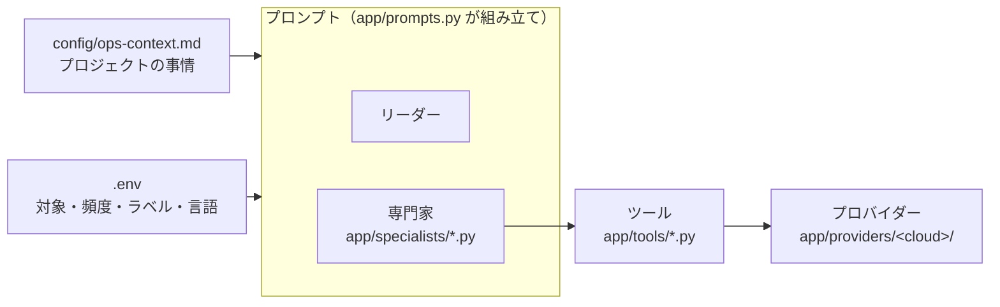

# カスタマイズガイド

cloud-ops-team は、クローンしたあとに **自分のプロジェクト向けに育てていく** ことを前提に作っています。
このページでは、よくある変更を「やりたいこと → どこを触るか → 具体例」の順にまとめます。

English: [docs/en/customization.md](en/customization.md) ・ 全体の仕組み: [architecture.md](architecture.md) ・ フォルダ構成: [architecture.md#フォルダ構成](architecture.md#フォルダ構成)

## まず全体像



| やりたいこと | 触る場所 | コード変更 |
|---|---|---|
| サービスの役割や「無視してよいエラー」を教える | `config/ops-context.md` | 不要 |
| 実行時間・頻度を変える | `.env` / `make gcp-schedule` の変数 | 不要 |
| ISSUE のラベルを自分のリポジトリに合わせる | `.env`（`OPS_*_LABELS`） | 不要 |
| レポートを英語にする | `.env`（`OPS_REPORT_LANGUAGE=en`） | 不要 |
| 担当者の手順・判断基準・ISSUE の書式を変える | `app/specialists/<担当>.py` の `INSTRUCTION` | 文章の編集のみ |
| 新しい調査ツールを追加する | `app/tools/` + 担当の `tools` | 必要 |
| 既存の担当に新しいジョブを追加する | `app/specialists/<担当>.py` の `jobs` | 少し |
| 新しい担当（専門家）を追加する | `app/specialists/_template.py` をコピー | 必要 |
| AWS / Azure の機能を実装する | `app/providers/aws/`・`azure/` | 必要（[providers.md](providers.md)） |

変更したら、次の 3 つで確認します。

```bash
make test                      # ルール違反がないか（オフライン・数秒）
make run JOB=error_watch       # 実データで 1 回動かす（お試しモード）
make eval                      # 振る舞いが悪くなっていないか（任意・数分）
```

---

## 1. プロジェクトの事情を教える（コード変更なし）

いちばん効果が大きいカスタマイズです。サンプルをコピーして、自分のシステムについて書きます。

```bash
cp config/ops-context.example.md config/ops-context.md
```

書くと良いこと:

- **サービス構成**: どのサービスが何をしていて、どれが止まると困るか
- **重要度の考え方**: 「決済に関わるものは 1 回でも high」など
- **既知のノイズ**: ボットの 404、毎晩のバックアップ中に出る単発エラーなど、起票しなくてよいもの
- **修正の進め方**: 推奨対応に書いてほしいこと（ファイルパス、担当チームなど）
- **不審アクセス調査の前提**: 許可されたセキュリティ検査、正規の IAM 変更予定、ログの収集・除外・保持期間
- **インフラの制約**: ピーク時刻、可用性要件、待機系の用途、権限変更で維持すべき業務

このファイルの内容は、すべてのエージェントの指示文の末尾に「プロジェクト固有の情報」として追加されます。
最大 8,000 文字です。安全ルール（読み取り専用など）より優先されることはありません。
デプロイ時にイメージに含まれるので、**秘密情報は書かないでください**。別の場所に置く場合は `OPS_CONTEXT_FILE` でパスを指定します。

## 2. 実行時間・頻度を変える（コード変更なし）

スケジュールは各担当のジョブ定義から自動で作られ、環境変数で上書きできます。

```bash
make jobs                                                        # 現在のジョブと予定を確認
ERROR_WATCH_CRON="0 */6 * * *" ERROR_WATCH_HOURS=6 make gcp-schedule   # 6 時間ごとに変更
```

| 変数 | 意味 |
|---|---|
| `ERROR_WATCH_CRON` / `ERROR_WATCH_HOURS` | エラー監視の予定 / さかのぼる時間 |
| `ACCESS_WATCH_CRON` / `ACCESS_WATCH_HOURS` | 不審アクセス調査の予定 / さかのぼる時間（既定: 毎日 08:30 / 24 時間） |
| `INFRASTRUCTURE_REVIEW_CRON` | インフラ見直し（既定: 毎週月曜 10:00） |
| `WEEKLY_CRON` / `WEEKLY_DAYS` | 週次の修正確認 |
| `MONTHLY_CRON` / `MONTHLY_KEV_DAYS` | 月次のセキュリティ診断 |
| `<ジョブキー>_CRON` | 自分で追加したジョブ（例: `DEPLOY_WATCH_CRON`） |
| `ONLY_JOBS` | 更新するジョブを限定（例: `ONLY_JOBS=error-watch`） |

`.env` に書いておけば、毎回指定する必要はありません。

## 3. ラベルを自分のリポジトリに合わせる（コード変更なし）

エージェントが作る ISSUE には、必ず `ops-agent` と `ops:error` / `ops:security` / `ops:report` が付きます。
それ以外のラベルは `.env` で変えられます。値を空にすると付けません。

```bash
OPS_ERROR_LABELS=bug,backend
OPS_SECURITY_LABELS=security,infrastructure
OPS_SEVERITY_LABELS=critical=priority: critical,high=priority: high,medium=priority: medium,low=priority: low
```

`OPS_SEVERITY_LABELS` は `重要度=ラベル` をカンマで区切ります。1 つの重要度に複数付けるときは `high=priority: high|urgent` のように `|` で区切ります。
存在しないラベルは初回に自動で作られます。

## 4. 担当者の手順・判断基準・ISSUE の書式を変える

各担当の指示文は `app/specialists/<担当>.py` の `INSTRUCTION` にあります。普通の文章なので、そのまま編集できます。

- `app/specialists/error_watch.py`: エラー監視（起票する / 静観する基準、ISSUE の見出し）
- `app/specialists/access_watch.py`: 不審アクセス調査（証拠・確度・取得範囲の扱い、調査の優先度）
- `app/specialists/infrastructure_review.py`: インフラ見直し（費用・権限・構成の優先度、変更リスク・確認・ロールバック案）
- `app/specialists/security_audit.py`: 月次診断（チェックリスト、起票する重要度）
- `app/specialists/pr_review.py`: 修正の確認（「確認済み」「停滞」の判定）

例: 「medium 以上も起票する」に変えたい場合は `security_audit.py` の起票ルールを書き換えます。

不審アクセス調査では、HTTP 拒否や重要操作を単独で侵入成功と扱わず、証拠と推測を分けるルールを維持してください。
インフラ見直しでは、API にない節約額を推測しないこと、クラウドを自動変更しないこと、既存の月次診断と同じ
`check_id:resource`・`kind="security"` で重複を防ぐことを維持します。

```text
## 起票ルール
- critical / high / medium の finding ごとに create_ops_issue(...)   ← medium を追加
```

指示文の中では次の差し込み文字が使えます。

| 差し込み | 内容 |
|---|---|
| `__PROVIDER__` / `__TARGET__` / `__TARGET_LABEL__` / `__REGION__` | クラウド名 / 対象 / 「プロジェクト」などの呼び名 / リージョン |
| `__REPO__` | GitHub リポジトリ |
| `__LOOKBACK__` | エラー監視の既定のさかのぼり時間 |
| `__STACK__` | 脅威情報の絞り込みキーワード |
| `__CLI__` | クラウドの CLI（`gcloud` など） |
| `__LANG__` | 出力言語 |

ツールの意味の対応表、出力言語、プロジェクト固有の情報は自動で末尾に追加されます。
手順を変えたら `make run` で動きを確かめ、可能なら `make eval` で点数が下がっていないか確認してください。

## 5. 調査ツールを追加する

ツールは普通の Python 関数です。docstring がそのままモデルへの説明になります。
例として、TLS 証明書の期限を調べるツールを追加します。

```python
# app/tools/certificates.py
"""TLS certificate checks (read-only)."""

from __future__ import annotations

import datetime as dt
import socket
import ssl


def check_tls_certificate(hostname: str) -> dict:
    """Check the TLS certificate served by ``hostname`` and how many days remain.

    Args:
        hostname: Public host name, e.g. ``api.example.com``.
    """
    try:
        context = ssl.create_default_context()
        with socket.create_connection((hostname, 443), timeout=10) as sock:
            with context.wrap_socket(sock, server_hostname=hostname) as tls:
                cert = tls.getpeercert()
    except OSError as exc:
        return {"status": "error", "hostname": hostname, "message": str(exc)}
    expires = dt.datetime.strptime(cert["notAfter"], "%b %d %H:%M:%S %Y %Z").replace(
        tzinfo=dt.UTC
    )
    days_left = (expires - dt.datetime.now(dt.UTC)).days
    return {
        "status": "ok",
        "hostname": hostname,
        "expires": expires.isoformat(),
        "days_left": days_left,
    }
```

使わせたい担当の `tools` に追加し、指示文に使いどころを 1 行書きます。

```python
# app/specialists/security_audit.py
from app.tools.certificates import check_tls_certificate

SPECIALIST = Specialist(
    ...,
    tools=[*SECURITY_AUDIT_TOOLS, check_tls_certificate],
)
```

```text
9. 証明書        : config/ops-context.md に書かれた公開ホストごとに check_tls_certificate。30 日未満なら high で起票
```

ツールのルール（`make test` が自動で検査します）:

- すべての引数に型ヒントを付け、**既定値は付けない**（ADK の制約）
- docstring にモデル向けの説明と引数の説明を書く
- 戻り値は `status` を含む dict。API の失敗は例外にせず `{"status": "error", "message": ...}` で返す
- **読み取り専用**。クラウドや外部サービスを変更しない。GitHub に書く場合は `CONFIG.dry_run` を守る
- 秘密情報を返さない（ログの抜粋は `app.core.redact.redact` を通す）
- どのクラウドでも同じ意味になるツールは `app/tools/` に、クラウド固有の取得処理は `app/providers/<cloud>/` に置く

## 6. 既存の担当に新しいジョブを追加する

担当の `jobs` に `Job` を足すだけで、リーダーの振り分け表とスケジューラの両方に反映されます。
例: エラー監視に「毎週月曜に先週 1 週間をまとめて振り返る」ジョブを追加します。

```python
# app/specialists/error_watch.py
jobs=(
    Job(name="error_watch", ...),                      # 既存
    Job(
        name="weekly_error_review",
        params={"hours": "data.hours があればそれ、無ければ 168"},
        schedule="0 10 * * 1",                         # 月曜 10:00
        schedule_key="weekly-error-review",            # スケジューラのジョブ名: <prefix>-weekly-error-review
        scheduled_params={"hours": 168},
    ),
),
```

```bash
make jobs           # 追加されたことを確認
make test
make gcp-deploy     # 本番に反映（リーダーが新しいジョブ名を知る）
make gcp-schedule   # スケジューラにジョブを作成（WEEKLY_ERROR_REVIEW_CRON で時刻を変更可）
```

## 7. 新しい担当（専門家）を追加する

ひな形をコピーして中身を埋め、一覧に登録します。例として「デプロイ直後の悪化を見張る担当」を作ります。

```bash
cp app/specialists/_template.py app/specialists/deploy_watch.py
```

```python
# app/specialists/deploy_watch.py
from app.specialists.base import Job, Specialist
from app.tools import (
    count_matching_errors,
    create_ops_issue,
    find_existing_ops_issue,
    get_request_error_rates,
    get_run_context,
    list_deployments,
    list_services,
    search_issues,
    summarize_error_groups,
)

INSTRUCTION = """
あなたは __PROVIDER__ の__TARGET_LABEL__「__TARGET__」で、デプロイ直後の品質悪化を見張る担当です。
1. list_services で直近 hours 時間以内にデプロイされたサービスを探す。
2. それぞれ list_deployments でデプロイ時刻を確認し、summarize_error_groups と get_request_error_rates で
   デプロイ後に新しく現れた / 増えたエラーを探す。
3. 悪化があれば重複を確認してから create_ops_issue(kind="error", ...) で起票し、どのリビジョンからかを書く。
"""

SPECIALIST = Specialist(
    name="deploy_watch",
    role="デプロイ直後のエラー増加の検知",
    description="デプロイ後に増えたエラーを見つけて起票する。request には対象の時間（hours）を書く。",
    instruction=INSTRUCTION,
    tools=[
        get_run_context,
        list_services,
        list_deployments,
        summarize_error_groups,
        get_request_error_rates,
        count_matching_errors,
        find_existing_ops_issue,
        search_issues,
        create_ops_issue,
    ],
    jobs=(
        Job(
            name="deploy_watch",
            params={"hours": "data.hours があればそれ、無ければ 6"},
            schedule="0 */6 * * *",
            schedule_key="deploy-watch",
            scheduled_params={"hours": 6},
        ),
    ),
)
```

```python
# app/specialists/__init__.py
from app.specialists import (
    access_watch,
    deploy_watch,
    error_watch,
    infrastructure_review,
    pr_review,
    security_audit,
)

SPECIALISTS = [
    error_watch.SPECIALIST,
    access_watch.SPECIALIST,
    infrastructure_review.SPECIALIST,
    security_audit.SPECIALIST,
    pr_review.SPECIALIST,
    deploy_watch.SPECIALIST,  # 追加
]
```

```bash
make test                               # 名前の重複・ツールのルールなどを検査
make run JOB=deploy_watch ARGS="--hours 24"
make gcp-deploy && make gcp-schedule    # 本番に反映
```

リーダーの指示文（担当の一覧とジョブの振り分け表）は登録内容から自動で作られるので、編集は不要です。

## 8. AWS / Azure の機能を実装する

`app/providers/aws/__init__.py` と `azure/__init__.py` は雛形です。未実装の機能は「未対応」として扱われるので、
1 つずつ実装して増やしていけます。返すべきデータの形、各クラウドで使う API、テストの書き方は
[providers.md](providers.md) にまとめています。実装状況は `make doctor` で確認できます。

## 9. モデルを変える

`.env` の `OPS_MODEL` で全エージェントのモデルを変えられます（既定 `gemini-3.8-flash`）。
Web の脅威調査だけ別のモデルにする場合は `OPS_RESEARCH_MODEL` を使います（Google 検索グラウンディングに対応したモデルが必要です）。
Gemini 以外を使う場合は、`app/agent.py` の `_model()` で ADK の `LiteLlm` に置き換えます。

## 開発の流れとデバッグ

| やりたいこと | コマンド |
|---|---|
| 設定と権限の確認 | `make doctor`（`--quick` で診断系を省略） |
| ジョブを 1 回実行し、ツール呼び出しを全部見る | `make run JOB=<ジョブ名> ARGS="--hours 24"` |
| 話しかけて試す | `make chat` |
| ジョブと予定の一覧 | `make jobs` |
| オフラインのテスト / 静的チェック | `make test` / `make lint` |
| 振る舞いの評価（LLM 採点） | `make eval`（ケースは `tests/eval/datasets/`） |

困ったとき:

- **ツールが `permission_denied` / `api_disabled` を返す** → `make doctor` が原因と直し方を表示します
- **エージェントが予想外の動きをする** → `make run` の出力で、どのツールを何の引数で呼んだかを確認し、指示文を直します
- **`agents-cli run` が 120 秒で切れる** → `make run`（`scripts/run_job.py`）を使います。こちらは時間制限がありません
- **Gemini が 429 を返す** → 自動で 5 回まで再試行します。並列で大量に実行しているときに起きやすくなります

変更を本番に反映するときは `make gcp-deploy` を実行します。安全のため、まずは `.env` の `OPS_DRY_RUN=true` のまま動かしてください。
