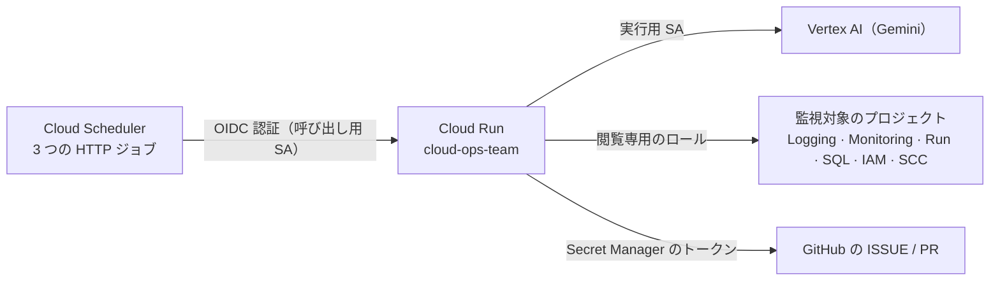

# Google Cloud へのデプロイ手順

English: [docs/en/deployment-gcp.md](en/deployment-gcp.md)

チームは 1 つの Cloud Run サービスとして動きます。Cloud Scheduler が、OIDC で認証した HTTP リクエストでこのサービスを呼び出します。
費用のほとんどはモデルのトークン代です。毎日のエラー監視、週次レビュー、月次診断を合わせても、1 か月に数十回の短いリクエストで済みます。
それ以外の時間はインスタンスが 0 台まで縮小されます。



## 用意するもの

- サービスアカウントの作成、IAM ロールの付与、Cloud Run へのデプロイができるユーザーで `gcloud` にログインしていること
- 対象リポジトリの GitHub トークン。fine-grained token で **Issues: read and write**、**Pull requests: read**、
  **Actions: read**、**Contents: read**、**Metadata: read** の権限を付けます（**Administration: read** を追加すると、診断でブランチ保護も確認できます）
- 監視対象のプロジェクトは、デプロイ先と同じプロジェクトでも別のプロジェクトでも構いません

以下の手順にはすべて、`.env` を読み込む `make` コマンドを用意しています（`.env` は `make setup` で作り、`make doctor` で点検します）。
直接呼び出したい場合は、`scripts/gcp/` にある元のスクリプトに同じ値を環境変数として渡してください。

## 1. 初期設定（初回だけ）

```bash
make gcp-bootstrap          # または: PROJECT_ID=my-project TARGET_PROJECT=my-project GITHUB_TOKEN=github_pat_xxx ./scripts/gcp/bootstrap.sh
```

このコマンドは次のことを行います。

- 必要な API を有効にします
- 実行用サービスアカウント `cloud-ops-team@<project>` を作成し、`roles/aiplatform.user`、`roles/secretmanager.secretAccessor`、
  `roles/logging.logWriter`、`roles/cloudtrace.agent`、`roles/monitoring.metricWriter` を付与します
- 監視対象に対する閲覧専用のロールを付与します（`scripts/gcp/grant_target_roles.sh`）
- GitHub トークンをシークレット `cloud-ops-team-github-token` に保存します（`GITHUB_TOKEN` が未設定なら入力を求められます）

## 2. デプロイ

まずはお試しモードで動かし、チームが登録しようとする ISSUE を確認してから、書き込みを有効にします。

```bash
make gcp-deploy                         # お試しモード（OPS_DRY_RUN は .env の値）
OPS_DRY_RUN=false make gcp-deploy       # ISSUE の登録を開始
```

スクリプトは最後に `SERVICE_URL=...` を表示し、その URL 宛ての OIDC トークンだけを受け付けるようにサービスを設定します
（`OPS_TRIGGER_AUDIENCE`、`OPS_TRIGGER_SERVICE_ACCOUNTS`）。動作確認は次のとおりです。

```bash
URL=$(gcloud run services describe cloud-ops-team --region asia-northeast1 --format='value(status.url)')
curl -s -H "Authorization: Bearer $(gcloud auth print-identity-token)" "$URL/list-apps"     # ["app"] と表示されれば OK
```

## 3. 定期実行の登録

```bash
make jobs                    # 登録される予定を確認
make gcp-schedule            # ジョブを作成または更新（サービスの URL は自動で見つけます）
gcloud scheduler jobs run cloud-ops-error-watch --location asia-northeast1   # 今すぐ 1 回実行
```

既定の予定は、エラー監視が毎日 8:00、週次レビューが毎週月曜 9:00、月次診断が毎月 1 日 9:00 です（いずれも Asia/Tokyo）。
どれも環境変数で変えられます。詳しくは [設定一覧](configuration.md#定期実行の設定make-gcp-schedule) を見てください。

## 運用手順

| やりたいこと | コマンド |
|---|---|
| 設定とアクセス権を点検する | `make doctor` |
| 最近の実行を確認する | `make gcp-logs`、または `gcloud logging read 'resource.type="cloud_run_revision" AND resource.labels.service_name="cloud-ops-team" AND httpRequest.requestUrl:"trigger/pubsub"' --limit 10 --format="value(timestamp,httpRequest.status,httpRequest.latency)"` |
| チームが作った ISSUE を見る | `gh issue list -R owner/repo --label ops-agent --state all` |
| GitHub への書き込みを止める・再開する | `gcloud run services update cloud-ops-team --region asia-northeast1 --update-env-vars OPS_DRY_RUN=true`（再開は `false`） |
| ジョブを一時停止する | `gcloud scheduler jobs pause cloud-ops-error-watch --location asia-northeast1`（再開は `resume`） |
| 予定を変える | `ERROR_WATCH_CRON=... ONLY_JOBS=error-watch make gcp-schedule` |
| コードや設定の変更を反映する | `make test && make gcp-deploy` |
| GitHub トークンを更新する | `printf '%s' "$TOKEN" \| gcloud secrets versions add cloud-ops-team-github-token --data-file=-`（新しく起動したインスタンスから反映されます） |
| ロールバックする | `gcloud run services update-traffic cloud-ops-team --region asia-northeast1 --to-revisions=<以前のリビジョン>=100` |
| サービス自体のエラーを見る | `gcloud logging read 'resource.type="cloud_run_revision" AND resource.labels.service_name="cloud-ops-team" AND severity>=ERROR' --limit 20` |

## 複数のプロジェクトを監視する

監視対象ごとにサービスを 1 つずつデプロイし（`SERVICE=cloud-ops-staging TARGET_PROJECT=...`）、定期実行ジョブにもそれぞれ別の接頭辞を付けます
（`JOB_PREFIX=cloud-ops-staging`）。同じリポジトリを共有しても構いません。重複の判定は、各 ISSUE に記録された監視対象ごとに行われます。

## Terraform や CI/CD を使う場合

このスクリプトはあえて小さく作っています。インフラをコードで管理したい場合は、`agents-cli scaffold enhance . --deployment-target cloud_run`
でサービスとサービスアカウントの Terraform を生成でき、`--cicd-runner github_actions` を付けるとデプロイ用のパイプラインも追加されます。
定期実行ジョブと IAM の設定は、スクリプトの内容を移植してください。
