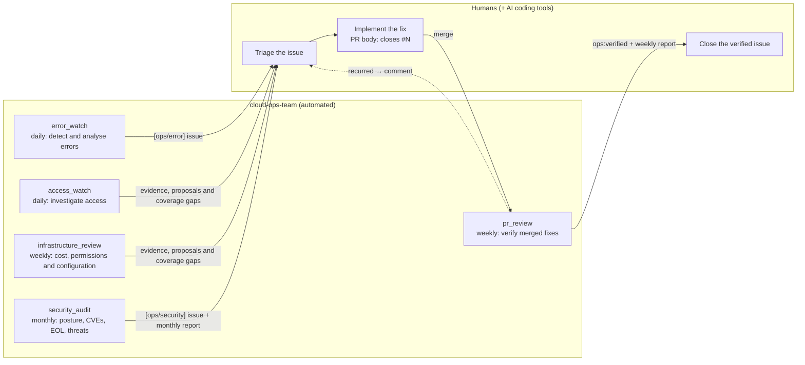
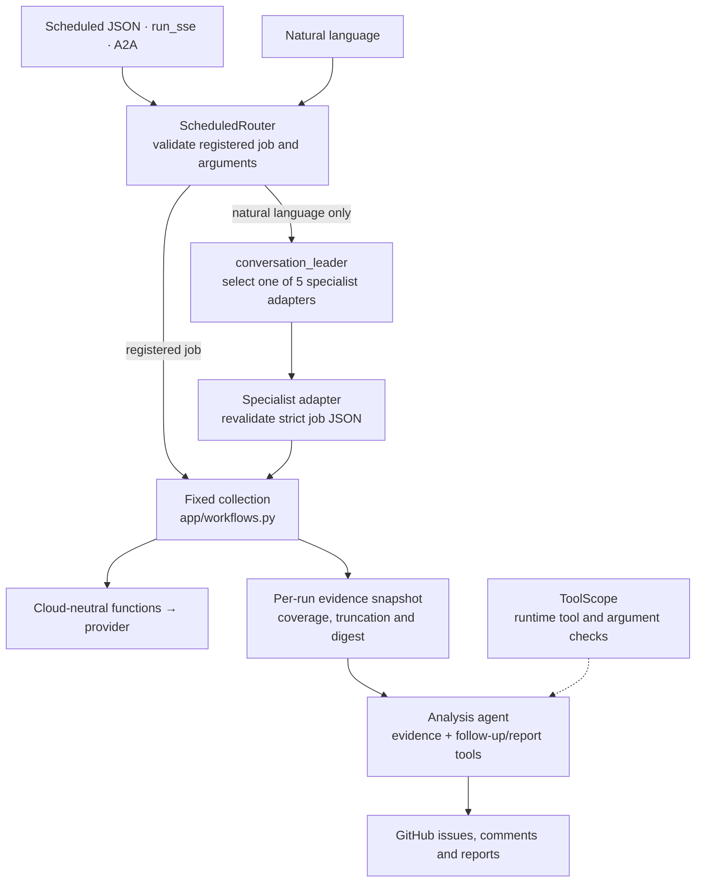
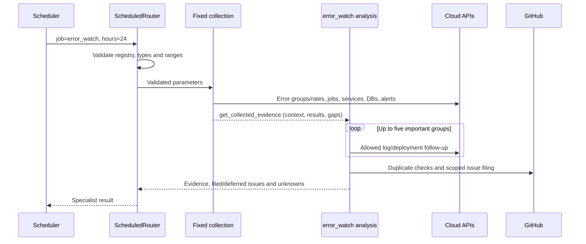
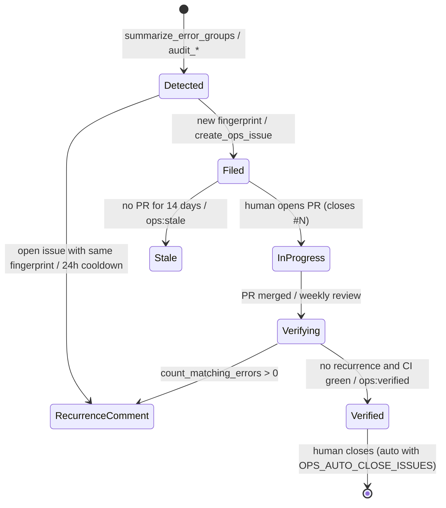

# Architecture

cloud-ops-team runs the routine operations work of a cloud environment with a small team of AI agents:
an **error watch**, daily **access investigation**, weekly **infrastructure review**, a **monthly security audit**,
and a **weekly fix review** that verifies whether merged pull requests fixed the issues.
Humans (often with AI coding tools) implement the fixes; the agents never change the cloud.

- Framework: [Agent Development Kit (ADK)](https://adk.dev/) 2.x for Python, scaffolded with [agents-cli](https://github.com/google/agents-cli)
- Model: Gemini (`gemini-3.8-flash` by default, `OPS_MODEL`)
- Clouds: **Google Cloud** (implemented), **AWS** and **Azure** (provider skeletons, see [providers.md](providers.md))
- Issue tracker: GitHub

日本語版（メイン）: [docs/architecture.md](../architecture.md) · [Known limitations and improvement plan](known-limitations.md)

## 1. The human–agent loop



The agents are **read-only** towards the cloud: no tool can change a cloud resource. Towards GitHub they only create issues,
comment and add labels; closing an issue requires `OPS_AUTO_CLOSE_ISSUES=true`.

## 2. Layers



| Package | Responsibility |
|---|---|
| `app/agent.py` | Builds the shared root router, conversation adapters and per-job analysis agents |
| `app/routing.py` | Strict job/alias and argument validation, direct dispatch and isolated invocation context |
| `app/workflows.py` | Fixed collection, redacted/size-bounded evidence and removal of collectors from analysis tools |
| `app/tool_scope.py` | Runtime checks for the actual stage tools and arguments; scoped context and capability names |
| `app/prompts.py` | Replaces collection procedures with analysis steps and renders only the exposed glossary and reporting requirements |
| `app/specialists/` | Roles, analysis requirements, tool superset, jobs and schedules |
| `app/tools/`, `app/providers/` | Cloud-neutral functions and cloud-specific adapters; the whole registry is never a model's tool list |
| `app/core/`, `app/integrations/github.py` | Fingerprints, redaction, normalized findings, time and GitHub REST/GraphQL |
| `scripts/evaluate_routing.py`, `tests/eval/routing/` | Comparable baseline/candidate execution records; missing evidence and authorization violations fail closed |
| `app/fast_api_app.py`, `app/app_utils/a2a.py` | HTTP/SSE, Pub/Sub-shaped and A2A entry points using the same root |

## Folder structure

★ marks the places you will typically change when adapting the team to your project
([customization.md](customization.md)).

```
cloud-ops-team/
├── app/                          the agent service (deployed to Cloud Run)
│   ├── agent.py                  builds the router, conversation and analysis agents
│   ├── routing.py                registered job/argument validation and direct dispatch
│   ├── workflows.py              fixed collection, evidence and analysis scope
│   ├── tool_scope.py             per-stage runtime tool and argument checks
│   ├── prompts.py                renders instructions (cloud, language, project context)
│   ├── config.py                 settings from .env / environment variables
│   ├── fast_api_app.py           HTTP server (scheduler endpoint /apps/app/trigger/pubsub)
│   ├── specialists/              ★ one module per team member
│   │   ├── base.py               Specialist and Job types
│   │   ├── error_watch.py        error watch: instruction, tools, jobs
│   │   ├── access_watch.py       daily suspicious access investigation
│   │   ├── infrastructure_review.py  weekly cost, IAM and configuration review
│   │   ├── security_audit.py     monthly security audit
│   │   ├── pr_review.py          weekly fix verification
│   │   ├── _template.py          copy this to add a specialist
│   │   └── __init__.py           registry (SPECIALISTS)
│   ├── tools/                    ★ functions the model calls (cloud-neutral)
│   │   ├── cloud.py              the 20 cloud capabilities (delegate to the provider)
│   │   ├── issues.py             GitHub issues / PRs (dry-run aware)
│   │   ├── threat_intel.py       CISA KEV, end-of-life, web threat research
│   │   ├── repo.py               repository security posture
│   │   ├── context.py            run context (time, target, capabilities)
│   │   └── __init__.py           tool lists per specialist
│   ├── providers/                ★ one adapter per cloud
│   │   ├── base.py               CloudProvider contract (unimplemented = not_supported)
│   │   ├── gcp/                  Google Cloud (implemented)
│   │   ├── aws/                  AWS (skeleton)
│   │   └── azure/                Azure (skeleton)
│   ├── core/                     fingerprints, redaction, audit result shape, time helpers
│   ├── integrations/github.py    GitHub REST + GraphQL client
│   └── app_utils/                agents-cli server plumbing (A2A, sessions)
├── config/
│   └── ops-context.example.md    ★ project knowledge template (copy to ops-context.md)
├── scripts/
│   ├── setup.py                  create .env interactively (make setup)
│   ├── doctor.py                 check configuration and access, print fixes (make doctor)
│   ├── run_job.py                run one job and print every tool call (make run)
│   ├── jobs.py                   list jobs and schedules (make jobs)
│   ├── envrun.py                 run a command with .env loaded (used by the Makefile)
│   ├── trigger_local.sh          send a scheduler-style request to a local server
│   └── gcp/                      bootstrap, deploy_cloud_run, setup_schedules, grant_target_roles
├── tests/
│   ├── unit/                     offline: contracts, conventions, configuration
│   ├── integration/              calls the model
│   └── eval/                     LLM-judged behaviour cases
├── docs/                         architecture, customization, providers, configuration, deployment (Japanese; en/: English)
├── Makefile                      entry point for every task (`make` lists them)
├── .env.example                  configuration template
└── Dockerfile                    image for Cloud Run (app/ and config/)
```

## 3. Dispatch, fixed collection and analysis

`cloud_ops_team` is a `ScheduledRouter`, not an LLM. Registered JSON jobs go directly to their workflow; `full` runs in registry order. Routing never uses job-like text from previous conversation or tool results. Each analysis receives the current request and its own evidence.
Only natural language enters `conversation_leader`, which selects one of five adapters. Each adapter accepts strict JSON for its own specialist and enters the same fixed collection pipeline.
The issue-creation limit spans the whole invocation, including `full` and parallel conversation adapters. Only the trusted counter is shared under a lock; specialist history and other state remain isolated.

| Specialist | Fixed collection performed by code | Remaining model work | Previous → analysis tool count |
|---|---|---|---|
| `error_watch` | Context, error groups/rates, scheduled jobs, services, DBs and alerting | Up to five follow-up investigations, hypotheses, duplicate checks and filing | 15 → 9 |
| `security_audit` | Context, IAM/credential/configuration/DB/network audits, CVEs, findings, alerting, repository posture and KEV | Up to six EOL checks, one web research call, evidence-based filing and reporting | 19 → 8 |
| `pr_review` | Context, open team issues, recent PRs and main CI | Linked PRs and recurrence per issue; comments, labels and weekly reporting | 13 → 10 |
| `access_watch` | Context, suspicious-access evidence and coverage | Necessary follow-up, filing and reporting that preserve unverified legitimacy/coverage | 8 → 7 |
| `infrastructure_review` | Context, recommendations, identity/configuration audits, alerting and service/DB inventory | Evidence correlation, change impact/validation/rollback proposals, duplicate checks and reporting | 14 → 5 |

Counts include `get_collected_evidence`. A specialist's declared `tools` is a superset, not the list passed unchanged to a model. Fixed collectors run once with defined arguments; exceptions and unsupported sources remain missing evidence. Results form a redacted, size-bounded snapshot with SHA-256. This per-run snapshot is not a completed durable execution-history service.

The actual tool list, schema, docstrings, cloud glossary and context capabilities use the same stage scope. Both the `ToolScope` callback and exposed wrappers reject unauthorized names, unknown arguments, invalid types, excessive query size/time ranges, foreign target resources and repository search overrides before execution.
Analysis also rejects follow-up, issue creation and reporting until the actual `get_collected_evidence` read returns successfully. A snapshot containing partial/error sources still permits reporting those gaps after it has been read.
Instructions are callable providers: collection procedures are replaced with analysis steps while evidence, safety and reporting requirements are preserved.

**Project context.** `config/ops-context.md` (optional, `OPS_CONTEXT_FILE`) is appended to instructions so operators can
describe services, severity policy and known noise without editing prompts. It does not change runtime permissions, scope
or validation. The standard deployment does not forward custom paths; include the file in the image and apply the
[post-deploy settings](deployment-gcp.md#post-deploy-settings).

Programmatic dispatch and specialist adapters preserve tool events for SSE clients and local runners. The scheduler
trigger does not return the investigation's progress or final report in its HTTP response. A long silent call can still
cause a client timeout, while in-memory history can be lost independently. Model/API latency remains; fewer tools do not
guarantee completion time. Scheduled requests retain a 30-minute default deadline.

## 4. Provider abstraction

Fixed collectors and scoped follow-up tools select from the 20 capabilities in `app/tools/cloud.py`; models receive only the subset needed by their stage. Each function calls the same-named method on the provider selected by `OPS_CLOUD_PROVIDER`:

| Capability | Normalized meaning | Google Cloud | AWS (planned) | Azure (planned) |
|---|---|---|---|---|
| `summarize_error_groups`, `list_error_logs`, `get_log_context`, `count_matching_errors` | Error logs, grouped and searchable | Cloud Logging | CloudWatch Logs Insights | Log Analytics (KQL) |
| `list_services` | Compute services and health | Cloud Run services | ECS / Lambda / App Runner | App Service / Container Apps |
| `list_deployments` | Releases of a service | Cloud Run revisions | ECS deployments / Lambda versions | Container Apps revisions |
| `list_scheduled_jobs` | Scheduled jobs and failures | Cloud Scheduler | EventBridge Scheduler | Container Apps Jobs / Logic Apps |
| `list_databases` | Managed DBs with `engine` / `engine_version` | Cloud SQL | RDS / Aurora | PostgreSQL / MySQL / SQL |
| `get_request_error_rates` | 5xx / 4xx per service | Cloud Monitoring | CloudWatch metrics | Azure Monitor metrics |
| `get_alerting_setup` | Alerts and uptime checks | Alert policies, uptime checks | CloudWatch alarms | Alert rules, availability tests |
| `audit_iam` | Public or over-privileged access | Project IAM policy | IAM, Access Analyzer | RBAC assignments |
| `audit_credentials` | Long-lived keys | Service-account keys | IAM access keys | Service-principal secrets |
| `audit_compute` | Exposure, identity, plain-text secrets, image pinning | Cloud Run | ECS / Lambda | App Service / Container Apps |
| `audit_databases` | Exposure, TLS, backups, maintenance | Cloud SQL | RDS | Azure databases |
| `audit_network` | Internet-open sensitive ports | VPC firewall | Security groups | NSGs |
| `audit_security_services` | Posture / scanning services enabled | SCC, container scanning, ... | GuardDuty, Security Hub, Inspector | Defender for Cloud plans |
| `list_security_findings` | Active posture findings | Security Command Center | Security Hub | Defender for Cloud |
| `scan_deployed_images` | CVEs in running images | Artifact Analysis | Amazon Inspector | Defender for Containers |
| `investigate_access` | Suspicious access signals and coverage | Cloud Audit Logs, HTTP access logs, Cloud Armor logs | Not implemented | Not implemented |
| `list_optimization_recommendations` | Cost and permission proposals | Recommender (Cloud Run, Cloud SQL, IAM) | Not implemented | Not implemented |

Design rules:

- **Unimplemented means `not_supported`, not an error.** `CloudProvider` implements every capability as
  `{"status": "not_supported", ...}`. A new provider is therefore usable from day one: the PR review, repository posture,
  CISA KEV, EOL checks and web research work on any cloud, and each capability can be implemented separately.
- **The agents know what is available.** Run context limits `capabilities` and `unsupported_capabilities` to the current workflow/stage, and the
  prompt glossary marks unsupported tools so reports list them as "not checked" instead of guessing.
- **Results share one shape.** Audits return `app.core.findings.result(...)`; observability results use the fields documented
  in [providers.md](providers.md#normalized-results).
  Some audits currently lose retrieval errors, coverage limits or expiry conditions. Neither `status:ok` nor an empty
  findings list establishes safety; see [known limitations](known-limitations.md) for the affected checks.
- **Providers are discovered lazily.** Built-ins are imported by key; third-party packages register through the
  `cloud_ops_team.providers` entry point; tests use `register_provider`.
- **Wrappers isolate failures.** A provider exception becomes `{"status": "error", ...}` and never crashes the run.

## 5. Jobs and triggers

The scheduler posts a Pub/Sub-push-shaped body to ADK's trigger endpoint:

```text
POST /apps/app/trigger/pubsub      Authorization: Bearer <OIDC token of the invoker service account>
{"message": {"data": "<base64 of {"job":"error_watch","hours":24}>", "attributes": {...}},
 "subscription": "projects/<project>/subscriptions/cloud-ops-error-watch"}
```

ADK (`trigger_sources=["pubsub"]`) decodes it and runs `ScheduledRouter` with
`{"data": {"job": "error_watch", "hours": 24}, "attributes": {...}}` in a fresh session; `subscription` becomes the session's
`user_id`.

| `job` | Parameters | Default schedule (configurable) | Specialist |
|---|---|---|---|
| `error_watch` | `hours` (`OPS_ERROR_LOOKBACK_HOURS`) | daily 08:00 (`ERROR_WATCH_CRON`, `ERROR_WATCH_HOURS`) | error_watch |
| `access_watch` | `hours` (24) | daily 08:30 (`ACCESS_WATCH_CRON`, `ACCESS_WATCH_HOURS`) | access_watch |
| `infrastructure_review` | — | Monday 10:00 (`INFRASTRUCTURE_REVIEW_CRON`) | infrastructure_review |
| `weekly_pr_review` | `days` (7) | Monday 09:00 (`WEEKLY_CRON`) | pr_review |
| `monthly_security_audit` | `kev_days` (30) | 1st of the month 09:00 (`MONTHLY_CRON`) | security_audit |
| `full` | — | manual | all five |

On Google Cloud, `scripts/gcp/setup_schedules.sh` creates Cloud Scheduler **HTTP** jobs rather than Pub/Sub push subscriptions:
push deliveries are capped at 10 minutes and redelivered when not acknowledged. HTTP jobs use a 30-minute deadline and
zero retries to suppress scheduler retries; other jobs and manual runs can still overlap. Schedules, look-back windows, time zone and job names are all environment variables;
re-running the script updates jobs in place. On AWS the equivalent is EventBridge Scheduler calling the service URL; on Azure,
a Container Apps job or Logic App.

Direct JSON, Pub/Sub-shaped requests, `/run_sse` and A2A share the same root. Unknown jobs/arguments, duplicate JSON keys, numeric strings/bools, out-of-range values and target/repository overrides are rejected. `hours` is an integer in 1–168, `days` in 1–90 and `kev_days` in 1–365. Natural language selects a specialist adapter, which forwards strict JSON through the same validation, fixed collection and analysis.

### Access and infrastructure review boundaries

Access investigation is a scheduled review. Denials, probes and sensitive operations are distinguished from successful intrusion.
Reports include the observation window, scope, evidence, confidence and follow-up checks. API failures, missing collection,
limits and sampling remain visible unknowns; zero matching logs do not prove that unauthorized access did not occur.
No blocking or automatic remediation is performed.
HTTP status codes alone do not establish successful blocking or safety. IAM change legitimacy remains unverified until matched against approval records.

Infrastructure review combines Recommender for Cloud Run/Cloud SQL in the target region and project IAM in `global` with
existing IAM, credential and configuration audits. No recommendations may mean none generated, inaccessible or out of scope.
Only API-provided savings are quoted, with units and duration. Each proposal considers availability, peak demand and standby
requirements and includes evidence, expected benefit, change risk, implementation, verification and rollback steps.
Steps describe the target and intended setting in prose; unverified commands or Terraform code are not generated. Zero recommendations do not establish optimal configuration or zero savings. Change impact remains unverified until dependencies are checked.
Recommendation prerequisites and grant scope also require verification. Moving grants to a parent folder or organization is not presented as a reduction. Unverified implementation details, such as connection methods, remain checks for the operator to resolve against official specifications and the current configuration.
For scheduled runs, the specialist's report is authoritative and the router returns it without a second LLM re-evaluation or summary.

Both specialists use existing dry-run, redaction and issue caps. Critical/high security findings use `kind="security"` and
`check_id:resource`, matching the monthly audit so that the same finding is not filed twice. Cost proposals belong in the report.
Cloud permissions, log collection and scheduled execution must be verified on the actual target separately from offline tests.

## 6. Error watch, step by step



Scheduled analysis does not need an LLM routing call or the already-completed inventory tools.
The final report is a session event; a successful trigger response does not establish that all required checks completed.
If daily monitoring files no issue and its instance terminates, the explanation of an incomplete investigation can be lost.

## 7. Issue lifecycle

This is the specialist's prompted workflow. There is no state machine that jointly validates repository and PR SHA, CI for
that SHA, the deployed revision and observation coverage. Referenced PRs can currently enter fix evidence, so a human must
inspect the evidence behind `ops:verified`.



- Title prefixes: `[ops/error]`, `[ops/security]`, `[ops/report]`
- Labels: `ops-agent` and the kind (`ops:error` / `ops:security` / `ops:report`) on every issue, plus severity labels
  (default `severity: critical` / `severity: high` / `severity: medium` / `severity: low`) and area labels (default `bug` for
  errors, `security` for security findings). Severity and area labels follow `OPS_SEVERITY_LABELS`, `OPS_ERROR_LABELS` and
  `OPS_SECURITY_LABELS`; missing labels are created.
- Body: Summary / Impact / Evidence / Root cause / Recommended fix / How to verify, followed by a hidden
  `<!-- ops-meta: {...} -->` block.
- Language: `OPS_REPORT_LANGUAGE` (`ja` or `en`) controls issue text, comments and reports.

## 8. De-duplication without a database

GitHub issues are the ledger.

1. A log message is normalized into a template: UUIDs → `<uuid>`, timestamps → `<ts>`, hex ids → `<hex>`, numbers → `<n>`,
   whitespace collapsed, cut at 240 characters.
2. `fingerprint = sha1(resource_type | service | template)[:16]` (`app/core/fingerprint.py`).
   Golden values are pinned by unit tests because changing the formula would re-file every open issue.
3. The fingerprint, service, `search_text`, provider and target are stored in the issue's `ops-meta` block.
4. Before filing, open issues and issues closed in the last 30 days are scanned. A match must have the same **fingerprint,
   provider and target**, so staging and production can share one repository (issues filed before multi-cloud support use the
   legacy `project` key, which is treated as the target).
5. An open match gets a recurrence comment unless it was updated within `OPS_RECURRENCE_COOLDOWN_HOURS`; a recently closed
   match is referenced from the new issue.

Normal issue creation is serialized within one invocation by `RunBudget`. There is no shared search-and-write lock across
separate invocations or instances, so overlapping runs can still create duplicate issues or recurrence comments within
the same cooldown. Cooldown uses the issue's `updated_at`, not the last recurrence comment time, so human edits also suppress reports.

`search_text` is what the weekly review later counts: for request logs the URL path up to the first id-like segment
(`/api/v1/worker/sns-plans`), otherwise the longest alphabetic run of the message. Security findings use
`"<check_id>:<resource>"` as their fingerprint.

## 9. Safety

| Layer | Mechanism |
|---|---|
| Permissions | Viewer / reviewer roles only on the monitored cloud (`scripts/gcp/grant_target_roles.sh`). No tool calls a mutating API |
| Job/tool boundary | The shared root validates jobs/arguments; callbacks and wrappers reject out-of-stage tools, foreign scope and excessive queries |
| Entry point | The service rejects unauthenticated requests; the scheduler authenticates with an OIDC token of a dedicated service account. A2A session ownership needs separate validation |
| Writes | `OPS_DRY_RUN=true` (default) returns previews instead of writing to GitHub; closing needs `OPS_AUTO_CLOSE_ISSUES=true` |
| Blast radius | `RunBudget` shares the normal issue cap (`OPS_MAX_ISSUES_PER_RUN`, default 10) across one invocation, including `full`, and resets at the next standard-router request. `publish_report` is outside that budget and has no enforced call-count cap. Separate runs can still race |
| Data | `app/core/redact.py` masks tokens (Bearer, JWT, Stripe, Google, GitHub, Slack), private keys, `password=`-style values, credentials in URLs, e-mail addresses (service accounts excepted), card numbers and the last octet of public IPs. Environment variables are returned by name only |
| Prompts | Refuse change requests and propose an issue instead; cite evidence; never output personal data; report `error` / `not_supported` honestly |
| Secrets | The GitHub token lives in a secret manager and is injected as `GITHUB_TOKEN`; `.env` and `.env.backup-*` are excluded from Git and deployment uploads. Bootstrap currently grants Secret Accessor at project scope |

## 10. Authentication

| Target | Local development | Deployed (Google Cloud) |
|---|---|---|
| Gemini | ADC with Vertex AI, or `GEMINI_API_KEY` | Runtime service account (`roles/aiplatform.user`) |
| Google Cloud APIs | ADC, or `OPS_GCP_AUTH=gcloud` to borrow `gcloud auth print-access-token` | Runtime service account (read-only roles on the target) |
| GitHub | `GITHUB_TOKEN`, else `gh auth token` | Secret Manager → `GITHUB_TOKEN` |

GCP REST calls send `x-goog-user-project: <target>`, so the caller needs `roles/serviceusage.serviceUsageConsumer` on the target.
The project that runs the model (`GOOGLE_CLOUD_PROJECT`) and the monitored target (`OPS_TARGET`) can differ.
AWS and Azure providers are expected to use their SDK default credential chains (`boto3`, `DefaultAzureCredential`).

## 11. Configuration

See [configuration.md](configuration.md) for every variable. The essentials: `OPS_CLOUD_PROVIDER`, `OPS_TARGET`,
`OPS_TARGET_REGION`, `GITHUB_REPO`, `OPS_DRY_RUN`, `OPS_REPORT_LANGUAGE`.

## 12. Deployment on Google Cloud

| Item | Value | Why |
|---|---|---|
| Cloud Run | 1 vCPU, 2 GiB, concurrency 4, 0–2 instances, 1800 s timeout, no unauthenticated access | One job is one long request; scale to zero between jobs |
| Runtime identity | Dedicated service account | Never the default compute account (which the audit itself flags) |
| Scheduler | HTTP target, OIDC, 1800 s deadline, 0 retries | Suppresses retries; does not prevent overlapping runs |
| Build | `gcloud run deploy --source .` (Dockerfile: python:3.12-slim + uv) | An allowlisted JSON env file preserves values. Custom `OPS_CONTEXT_FILE` and `APP_URL` are currently excluded |
| Sessions | In memory | History is lost on instance termination; A2A tasks also use memory by default |

Step-by-step guide: [deployment-gcp.md](deployment-gcp.md).

## 13. Observability

- Runs: request logs of the trigger endpoint (latency = run time)
- What the agents did: Cloud Trace via OpenTelemetry (`otel_to_cloud=True`, message content not captured), ADK session API while
  the instance is alive, or `scripts/run_job.py` locally (prints every tool call with timestamps)
- Outcomes: GitHub issues labelled `ops-agent`, including the weekly and monthly reports. Daily monitoring does not always
  publish a report issue. HTTP success with no issue does not distinguish a clean run from an incomplete investigation.
  Durable results and coverage are part of the [improvement plan](known-limitations.md).
- Model exposure: `model_tool_presentation` JSON logs record each analysis call's actual tool names/count and schema/description character counts. Prompts, schema text, arguments and results are not written into these records.

## 14. Tests and evaluation

| Kind | Location | What it covers |
|---|---|---|
| Unit | `tests/unit/` | Fingerprints, redaction, configuration, provider contracts, tool conventions and i18n. Regression cases also cover target isolation, issue and log completeness, failed writes, firewall rules, serving revisions, MySQL PITR, malformed external responses and deployment env value preservation |
| Integration | `tests/integration/` | Streaming responses and the A2A server (calls the model) |
| Content evaluation | `tests/eval/datasets/`, `tests/eval/holdout/` | Existing 5 core + 2 hold-out cases for evidence, reports, dry-run honesty and safety |
| Architecture comparison | `tests/eval/routing/`, `scripts/evaluate_routing.py` | 15 cases comparing routes, required tools, arguments, preconditions, completion and unauthorized presentation/attempt/execution |

CI (`.github/workflows/ci.yml`) runs lint, type checks and unit tests on every pull request.
Passing unit tests does not establish model-backed task completion, deployed permissions and revision, or scheduled run outcomes.
Unresolved cases and required regression coverage are listed in [known limitations](known-limitations.md).


Use the [comparison guide](../../tests/eval/routing/README.md) to record baseline and candidate with the same model, configuration, data, clock, target and permissions. Every case needs at least three independent samples; missing cases, incomparable conditions or incomplete traces fail closed. Unauthorized presentation, attempt and execution must each remain zero.
`runtime_stubbed` exercises contracts with a substitute model and remains `release_eligible=false` even when it passes. A successful `live_model` comparison satisfies this gate only; three repeats do not establish statistical accuracy or production readiness. The CLI validates supplied records, not the truth of generated prose, and never manufactures traces. Target validation and deployment of this change remain separate.

## 15. Extending

Step-by-step recipes with code are in [customization.md](customization.md). In short:

- **Project knowledge**: `config/ops-context.md` — no code.
- **A specialist**: register its definition, parameter schema, fixed collection, analysis scope/instructions and comparison cases. Registration alone does not authorize an undefined workflow.
- **A job**: keep `Job` and `JOB_PARAMETER_BOUNDS` consistent, define `collection_steps` and the analysis subset, then add success/rejection/confusion comparison cases.
- **A tool**: add a function to `app/tools/` (type hints, no defaults, a docstring the model can act on, return a dict with
  `status`, never raise for API errors) and add it to a specialist's `tools`. GitHub writes must honour `CONFIG.dry_run`.
- **A capability**: add the method to `CloudProvider` (returning `not_supported`), a wrapper to `app/tools/cloud.py`, a glossary
  entry to each profile, and implement it where possible. The contract tests enforce that all three exist.
- **A cloud**: implement a `CloudProvider` subclass — see [providers.md](providers.md).
- **An issue tracker**: `app/tools/issues.py` and `app/tools/repo.py` are the only GitHub-aware modules.
- **A model**: `OPS_MODEL` selects any Gemini model; other providers are possible through ADK's `LiteLlm` wrapper in `app/agent.py`.

## 16. Known limitations

The [known limitations and improvement plan](known-limitations.md) records ten unresolved defects, the resolved
session-counter defect (A03) and two conditional risks from the additional review. Read it alongside the limitations below.

- `agents-cli run` and `agents-cli eval generate` have a fixed 120-second read timeout; a single tool call that stays silent
  longer than that ends the client connection. Use `scripts/run_job.py` for long jobs locally.
- Sessions are in memory; with more than one instance the session API may not find a run's history.
- AWS and Azure providers are skeletons; every cloud capability reports `not_supported` there until implemented.
- Prompts are written in Japanese; output language is selectable with `OPS_REPORT_LANGUAGE`.

Browser coordinate recording/replay, backup creation/restore, DB performance, maintenance, cost spikes and configuration history remain planned in [Issue #7](https://github.com/atsuki-sakai/cloud-ops-team/issues/7). This architecture change does not implement those features or establish that it has been deployed.
