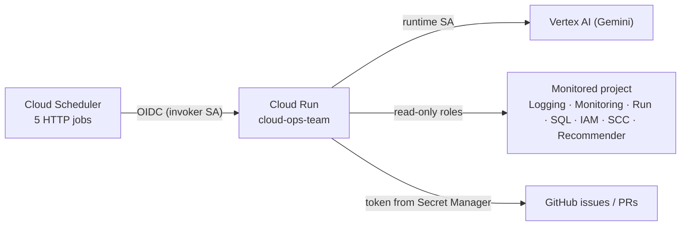

# Deploying on Google Cloud

日本語版（メイン）: [docs/deployment-gcp.md](../deployment-gcp.md)

The team runs as one Cloud Run service. Cloud Scheduler calls it with OIDC-authenticated HTTP requests.
Model tokens are a main cost: daily error and access reviews, weekly fix and infrastructure reviews, and a monthly audit.
Also check the target's log collection and retention costs. The service scales to zero between runs.



## Prerequisites

- `gcloud` authenticated as a user who can create service accounts, grant IAM roles and deploy Cloud Run
- A GitHub token for the repository: a fine-grained token with **Issues: read and write**, **Pull requests: read**,
  **Actions: read**, **Contents: read**, **Metadata: read** (add **Administration: read** to let the audit check branch protection)
- The monitored project can be the same as the deploy project or a different one

Every step below has a `make` target that reads `.env` (create it with `make setup`, check it with `make doctor`).
The underlying scripts in `scripts/gcp/` take the same values as environment variables if you prefer to call them directly.

## 1. Bootstrap (once)

```bash
make gcp-bootstrap          # or: PROJECT_ID=my-project TARGET_PROJECT=my-project GITHUB_TOKEN=github_pat_xxx ./scripts/gcp/bootstrap.sh
```

This enables the required APIs, creates the runtime service account `cloud-ops-team@<project>` with
`roles/aiplatform.user`, `roles/secretmanager.secretAccessor`, `roles/logging.logWriter`, `roles/cloudtrace.agent` and
`roles/monitoring.metricWriter`, grants it read-only roles on the target (`scripts/gcp/grant_target_roles.sh`), and stores the
token in the secret `cloud-ops-team-github-token` (it asks for the token when `GITHUB_TOKEN` is not set).

### Access and infrastructure data prerequisites

- Enable `logging.googleapis.com` and `recommender.googleapis.com` on the monitored target; bootstrap includes them.
- The target-role script adds `roles/logging.privateLogViewer` for Data Access audit logs and `roles/recommender.iamViewer`
  for IAM recommendations to the existing read roles. Update an existing installation with `make gcp-grant`.
- Data Access logging is disabled by default for many services. An administrator must check collection, exclusions,
  destination and retention for the services under review. Bootstrap does not enable Data Access logging.
  See [audit logs and required roles](https://docs.cloud.google.com/logging/docs/audit).
- HTTP investigation needs access logs containing `httpRequest`; Cloud Armor denials are available only when their logs are
  collected. The scripts do not deploy Cloud Armor or enable its logging. Zero entries may reflect missing collection.
- Recommender covers Cloud Run and Cloud SQL in the target region and project IAM in `global`. Missing recommendations,
  disabled APIs, denied access and partial reads must not be reported as no improvement opportunities.
  See [Recommender roles](https://docs.cloud.google.com/iam/docs/roles-permissions/recommender).

After `make doctor`, check the target's coverage, unknowns and proposals with:

```bash
OPS_DRY_RUN=true make run JOB=access_watch ARGS="--hours 24"
OPS_DRY_RUN=true make run JOB=infrastructure_review
```

Passing local tests does not verify a target's log collection, API permissions or scheduled runs. Check execution logs and
reports after deployment.

## 2. Deploy

Start in dry-run mode, look at what the team would file, then enable writes:

```bash
make gcp-deploy                         # dry run (OPS_DRY_RUN from .env)
OPS_DRY_RUN=false make gcp-deploy       # start filing issues
```

The script prints `SERVICE_URL=...` and configures the service to verify the scheduler's OIDC tokens for that URL
(`OPS_TRIGGER_AUDIENCE`, `OPS_TRIGGER_SERVICE_ACCOUNTS`). Smoke test it:

```bash
URL=$(gcloud run services describe cloud-ops-team --region asia-northeast1 --format='value(status.url)')
curl -s -H "Authorization: Bearer $(gcloud auth print-identity-token)" "$URL/list-apps"     # ["app"]
```

## 3. Schedule

```bash
make jobs                    # what will be scheduled
make gcp-schedule            # create or update the jobs (the service URL is detected automatically)
gcloud scheduler jobs run cloud-ops-error-watch --location asia-northeast1   # run once now
```

Defaults (Asia/Tokyo): error watch daily at 08:00, access review daily at 08:30, fix review Mondays at 09:00,
infrastructure review Mondays at 10:00, and monthly audit on the 1st at 09:00.
Change any of them with environment variables — see [configuration.md](configuration.md#schedules-make-gcp-schedule).

## Runbook

| Task | Command |
|---|---|
| Check configuration and access | `make doctor` |
| Recent runs | `make gcp-logs`, or `gcloud logging read 'resource.type="cloud_run_revision" AND resource.labels.service_name="cloud-ops-team" AND httpRequest.requestUrl:"trigger/pubsub"' --limit 10 --format="value(timestamp,httpRequest.status,httpRequest.latency)"` |
| Issues created by the team | `gh issue list -R owner/repo --label ops-agent --state all` |
| Stop / resume writing to GitHub | `gcloud run services update cloud-ops-team --region asia-northeast1 --update-env-vars OPS_DRY_RUN=true` (`false` to resume) |
| Pause a job | `gcloud scheduler jobs pause cloud-ops-error-watch --location asia-northeast1` (`resume` to restart) |
| Change a schedule | `ERROR_WATCH_CRON=... ONLY_JOBS=error-watch make gcp-schedule` |
| Ship code or configuration changes | `make test && make gcp-deploy` |
| Rotate the GitHub token | `printf '%s' "$TOKEN" \| gcloud secrets versions add cloud-ops-team-github-token --data-file=-` (picked up by new instances) |
| Roll back | `gcloud run services update-traffic cloud-ops-team --region asia-northeast1 --to-revisions=<previous-revision>=100` |
| Errors of the service itself | `gcloud logging read 'resource.type="cloud_run_revision" AND resource.labels.service_name="cloud-ops-team" AND severity>=ERROR' --limit 20` |

## Monitoring several projects

Deploy one service per target (`SERVICE=cloud-ops-staging TARGET_PROJECT=...`) with its own scheduler prefix
(`JOB_PREFIX=cloud-ops-staging`). They can share one repository: de-duplication is scoped to the target recorded in each issue.

## Using Terraform or CI/CD instead

The scripts are intentionally small. If you prefer infrastructure as code, `agents-cli scaffold enhance . --deployment-target cloud_run`
generates Terraform for the service and its service account, and `--cicd-runner github_actions` adds a deployment pipeline;
port the scheduler jobs and IAM bindings from the scripts.
