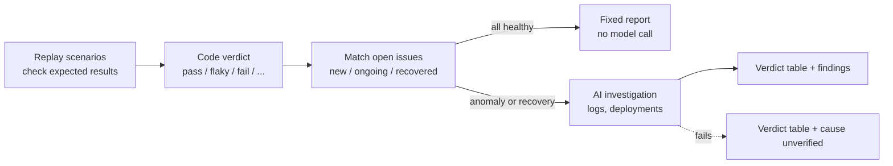

# Service checks and post-deployment verification

日本語: [docs/service-checks.md](../service-checks.md) ・ Configuration: [configuration.md](configuration.md) ・ Plan: [Issue #10](https://github.com/atsuki-sakai/cloud-ops-team/issues/10)

Two jobs replay registered user scenarios against the same public URLs your users reach.

| Job | Specialist | Trigger | What it does |
|---|---|---|---|
| `service_check` | `service_check` | Schedule (`SERVICE_CHECK_CRON`), manual | Replays every scenario and records incidents, ongoing failures and recovery as issues |
| `deploy_verification` (alias `post_deploy_check`) | `deploy_verification` | After a deployment, manual | Confirms the revision actually serving traffic and verifies it with scenarios and old-vs-new revision metrics |

Scheduled, manual and post-deployment runs use **the same version of the same scenario file**. Each scenario's version (a content hash) and the run ID are kept in results, logs and issues.

## Code judges, the model only investigates anomalies



- The model never chooses the next click, input or the verdict. Replay, expectation checks, before/after comparison and state transitions are code.
- When every scenario is healthy, a fixed report is returned without calling a model (no AI cost, no judgement drift).
- Only anomalies and recoveries reach the analysis model, with a limited set of tools: evidence reader, logs, deployment history and issue writing.
- The final report always starts with the code verdict table; the model's text cannot replace it. If the analysis fails, the table is still returned with "cause unverified".
- Each scenario verdict is also logged as the structured `ops_service_check` event, so a failed analysis cannot lose the check result.

## Judgement rules for accurate detection

This is not a plain liveness check (is it HTTP 200?). These rules apply:

| Rule | Behaviour |
|---|---|
| Expected results | Pass only when status, required and forbidden text, JSON values, headers, final URL, element visibility/counts and latency all match. A finished process or a clicked button is not success |
| Confirming retries | Retry only on failure, up to `attempts`. All attempts failing is `fail`; a later pass is `flaky`. **The failure before the retry is kept** |
| Failure classes | Site (`http_status`, `content_mismatch`, `json_mismatch`, `latency_exceeded`, `server_error_response`, ...), reachability (`dns_error`, `connect_error`, `timeout`) and checker (`browser_unavailable`, `browser_launch_failed`, `checker_error`) are separate |
| Checker outages | Reachability-only failures while the off-target `control_url` also fails are `inconclusive`; checker faults are `checker_error`. Neither is filed as a site incident |
| Hidden page failures | In the browser, a page that renders but received 5xx from an allowed host (a failed API call) fails with `server_error_response` (`fail_on_http_5xx`). A console error limit is available |
| Safe coordinate clicks | When the element at the recorded point does not match `expect_target` (moved button, overlapping dialog), the runner does not click and stops with `target_mismatch` |
| Maintenance | Scenarios inside a `maintenance` window are skipped as `maintenance`, never reported healthy |
| Budget and overlap | A run stays within `run_budget_seconds`; the rest is `not_run`. A second run in the same instance does not start while one is in progress |

### State transitions (`service_check`)

Verdicts are matched against open issues with the fingerprint `service_check:<scenario id>`.

| Verdict | No open issue | Open issue |
|---|---|---|
| `fail` | `new_incident` → file | `ongoing` → recurrence comment with the same fingerprint (rate-limited by the tool) |
| `pass` | `healthy` | `recovered` → recovery comment (the issue is not closed) |
| `flaky` | `transient` → report only | `unstable` → comment, not treated as recovered |
| `inconclusive` / `checker_error` | `unverified` → report only | same |
| `maintenance` / `not_run` | `not_checked` | same |

Open issues of scenarios removed from the file are reported as `orphaned`.

### Deployment verdicts (`deploy_verification`)

A merged pull request or a finished build is never evidence of a deployment. The verdict comes from the cloud's serving state.

| Verdict | Condition |
|---|---|
| `not_ready` | The new revision is not Ready |
| `not_serving` | The new revision receives no production traffic (tagged candidate URLs only are included) |
| `failed` | A production scenario failed while the new revision served 100% |
| `regressed` | The new revision's **own** error rate or p95 latency worsened beyond the thresholds compared with the previous revisions |
| `unverified` | No conclusion: no scenario registered, traffic split, checker faults, ... |
| `verified` | None of the above and the scenarios pass (or are flaky) |
| `superseded` | A newer revision was created in the same window |

Metrics are grouped by `revision_name`: the new revision after the deployment is compared with the previous revisions just before it, never a blend of both.
The baseline is as long as the time since the deployment (15-60 minutes). Fewer requests than `min_requests` on either side leaves the comparison **unevaluated**.
The error rate regresses when it exceeds both `error_ratio_factor` × old and old + `error_ratio_min_increase`, with at least `min_new_5xx` 5xx responses.
p95 regresses when it exceeds `latency_p95_factor` × old and grows by at least `latency_p95_min_increase_ms`. Cloud Monitoring data can lag a few minutes.

## Scenario file

Copy `config/service-checks.example.json` to `config/service-checks.json` (or set `OPS_SERVICE_CHECKS_FILE`).
The file ships in the image: **never put passwords, tokens or cookies in it**. Values that look like secrets are rejected on load.

| Field | Meaning |
|---|---|
| `allowed_hosts` | https hosts a scenario may open (`*.example.com` allowed). Leaving them through redirects or navigation fails with `outside_allowlist` |
| `control_url` | Off-target URL used to judge the checker's own network (optional; without it a checker outage cannot be told apart from a site outage) |
| `defaults` | `attempts` (1-5), `attempt_interval_seconds`, `timeout_seconds`, `max_total_ms`, `fail_on_http_5xx`, `max_console_errors` (-1 = unlimited) |
| `deploy` | Deployment verification thresholds (above) |
| `maintenance` | `start`/`end` (RFC 3339, at most 7 days), `scenarios` (all when omitted), `reason` |
| `scenarios[]` | `id`, `service` (Cloud Run service name, used to map deployments), `environment` (only `production` runs after deployments), `runner` (`http` / `browser`), `critical` (high severity on failure), `steps` |

**HTTP scenarios** use `GET`/`HEAD` only. `expect` supports `status`, `text_contains`, `text_absent`, `json` (`path`, `equals`, `exists`),
`headers_contain`, `content_type`, `min_bytes`, `url_prefix` and `max_latency_ms`. Cookies carry over between steps.

**Browser scenarios** start with `goto` and may use `click` (`selector`, or `x`/`y` with a mandatory `expect_target`), `fill`, `press`, `scroll`, `wait` and `expect`.
Coordinates are CSS pixels of the recorded viewport (`browser.viewport`). Viewport, device scale factor, locale, time zone, colour scheme and mobile flag are stored and recorded with results.
`expect` supports `url_prefix`, `title_contains`, `selector_visible`, `selector_absent`, `text_visible`, `text_contains`, `text_absent`, `min_count` and `max_latency_ms`.
Password fields are never filled. `side_effects` other than `none` are rejected (bookings, payments and notifications stay disabled until dedicated targets, duplicate prevention and clean-up exist).

## Enabling

1. Create the scenario file and try it locally with `make run JOB=service_check ARGS="--attempts 2"` (keep `OPS_DRY_RUN=true`).
2. For browser scenarios: `uv sync --extra browser && uv run playwright install --with-deps chromium`.
   Cloud Run source builds cannot pass build arguments, so set `ARG INSTALL_BROWSER=false` to `true` in the `Dockerfile` and redeploy (about 400 MB larger image).
   Without it, browser scenarios report `checker_error`, never a site failure.
3. Schedule: set `SERVICE_CHECK_CRON="*/15 * * * *"` in `.env` and run `ONLY_JOBS=service-check make gcp-schedule`.
   Healthy runs do not call a model, so AI cost follows anomalies only (Cloud Run and Scheduler cost follows the run count).
4. After deployments: post this JSON to `/apps/app/trigger/pubsub` at the end of a deployment (same Pub/Sub shape and OIDC as Cloud Scheduler).

```bash
# e.g. as the last Cloud Build step, with the invoker service account's ID token
# The caller needs run.invoker on the service and must be listed in OPS_TRIGGER_SERVICE_ACCOUNTS when that is set.
DATA=$(printf '{"job":"deploy_verification","minutes":30}' | base64 | tr -d '\n')
curl -fsS -X POST "$AGENT_URL/apps/app/trigger/pubsub" \
  -H "Authorization: Bearer $(gcloud auth print-identity-token --audiences="$AGENT_URL")" \
  -H "Content-Type: application/json" \
  -d "{\"message\":{\"data\":\"$DATA\"},\"subscription\":\"projects/$PROJECT_ID/subscriptions/deploy-verification\"}"
```

`minutes` is the window for new revisions (5-1440). To collect metric samples, send it a few minutes after the deployment, or send a second one later.

## What is not covered

- Results cover the checker location (the Cloud Run region), network, browser conditions and recorded steps only; not every user's experience or unrecorded pages.
- With `OPS_EXECUTION_DB_PATH` set, collected verdicts and the input of code-only decisions are saved in the [run ledger](execution-history.md). Consecutive counts and missed scheduled runs are not detected automatically; people check issues, logs and the ledger. Screenshots and traces are not stored.
- There is no recording UI yet ([#9](https://github.com/atsuki-sakai/cloud-ops-team/issues/9)); scenarios are written as JSON.
- Overlap prevention is per instance. Avoid concurrent runs across instances with zero Scheduler retries and the Cloud Run settings.
- Scenarios on tagged candidate URLs, checks with saved authentication and automatic rollback are out of scope (rollback is only proposed).
- The routing comparison was run with frozen responses (`runtime_stubbed`) as a contract check only. A live-model comparison is still required before release ([guide](../../tests/eval/routing/README.md)).
