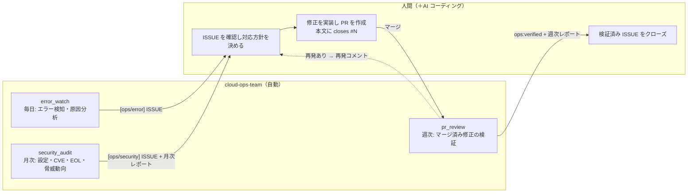
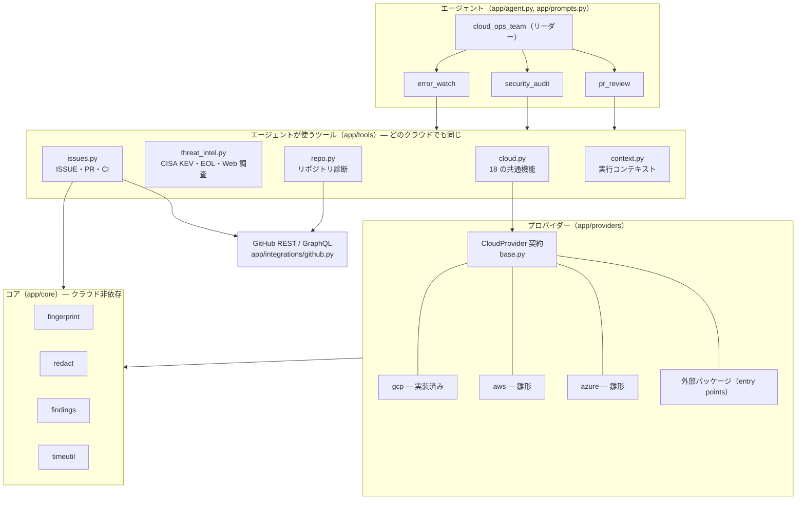
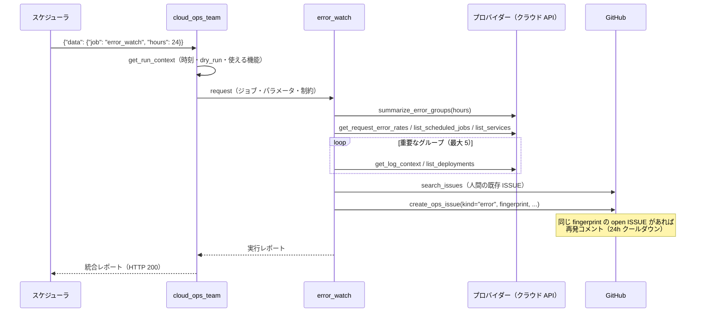
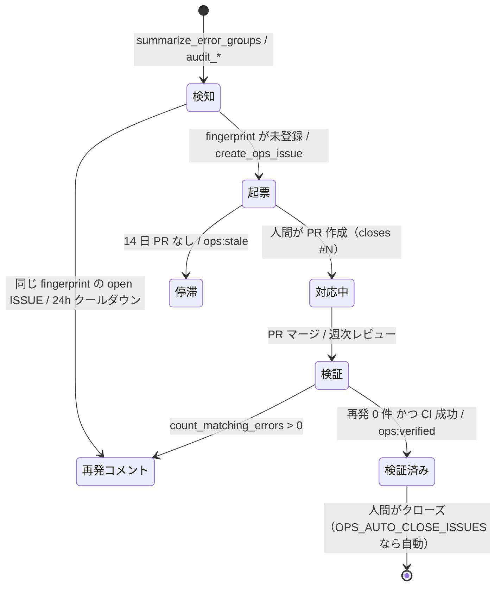

# アーキテクチャ（日本語）

cloud-ops-team は、クラウド環境の定常的な運用保守を小さな AI エージェントチームで回します。
本番エラーを調査済みの GitHub ISSUE に変える **エラー監視**、**月次セキュリティ診断**、マージされた PR が本当に問題を直したかを確かめる
**週次レビュー** の 3 つです。修正は人間（＋AI コーディングツール）が行い、エージェントはクラウドを一切変更しません。

- フレームワーク: [ADK](https://adk.dev/) 2.x（Python）、[agents-cli](https://github.com/google/agents-cli) でスキャフォールド
- モデル: Gemini（既定 `gemini-3.8-flash`、`OPS_MODEL` で変更）
- クラウド: **Google Cloud**（実装済み）、**AWS** / **Azure**（雛形。[providers.md](../providers.md)）
- ISSUE トラッカー: GitHub

English: [docs/architecture.md](../architecture.md)

## 1. 人間とエージェントの役割分担



## 2. レイヤー構成



| パッケージ | 責務 |
|---|---|
| `app/agent.py`, `app/prompts.py` | リーダーと 3 専門家、指示文、ツールの割り当て |
| `app/tools/` | モデルが呼ぶ関数。名前と docstring はクラウド非依存 |
| `app/providers/` | クラウドごとのアダプター（`CloudProvider` 契約の実装） |
| `app/core/` | フィンガープリント、マスキング、監査結果の共通形式、時刻ヘルパー |
| `app/integrations/github.py` | 最小限の GitHub クライアント |
| `app/config.py` | 環境変数から読み込む全設定 |
| `app/fast_api_app.py` | Pub/Sub 形式のトリガーを有効にした ADK サーバー |

## 3. エージェント

| エージェント | 役割 | ツール数 | 出力 |
|---|---|---|---|
| `cloud_ops_team`（root） | ジョブ（スケジューラの JSON か自然言語）を解釈して専門家を呼び、統合レポートを書く | 1 + 専門家 3 | レポート |
| `error_watch` | エラーをフィンガープリント単位に集約 → 5xx 率・失敗ジョブ・直近デプロイと突合 → 確度付きの原因仮説 → 起票 | 15 | `[ops/error]` ISSUE |
| `security_audit` | IAM・認証情報・コンピュート・DB・ネットワーク・セキュリティサービス・検出結果・イメージ CVE・EOL・CISA KEV・Web 脅威調査 → critical/high を起票 | 19 | `[ops/security]` ISSUE + 月次レポート |
| `pr_review` | チーム起票 ISSUE ごとに紐づく PR・マージ・CI・マージ後の再発を検証 | 13 | `ops:verified` / `ops:stale` + 週次レポート |

- **専門家は `mode="single_turn"` のサブエージェント**です。ADK がリーダーのツールとして公開し、同じセッション内でインライン実行します。
  `AgentTool` と違い、専門家のツール呼び出しが 1 件ずつストリームされるので、HTTP/SSE やスケジューラの接続が無音にならず、トレースにも全呼び出しが残ります。
- **指示文は関数（InstructionProvider）**で渡します。文字列だと ADK が JSON 例の `{...}` を変数展開しようとして壊れるためです。
  プロバイダーのプロファイル（表示名・対象の種別・CLI・用語集）、`CONFIG`、出力言語から組み立てます。
- **予算をプロンプトに明記**しています（ツール呼び出し 25〜30 回以内、ISSUE 検索 3 回、Web 調査 1 回、5〜8 分目安）。
  Google Cloud での実測はエラー監視 60〜150 秒、月次診断が約 200 秒・27 回です。

## 4. プロバイダー抽象

専門家が見るのは `app/tools/cloud.py` の 18 個の共通ツールだけです。各ツールは `OPS_CLOUD_PROVIDER` で選ばれたプロバイダーの同名メソッドを呼びます。

| 共通機能 | 正規化された意味 | Google Cloud | AWS（予定） | Azure（予定） |
|---|---|---|---|---|
| `summarize_error_groups` ほかログ系 4 種 | エラーログの集約・検索 | Cloud Logging | CloudWatch Logs Insights | Log Analytics（KQL） |
| `list_services` / `list_deployments` | サービスと稼働状態 / リリース履歴 | Cloud Run サービス / リビジョン | ECS・Lambda | App Service・Container Apps |
| `list_scheduled_jobs` | 定期ジョブと失敗 | Cloud Scheduler | EventBridge Scheduler | Container Apps Jobs・Logic Apps |
| `list_databases` | DB（`engine` / `engine_version` 付き） | Cloud SQL | RDS / Aurora | PostgreSQL / MySQL / SQL |
| `get_request_error_rates` / `get_alerting_setup` | 5xx 率 / アラートと死活監視 | Cloud Monitoring | CloudWatch | Azure Monitor |
| `audit_iam` / `audit_credentials` | 過剰権限 / 長期認証情報 | IAM ポリシー / SA 鍵 | IAM・Access Analyzer / アクセスキー | RBAC / SP シークレット |
| `audit_compute` / `audit_databases` / `audit_network` | 公開・SA・平文秘密 / DB 設定 / 開放ポート | Cloud Run / Cloud SQL / VPC FW | ECS・Lambda / RDS / SG | App Service / Azure DB / NSG |
| `audit_security_services` / `list_security_findings` / `scan_deployed_images` | 有効化状況 / 検出結果 / イメージ CVE | SCC ほか / SCC / Artifact Analysis | GuardDuty 等 / Security Hub / Inspector | Defender for Cloud |

設計ルール:

- **未実装は `not_supported`（エラーではない）**。基底クラスが全機能を `not_supported` で実装しているため、新しいプロバイダーは初日から動きます。
  PR レビュー・リポジトリ診断・CISA KEV・EOL・Web 調査はクラウドに依存しません。
- **エージェントは使える機能を知っている**。`get_run_context` が `capabilities` / `unsupported_capabilities` を返し、
  プロンプトの用語集にも「未対応」と表示されるので、レポートには「診断できなかった項目」として書かれます。
- **結果の形を統一**。監査は `app.core.findings.result(...)`、観測系は [providers.md](../providers.md#normalized-results) のフィールド。
- **遅延読み込み**。組み込みはキーで import、外部パッケージは `cloud_ops_team.providers` の entry point、テストは `register_provider`。
- **障害の隔離**。プロバイダーの例外は `{"status": "error"}` に変換され、実行全体は止まりません。

## 5. ジョブとトリガー

スケジューラは Pub/Sub push と同じ形式のボディを ADK のトリガーエンドポイントに送ります。

```text
POST /apps/app/trigger/pubsub      Authorization: Bearer <呼び出し用 SA の OIDC トークン>
{"message": {"data": "<{"job":"error_watch","hours":24} の base64>", "attributes": {...}},
 "subscription": "projects/<project>/subscriptions/cloud-ops-error-watch"}
```

| `job` | パラメータ | 既定の周期（変更可） | 担当 |
|---|---|---|---|
| `error_watch` | `hours`（`OPS_ERROR_LOOKBACK_HOURS`） | 毎日 08:00（`ERROR_WATCH_CRON`、`ERROR_WATCH_HOURS`） | error_watch |
| `weekly_pr_review` | `days`（7） | 月曜 09:00（`WEEKLY_CRON`） | pr_review |
| `monthly_security_audit` | `kev_days`（30） | 毎月 1 日 09:00（`MONTHLY_CRON`） | security_audit |
| `full` | — | 手動 | 3 人全員 |

Google Cloud では `scripts/gcp/setup_schedules.sh` が Cloud Scheduler の **HTTP** ジョブを作ります。
Pub/Sub push は 10 分上限で、未 ack だと再配送されるため、30 分のデッドライン・再試行 0 回にできる HTTP ジョブを選んでいます（長い月次診断が二重起動しない）。
周期・遡り時間・タイムゾーン・ジョブ名はすべて環境変数で変えられ、再実行すると既存ジョブが更新されます（[configuration.md](../configuration.md#schedules-scriptsgcpsetup_schedulessh)）。

## 6. エラー監視の流れ



## 7. ISSUE のライフサイクル



- タイトル接頭辞: `[ops/error]` `[ops/security]` `[ops/report]`
- ラベル: 全件 `ops-agent` ＋ 種別 ＋ 重要度（`priority: critical` / `priority: high` / `major` / `minor`）＋ 領域（`bug` / `security` / `infrastructure`）
- 本文: 概要 / 影響範囲 / 証跡 / 原因分析 / 推奨対応 / 確認方法 ＋ 末尾の `<!-- ops-meta: {...} -->`
- 言語: `OPS_REPORT_LANGUAGE`（`ja` / `en`）で ISSUE・コメント・レポートの言語を切り替え

## 8. データベースなしの重複排除

1. ログメッセージを正規化（UUID → `<uuid>`、時刻 → `<ts>`、16 進 ID → `<hex>`、数値 → `<n>`、空白圧縮、240 文字）
2. `fingerprint = sha1(resource_type | service | template)[:16]`。式を変えると open ISSUE がすべて再起票されるため、ユニットテストで基準値を固定
3. fingerprint・service・`search_text`・provider・target を ISSUE の `ops-meta` に保存
4. 起票前に open と 30 日以内にクローズされた ISSUE を走査。**fingerprint と target の両方**が一致したものだけを同一とみなす
   （staging と本番で同じリポジトリを使える。マルチクラウド化以前の ISSUE の `project` キーは target として扱う）
5. open なら再発コメント（`OPS_RECURRENCE_COOLDOWN_HOURS` 以内に更新済みなら省略）、最近クローズ済みなら新規 ISSUE に関連として記載

## 9. 安全設計

| 層 | 仕組み |
|---|---|
| 権限 | 監視対象には閲覧系ロールのみ。変更系 API を呼ぶツールは存在しない |
| 入口 | サービスは未認証アクセス不可。スケジューラは専用 SA の OIDC トークンで呼ぶ |
| 書き込み | `OPS_DRY_RUN=true`（既定）はプレビューのみ。クローズは `OPS_AUTO_CLOSE_ISSUES=true` のときだけ |
| 影響範囲 | 1 実行あたりの起票は `OPS_MAX_ISSUES_PER_RUN`（10）まで、再発コメントはクールダウン内 1 回 |
| データ | トークン・秘密鍵・`password=`・URL 内の認証情報・メール（SA 除く）・カード番号・公開 IP 末尾をマスク。環境変数は名前のみ |
| プロンプト | 変更依頼は断って ISSUE 化を提案、根拠を必ず添える、個人情報を出さない、`error` / `not_supported` を正直に報告 |
| 秘密情報 | GitHub トークンはシークレットマネージャーから注入。`.env` はアップロードしない |

## 10. 認証

| 対象 | ローカル | 本番（Google Cloud） |
|---|---|---|
| Gemini | ADC（Vertex AI）または `GEMINI_API_KEY` | ランタイム SA（`roles/aiplatform.user`） |
| Google Cloud API | ADC、または `OPS_GCP_AUTH=gcloud` | ランタイム SA（監視対象に閲覧系ロール） |
| GitHub | `GITHUB_TOKEN`、無ければ `gh auth token` | Secret Manager → `GITHUB_TOKEN` |

AWS / Azure プロバイダーは各 SDK の既定の認証チェーン（`boto3`、`DefaultAzureCredential`）を使う想定です。

## 11. 拡張ポイント

- **クラウドを追加**: `CloudProvider` を継承して機能を 1 つずつ実装（[providers.md](../providers.md)）
- **ツールを追加**: `app/tools/` に関数（型ヒント・既定値なし・docstring・`status` 付き dict を返す・例外を投げない）→ `app/tools/__init__.py` のリストへ。GitHub への書き込みは `CONFIG.dry_run` を尊重
- **共通機能を追加**: `CloudProvider` にメソッド（`not_supported` を返す）、`app/tools/cloud.py` にラッパー、各プロファイルに用語を追加。契約テストが 3 点の整合を検査
- **専門家を追加**: `mode="single_turn"` と `description` を持つ `create_xxx_agent()` を `root_agent.sub_agents` に登録し、ジョブ表とスケジュールに追加
- **モデルを変更**: `OPS_MODEL`。Gemini 以外は `app/agent.py` で ADK の `LiteLlm` を使う

## 12. 既知の制約

- `agents-cli run` / `agents-cli eval generate` は 120 秒の固定読み取りタイムアウトを持つ。長いジョブは `scripts/run_job.py` で実行
- セッションはインメモリ。複数インスタンスでは実行履歴をセッション API で引けない場合がある
- AWS / Azure は雛形のため、クラウド依存の機能はすべて `not_supported`
- プロンプトは日本語。出力言語は `OPS_REPORT_LANGUAGE` で選択
