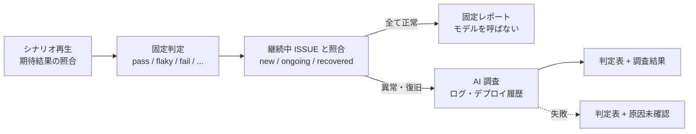

# 稼働確認とデプロイ後検証

English: [docs/en/service-checks.md](en/service-checks.md) ・ 設定一覧: [configuration.md](configuration.md) ・ 計画: [Issue #10](https://github.com/atsuki-sakai/cloud-ops-team/issues/10)

利用者と同じ公開 URL で、登録した操作（シナリオ）を再生して確認する 2 つのジョブです。

| ジョブ | 担当 | 起動 | 内容 |
|---|---|---|---|
| `service_check` | `service_check` | 定期（`SERVICE_CHECK_CRON`）・手動 | 全シナリオを再生し、障害の発生・継続・復旧を ISSUE に記録 |
| `deploy_verification`（別名 `post_deploy_check`） | `deploy_verification` | デプロイ完了後・手動 | 実際に配信中のリビジョンを確認し、シナリオと新旧リビジョンの指標で検証 |

どちらも、定期・手動・デプロイ後で **同じシナリオファイルの同じ版** を使います。シナリオごとの版（内容のハッシュ）と実行 ID は結果・ログ・ISSUE に残ります。

## 判定はプログラム、AI は異常時の調査だけ



- 次のクリック・入力・合否を毎回 AI に選ばせません。シナリオ再生・期待結果の照合・前後比較・状態遷移はコードで行います。
- 全シナリオが正常なら、モデルを呼ばずに固定のレポートを返します（AI のコストがかからず、判定の揺れもありません）。
- 異常・復旧があるときだけ、分析 AI に証拠の読み取り・ログ・デプロイ履歴・起票の限定ツールを渡します。
- 最終レポートの冒頭には、常にプログラムの判定表が付きます。AI の文章で判定を置き換えることはできません。AI の調査が失敗しても、判定表と「原因は未確認」を返します。
- シナリオごとの判定は `ops_service_check` という構造化ログにも出力されるので、AI の失敗で検査結果が失われません。

## 正確に検知するための判定ルール

単純な死活監視（HTTP 200 か）ではなく、次のルールで判定します。

| ルール | 内容 |
|---|---|
| 期待結果で判定 | ステータスだけでなく、表示文言・禁止文言・JSON の値・ヘッダー・最終 URL・要素の表示や件数・所要時間をすべて満たして pass。処理が終わった・ボタンを押せたことだけでは成功にしない |
| 再試行で確定 | 失敗したときだけ `attempts` 回まで再試行。全試行で失敗なら `fail`、途中で成功なら `flaky`。**再試行前の失敗内容は消さずに残す** |
| 失敗の分類 | サイト側（`http_status`・`content_mismatch`・`json_mismatch`・`latency_exceeded`・`server_error_response` など）、到達性（`dns_error`・`connect_error`・`timeout`）、検査基盤（`browser_unavailable`・`browser_launch_failed`・`checker_error`）を区別 |
| 検査側の障害を区別 | `control_url`（対象外の外部 URL）にも届かない状態で到達性の失敗だけなら `inconclusive`。検査基盤の失敗は `checker_error`。どちらもサイト障害として起票しない |
| ページ内の隠れた失敗 | ブラウザでは画面が出ても、許可ホストからの 5xx 応答（API の失敗）があれば `server_error_response` で失敗（`fail_on_http_5xx`）。コンソールエラーの上限も設定できる |
| 座標クリックの安全 | 記録した座標の要素が `expect_target` と一致しないとき（ボタン移動・ダイアログの重なり）はクリックせず `target_mismatch` で停止 |
| 保守時間 | `maintenance` の時間帯は `maintenance` として明示的にスキップ。正常扱いにしない |
| 予算と重複起動 | 1 回の実行は `run_budget_seconds` 以内。超えた分は `not_run`。同じインスタンスで実行中なら新しい実行を始めない |

### 状態の遷移（`service_check`）

open の ISSUE（指紋 `service_check:<シナリオ ID>`）と照合して、次の遷移を決めます。

| 今回の判定 | open ISSUE なし | open ISSUE あり |
|---|---|---|
| `fail` | `new_incident` → 起票 | `ongoing` → 同じ指紋で再発コメント（間隔はツールが制御） |
| `pass` | `healthy` | `recovered` → 復旧コメント（クローズはしない） |
| `flaky` | `transient` → レポートのみ | `unstable` → 不安定のコメント（復旧扱いにしない） |
| `inconclusive` / `checker_error` | `unverified` → レポートのみ | 同左 |
| `maintenance` / `not_run` | `not_checked` | 同左 |

登録から消えたシナリオの open ISSUE は `orphaned` として報告します。

### デプロイ後検証の判定（`deploy_verification`）

PR のマージやビルド完了は「デプロイ済み」の根拠にしません。クラウドの配信状態から判定します。

| verdict | 条件 |
|---|---|
| `not_ready` | 新リビジョンが Ready でない |
| `not_serving` | 新リビジョンが本番トラフィックを受けていない（タグ付き候補 URL のみを含む） |
| `failed` | 新リビジョンが 100% を受けている状態で本番シナリオが失敗 |
| `regressed` | 新リビジョン **自身** のエラー率または p95 遅延が、直前のリビジョンより閾値を超えて悪化 |
| `unverified` | シナリオ未登録・トラフィック分割中・検査基盤の障害などで結論が出ない |
| `verified` | 上のいずれでもなく、シナリオが pass（または flaky） |
| `superseded` | 同じ期間内により新しいリビジョンがある |

指標は `revision_name` 別に集計し、デプロイ後の新リビジョンの値と、デプロイ直前の旧リビジョンの値を比べます（両方が混ざった全体平均ではありません）。
比較期間はデプロイ後の経過時間と同じ長さ（15〜60 分）です。どちらかのリクエスト数が `min_requests` 未満なら **未評価** とし、良否を推測しません。
エラー率は「旧の `error_ratio_factor` 倍」と「旧 + `error_ratio_min_increase`」の大きい方を超え、かつ 5xx が `min_new_5xx` 件以上で劣化です。
p95 は「旧の `latency_p95_factor` 倍」かつ「`latency_p95_min_increase_ms` 以上の増加」で劣化です。Cloud Monitoring のデータは数分遅れることがあります。

## シナリオファイル

`config/service-checks.example.json` を `config/service-checks.json` にコピーして編集します（`OPS_SERVICE_CHECKS_FILE` で変更可）。
ファイルはイメージに含まれるため、**パスワード・トークン・Cookie は書かないでください**。秘密情報らしき値は読み込み時に拒否します。

| 項目 | 内容 |
|---|---|
| `allowed_hosts` | シナリオが開ける https ホストの許可リスト（`*.example.com` 可）。リダイレクト・画面遷移で外へ出たら `outside_allowlist` で失敗 |
| `control_url` | 検査側の外部疎通を確かめる対象外の URL（任意。無いと検査側のネットワーク障害とサイト障害を区別できない） |
| `defaults` | `attempts`（1〜5）、`attempt_interval_seconds`、`timeout_seconds`、`max_total_ms`、`fail_on_http_5xx`、`max_console_errors`（-1 で無制限） |
| `deploy` | デプロイ後検証の閾値（上記） |
| `maintenance` | `start`・`end`（RFC 3339、最大 7 日）、対象 `scenarios`（省略時は全件）、`reason` |
| `scenarios[]` | `id`、`service`（Cloud Run サービス名。デプロイ後検証の対応付けに使う）、`environment`（`production` のみデプロイ後検証で実行）、`runner`（`http` / `browser`）、`critical`（失敗時 high）、`steps` |

**HTTP シナリオ** の各ステップは `GET` / `HEAD` だけです。`expect` には `status`、`text_contains`、`text_absent`、`json`（`path`・`equals`・`exists`）、
`headers_contain`、`content_type`、`min_bytes`、`url_prefix`、`max_latency_ms` を書けます。ステップ間で Cookie は引き継ぎます。

**ブラウザシナリオ** は最初が `goto` で、`click`（`selector`、または `x`・`y` と必須の `expect_target`）、`fill`、`press`、`scroll`、`wait`、`expect` を使えます。
座標は記録時の表示領域（`browser.viewport`）の CSS ピクセルです。表示サイズ・端末倍率・言語・タイムゾーン・配色・モバイル指定を保存し、結果にも記録します。
`expect` には `url_prefix`、`title_contains`、`selector_visible`、`selector_absent`、`text_visible`、`text_contains`、`text_absent`、`min_count`、`max_latency_ms` を書けます。
パスワード欄には入力しません。`side_effects` は `none` 以外を拒否します（予約確定・決済・通知を伴う操作は、専用対象・重複防止・後片付けを定義するまで無効）。

## 有効にする

1. シナリオファイルを作り、`make run JOB=service_check ARGS="--attempts 2"` で手元で確認します（`OPS_DRY_RUN=true` のまま）。
2. ブラウザシナリオを使う場合は `uv sync --extra browser && uv run playwright install --with-deps chromium`。
   Cloud Run の source build ではビルド引数を渡せないため、`Dockerfile` の `ARG INSTALL_BROWSER=false` を `true` にして再デプロイします（イメージが約 400 MB 増えます）。
   未導入のままブラウザシナリオを実行すると `checker_error` になり、サイト障害とは扱いません。
3. 定期実行: `.env` に `SERVICE_CHECK_CRON="*/15 * * * *"` を設定して `ONLY_JOBS=service-check make gcp-schedule`。
   正常時はモデルを呼ばないため、頻度を上げても AI の費用は異常時の分だけです（Cloud Run と Scheduler の費用は回数に比例します）。
4. デプロイ後検証: デプロイの最後に次の JSON を `/apps/app/trigger/pubsub` へ送ります（Cloud Scheduler と同じ Pub/Sub 形式・OIDC 認証）。

```bash
# Cloud Build の最後のステップなどで（呼び出し用サービスアカウントの ID トークンを使う）
# 呼び出す ID はサービスの呼び出し権限（run.invoker）を持ち、OPS_TRIGGER_SERVICE_ACCOUNTS を使う場合はそこに含めてください。
DATA=$(printf '{"job":"deploy_verification","minutes":30}' | base64 | tr -d '\n')
curl -fsS -X POST "$AGENT_URL/apps/app/trigger/pubsub" \
  -H "Authorization: Bearer $(gcloud auth print-identity-token --audiences="$AGENT_URL")" \
  -H "Content-Type: application/json" \
  -d "{\"message\":{\"data\":\"$DATA\"},\"subscription\":\"projects/$PROJECT_ID/subscriptions/deploy-verification\"}"
```

`minutes` は新リビジョンを探す期間（5〜1440）です。指標の標本を集めるため、デプロイ直後ではなく数分〜十数分後に送るか、2 回目を送ることを勧めます。

## 確認できないこと

- 結果は検査地点（Cloud Run のリージョン）・ネットワーク・ブラウザ条件・記録した操作に限られます。全利用者の体験や未記録の画面を保証しません。
- `OPS_EXECUTION_DB_PATH` を設定すると、収集した判定と固定判定の入力は [実行台帳](execution-history.md) に保存されます。連続回数や「予定された実行が来なかった」ことの自動検知は未実装で、ISSUE・ログ・台帳から人間が確認します。画面証拠（スクリーンショット・トレース）は保存しません。
- 操作の記録（録画・座標の取得）UI（[#9](https://github.com/atsuki-sakai/cloud-ops-team/issues/9)）はまだありません。シナリオは JSON で手書きします。
- 重複起動の抑止は同じインスタンス内だけです。複数インスタンスでの同時実行は Scheduler の再試行 0 回と Cloud Run の設定で避けてください。
- タグ付き候補 URL のシナリオ実行、保存済み認証を使う確認、トラフィックの切り戻しの自動実行は対象外です（切り戻しは提案のみ）。
- 比較評価は固定応答（`runtime_stubbed`）での契約確認までです。実モデルでの前後比較は公開前に別途必要です（[比較評価ガイド](../tests/eval/routing/README.md)）。
